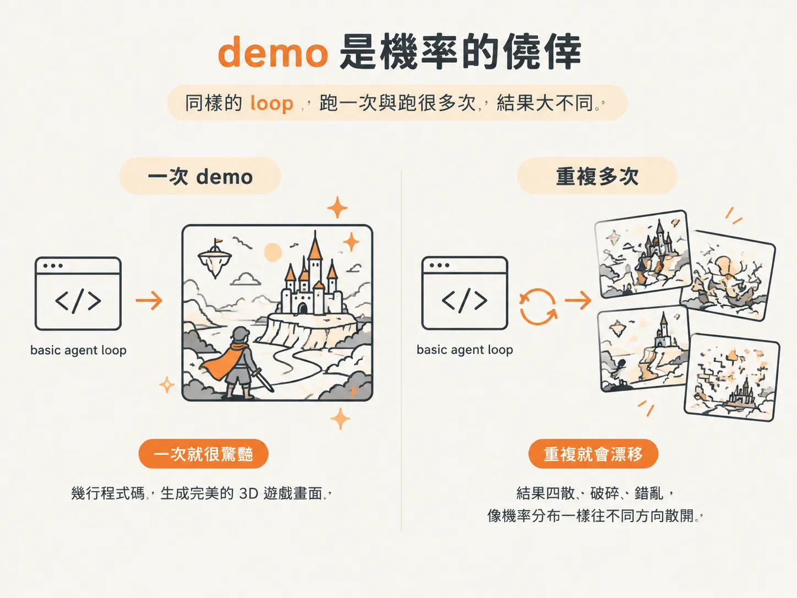
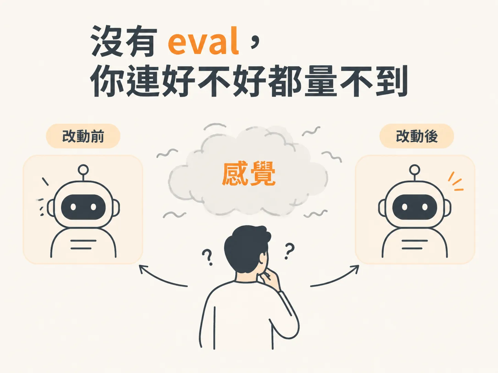
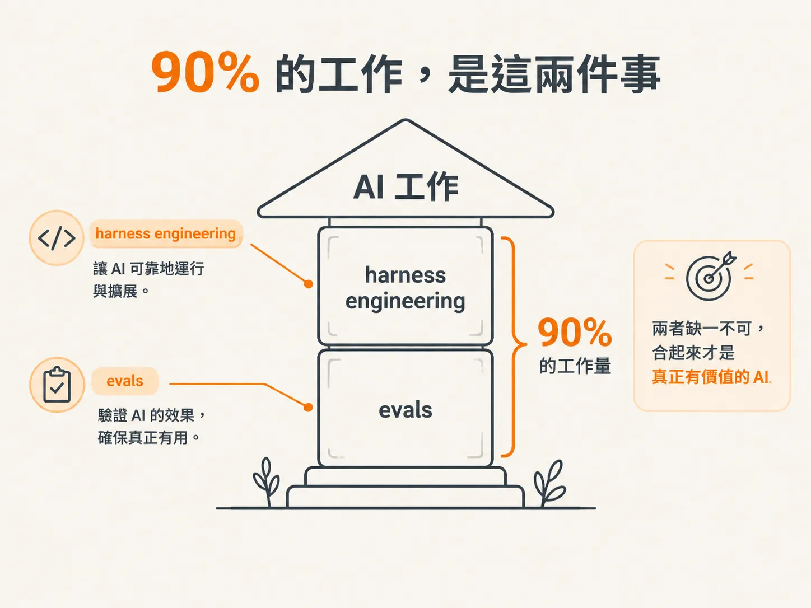
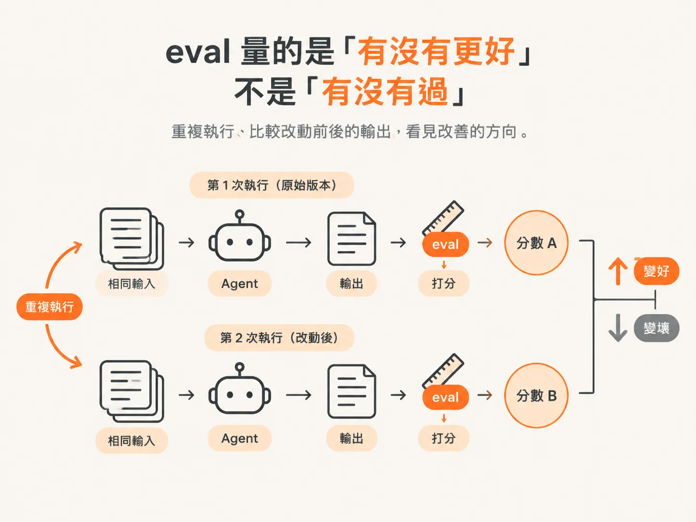

# Evals：demo 過了不代表品質

到目前為止，我們一直在做同一件事：把一個「能跑」的 agent，變成一個「不會掛」的 agent。

上一課補上了 idempotency，讓系統重試時不會重複扣款。但這裡有個錯覺：demo 過了，就代表做對了。

demo 通過，只能證明「某一次、某個 prompt、某個觀眾面前，它看起來很棒」。除此之外，它什麼也沒有證明。

## demo 是機率的僥倖

最基礎的 agent loop 只有幾行程式碼：給 LLM 一些工具和描述，再一輪一輪呼叫它，直到它認為自己可以回答為止。

作者說，只要工具給得對，光靠這個 basic loop 就能生出 3D 遊戲；他說這是他看過最驚豔的 demo。

但 LLM 是 probabilistic 的，也就是每次輸出都帶有機率變化。它這次做得很棒，下次還會繼續嗎？

作者的原話是：機率大概很低。

*AI 生成示意圖*

更關鍵的是，你得到好結果，可能只是因為 prompt 寫得好。

那一次剛好是 prompt 寫對了，跟系統本身好不好無關。這種好不能穩定複製，也無法靠一次 demo 證明。

## 沒有 eval，你連好不好都量不到

他說：you can't even really measure it without evals。

demo 裡的「好」，是你坐在台下看到的感覺，不是數據。作者說得很直接：對 demo 之外的人來說，這個 agent 做出好結果的機率，可能接近零，而不是接近百分之百。

這不代表你的 agent 很差。你只是不知道。

沒有 eval，一個改動究竟讓系統變好還是變壞，你只能靠感覺判斷。但感覺不是品質，也不能拿來穩定比較。

*AI 生成示意圖*

## 90% 的工作，是這兩件事

作者認為，現在做 AI 最重要的兩件事是 harness engineering 和 evals。

如果他要加入一家 AI 公司，他會 all in 其中一樣——不是 harness，就是 evals。在他眼中，這兩樣合起來佔了 90% 的工作量。

這門課練的是第一樣：harness。

eval 是另一半。作者說這門課講的是 infrastructure 那一半；少了 eval，你只能證明它跑得起來，不能證明它有用。

*AI 生成示意圖*

## eval 量的是「有沒有更好」，不是「有沒有過」

那麼，eval 到底是什麼？

作者的定義是：literally writing evals and improving the agents，寫 eval，然後持續讓 agent 變好。

他也說明了實際用法：把這門課介紹的工具放進 back pocket。之後每次修改系統，就用 eval 去測量「這個改動到底有沒有改善輸出」。

eval 產出的是測量結果，不是通過與否。

可重複執行的 eval 要拿改動前後的結果來比，確認輸出變好還是變壞；同樣的 eval 每次都用同樣的方式跑。

demo 讓你看到一次好結果；eval 則讓你看到重複執行後的分布。

*AI 生成示意圖*

## 做成容易，做好難

這門課接近尾聲時，作者提到他正在做的東西：background agent。

這類 agent 接到任務後會自己執行，也會掛在事件上等待通知。他對這類系統的評價只有一句：making it is easy, making it good is hard。

「做出來」很容易，有 demo 就夠了。

難的是維持。你得非常自律地持續 evaluate 它，也得花很多力氣把它 constrained 住。

開發不是最大的成本。最大的成本是持續證明它真的好，而且維持住。

## eval 在 harness 裡的位置

最後，把 eval 放回這門課的整體地圖。

作者在談 plan mode 和 sub-agent 時，順手畫出了一條界線：agent 什麼時候該自己判斷「要不要開 sub-agent」？

他的回答是：那需要 eval，而那不是這門課的範圍。

harness 提供的是機制，例如 memory、tool、durable 和 sandbox；eval 提供的是判斷，例如哪些機制有效、什麼時候該啟用，以及某個改動有沒有讓輸出變好。

沒有 eval，你改 harness 只能靠猜。

下一步是最後一塊：背景 agent 長什麼樣子、它的 inbox 要怎麼設計，以及如何把這七個平面整理成一張上 production 前的檢查清單。
