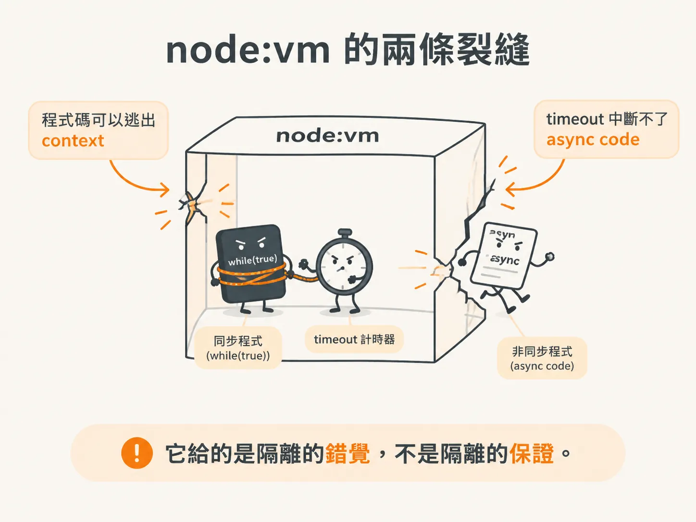
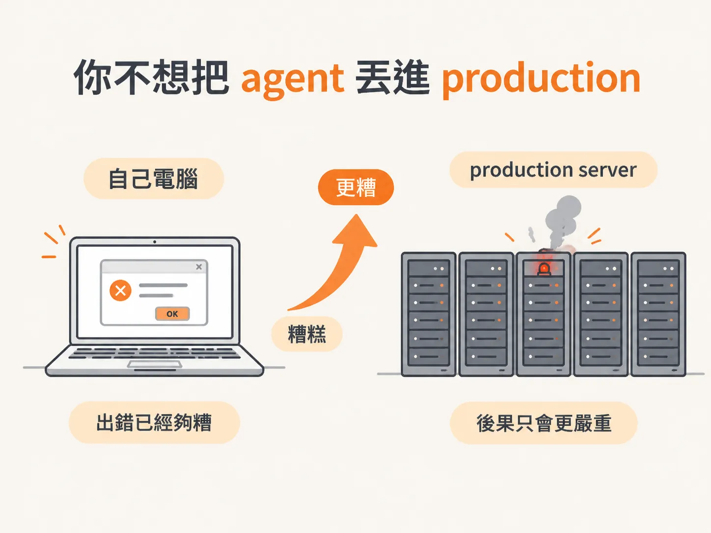
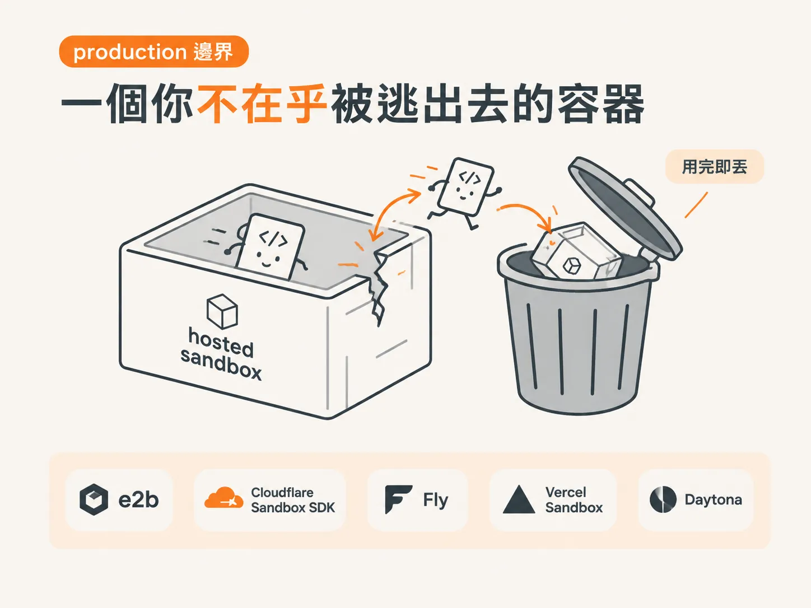
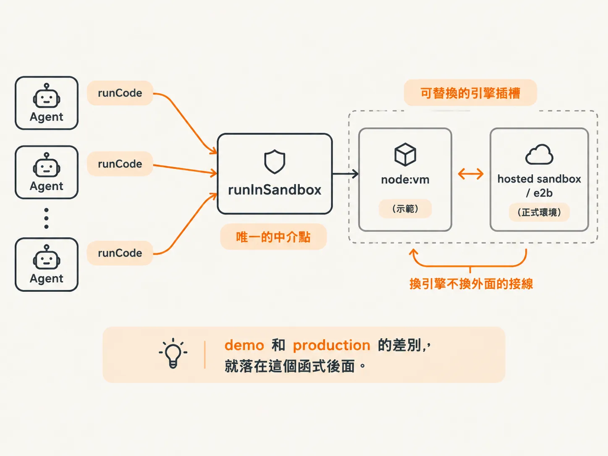

# 託管沙箱：把 node:vm 換成 production 邊界

上一課讓我們看得見 harness 的每一步了。但看得見，不代表就能放上 production——接著要檢查的第一個邊界，是 agent 寫出的程式在哪裡執行。

前面我們讓 agent 寫程式，再把程式交給 `harness/sandbox.ts` 執行，底層使用的是 Node.js 內建的 `node:vm`。

當時有一句話還沒完整說明：`node:vm` 是示範用的邊界，不是 production 用的邊界。

這一課會把這件事講清楚：`node:vm` 弱在哪裡？production 會用什麼取代它？換掉之後，harness 又需要修改多少？

## node:vm 的兩條裂縫

先誠實面對 `node:vm`。它在 `sandbox.ts` 的註解中，自己寫下了兩項限制：

<!-- source: sources/agent-harness/20260915/harness-engineering/lessons/03-secure-sandboxing/index.md#L56-L68 -->
```ts
// The harness is the security boundary. When the agent writes code (Code Mode),
// it runs HERE — never with raw access to the process.
//
// This is `node:vm`, which is deliberately minimal:
//   · the context has NO `require`, `process`, `fs`, `fetch`, ... — only what we
//     hand in (a small `tools` API + `console.log`)
//   · the `timeout` option kills runaway SYNCHRONOUS code (e.g. `while(true){}`)
//
// Be honest about the limit: `vm` is NOT a true security sandbox, and its
// timeout can't interrupt async code. That's exactly why production systems run
// untrusted code in a hosted sandbox (e2b, Cloudflare's Sandbox SDK, Fly,
// Vercel, Daytona). The harness's job is to MEDIATE the boundary; the strength
// of the boundary is a deployment choice.
```

翻成白話，就是兩件事。

第一，`vm` 不是真正的安全邊界，程式碼可能逃出 context。第二，`timeout` 只能中斷同步程式，例如 `while(true){}`，卻中斷不了非同步程式碼。

這不是 bug，而是它原本的定位。`node:vm` 的設計本來就是「故意最小化」：context 裡沒有 `require`、`process`、`fs` 或 `fetch`，只有你親手放進去的那一小份 tools API 和 `console.log`。

它能擋住寫得笨拙的程式，卻擋不住刻意尋找漏洞、想辦法逃出去的程式。



*AI 生成示意圖*

## 你不想把 agent 丟進 production

Scott 談到 code mode 時，把話說得很直接：agent 應該待在一個逃不出去的 sandbox 裡。

理由很簡單，就像你不會把陌生人直接丟進 production 一樣——你也不會想把 agent 丟進 production。在自己的電腦上出錯已經夠糟，若是在 production server 上出錯，後果只會更嚴重。



*AI 生成示意圖*

所以他也直接說明了示範與實際部署的差異：示範使用 `node:vm`，做的是 offline 版本。反正那是自己的 agent，離線跑跑沒有關係。

但到了 production，通常會改用獨立的 process 來執行。`node:vm` 是示範邊界，不是 production 邊界。

## production 邊界：一個你不在乎被逃出去的容器

那麼，production 會用什麼取代它？

lesson 3 的結尾和 wrap-up，給的是同一個答案：**hosted sandbox**。

它是一個用完就丟的 micro-VM 或 container。你不在乎有人從裡面逃出去，因為那個執行環境本身，下一秒就會被丟掉。

素材中點名的服務包括 e2b、Cloudflare 的 Sandbox SDK、Fly sandboxes、Vercel Sandbox，以及 Daytona。Scott 也在 wrap-up 補充，他把 hosted sandboxing 的 resources 放在課程底部；如果要用於 production，就到那裡找。



*AI 生成示意圖*

這些產品做的事情大致相同：把不受信任的程式碼，放進真正隔離、而且可以拋棄的執行環境。

差別在於，這道牆是真的；`node:vm` 則比較像一扇紗窗。

## 換掉 node:vm，harness 幾乎不用改

這才是這一步真正的重點：換掉沙箱引擎後，harness 需要修改多少？

答案是：幾乎不用改。

素材中的說法是，不管選哪一家服務，harness 的工作都一樣——把每一個 dangerous capability，都導向同一個 mediated boundary。至於這道邊界有多強，則是 deployment choice。

`harness/runtime.ts` 不需要修改，`runCode` 也只是一個 tool。

為什麼能做到這樣？因為前面建立 harness 時，我們沒有讓 agent 直接接觸執行引擎，而是把「執行程式」收斂成一個中介點：`runInSandbox` 這個函式。

所有由 model 寫出的程式，都從這裡進入，也從這裡離開。今天如果把 `node:vm` 換成 e2b，換掉的是這個函式後面的引擎，不是外面的接線。

所以，這一步要記住的不是「`node:vm` 很爛」，而是下面這張圖：

**harness 只留一個中介點，邊界的強度則是在部署時才做的選擇。**

demo 和 production 的差別，就落在這個函式後面。



*AI 生成示意圖*
