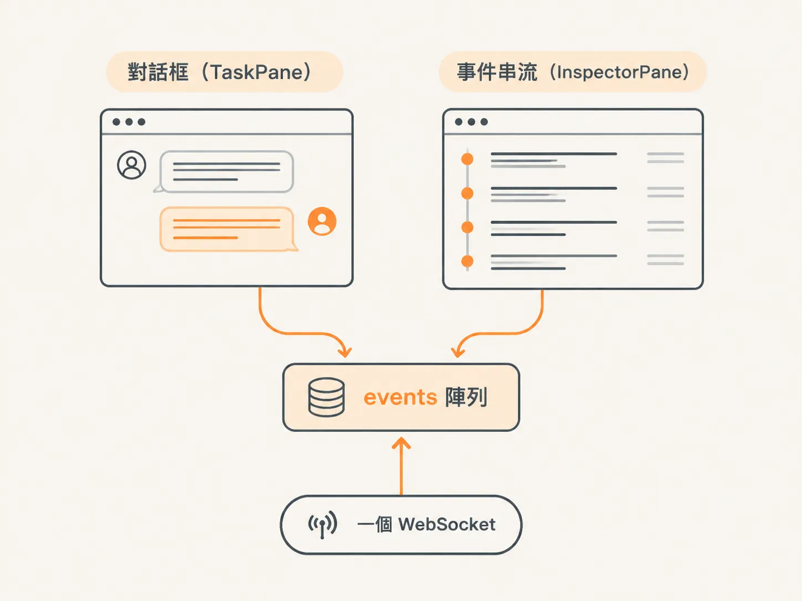
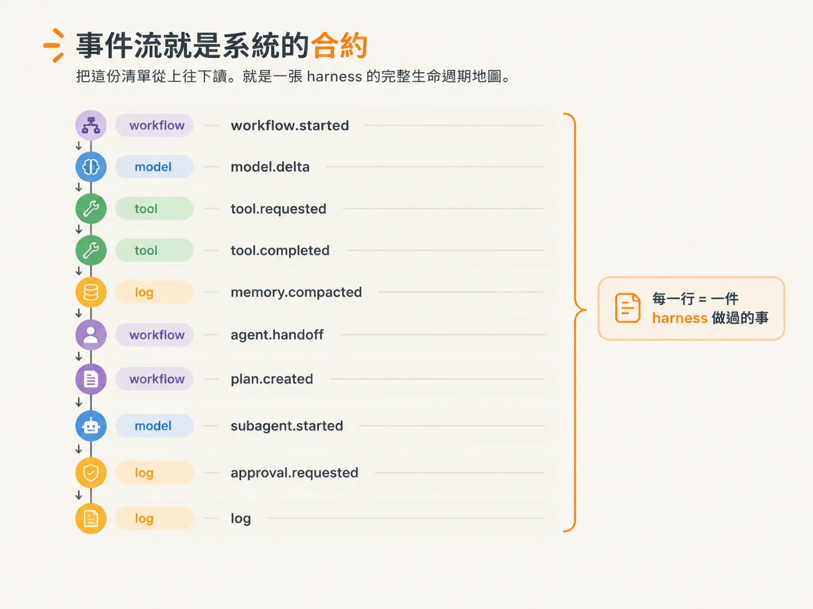
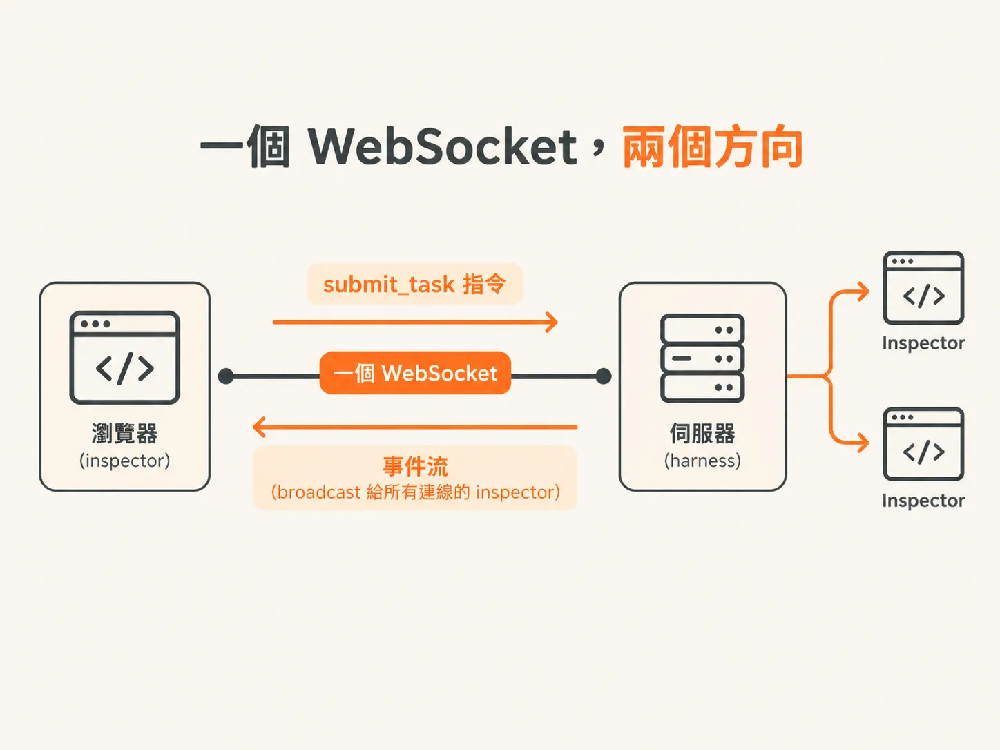
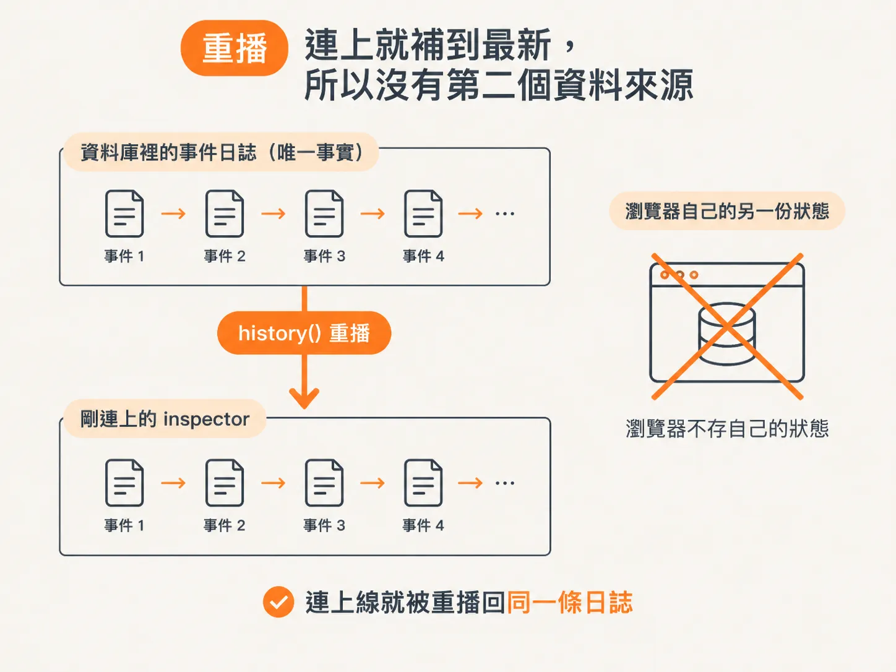

# Inspector：事件流就是可觀測性

打開這堂課的 demo，你會看到左右兩格。

左邊是一般的對話框，可以和 agent 聊天；右邊則是一條持續往下增加的事件串流。

這堂課的主角不是左邊的 agent。素材直接說，agent 本身沒有太多值得挖掘的地方。真正的重點是右邊的 **inspector**：它顯示的事件流，就是整個 harness 的可觀測性來源。

## 左右兩格，其實只有一個資料來源

表面上是兩格，其實是同一個陣列。

`App` 組件把同一份 `events` 狀態，分別傳給左邊的 `TaskPane` 和右邊的 `InspectorPane`：

<!-- source: sources/agent-harness/20260915/harness-engineering/web/src/App.tsx#L47-L50 -->
```tsx
<main className="grid min-h-0 flex-1 grid-cols-2">
  <TaskPane events={events} send={send} />
  <InspectorPane events={events} />
</main>
```

左邊的對話框不會自己呼叫模型，右邊的事件串流也不會自己讀資料庫。

兩者都只使用同一份 `events`。而這份 `events` 來自 `useHarnessSocket` 這個 hook——它只開啟一個 WebSocket，並把收到的每一則事件依序加進陣列：

<!-- source: sources/agent-harness/20260915/harness-engineering/web/src/useHarnessSocket.ts#L19-L22 -->
```tsx
socket.onmessage = (e) => {
  const event = JSON.parse(e.data) as AgentEvent;
  setEvents((prev) => [...prev, event]);
};
```

這就帶出本課最核心的一句話：

> UI 從來不直接和模型或工具溝通，它只負責渲染這條事件串流。



*AI 生成示意圖*

## 事件流就是系統的合約

為什麼只渲染事件串流就夠了？

因為 harness 和 inspector 之間有一份契約，寫在 `shared/events.ts`。這份契約開宗明義說明：harness 做的每一件事，都會變成事件串流上的一則事件；而 event log 就是系統本身。

具體來說，`EventType` 會列出所有事件型別：

<!-- source: sources/agent-harness/20260915/harness-engineering/shared/events.ts#L12-L38 -->
```ts
export enum EventType {
  // a workflow (one agent run) begins / ends
  WorkflowStarted = "workflow.started",
  WorkflowCompleted = "workflow.completed",
  WorkflowFailed = "workflow.failed",
  // the model thinking out loud (streamed token by token)
  ModelDelta = "model.delta",
  ModelCompleted = "model.completed",
  // a tool call and its outcome
  ToolRequested = "tool.requested",
  ToolCompleted = "tool.completed",
  ToolFailed = "tool.failed",
  // memory: old turns compacted into a running summary
  MemoryCompacted = "memory.compacted",
  // orchestration: control handed from one agent to another
  AgentHandoff = "agent.handoff",
  // supervision: the plan, and each parallel sub-agent
  PlanCreated = "plan.created",
  SubagentStarted = "subagent.started",
  SubagentCompleted = "subagent.completed",
  SubagentFailed = "subagent.failed",
  // human-in-the-loop: a privileged action paused for approval
  ApprovalRequested = "approval.requested",
  ApprovalResolved = "approval.resolved",
  // free-form harness logging
  Log = "log",
}
```

把這份清單從上往下讀，就是一張 harness 的完整生命週期地圖。

你會看到：

- workflow 從 `started` 開始，最後進入 `completed` 或 `failed`。
- 模型逐字產生內容，從 `delta` 一直到 `completed`。
- 工具從 `requested` 開始，最後進入 `completed` 或 `failed`。
- 系統也會記錄記憶壓縮、agent 交棒、監督者建立計畫與派發 sub-agent。
- 需要人核准的動作，以及自由格式的 `log`，也都會出現在事件流裡。



*AI 生成示意圖*

## 每一則事件長什麼樣？

這些型別不是憑空出現的。

`events.ts` 裡定義了 `AgentEvent`。它可以想成「某個事件型別的內容」，再加上 harness 補上的兩個標記：

- `id`：每一則事件的身分。
- `ts`：這則事件的時間戳。

Inspector 右邊的工作非常單純：照順序顯示每則事件的時間、型別，以及 payload 的摘要。

事件型別的前綴也會用不同顏色標示：

- `workflow` 是紫色。
- `model` 是藍色。
- `tool` 是綠色。
- `log` 是黃色。

因此，你可以在畫面上一眼分辨：這一行是模型在產生內容，那一行是工具正在執行。

## 從原始事件流讀出 harness 在做什麼

有了事件型別和發生順序，就可以直接「讀」這條事件流。

素材在課程後段示範過：每次呼叫 `emit`，就會有一則事件出現在 inspector 上。

- `model.delta`：模型「思考」時，每一個 token 都會形成一則 delta。因此畫面上看到的不是完整回覆，而是內容逐字出現。
- `tool.requested`：模型決定呼叫某個工具的那一刻。
- `tool.completed` / `tool.failed`：工具執行完成後的回傳值或錯誤。
- `workflow.completed`：整個 run 結束。

素材的總結是：這是一個很好的方式，讓你看見 agent 正在看見什麼，以及系統是怎麼走到目前這個狀態的。

換句話說，原本看不見的基礎設施——模型、工具、記憶和交棒——都透過事件流變得可見。

## 一個 WebSocket，兩個方向

這條事件流在網路上只走一條通道。

`useHarnessSocket` 的註解說得很清楚：inspector 的單一事實來源，就是透過一個 WebSocket 收到的 harness 事件流；而瀏覽器也會透過同一條通道，把 `submit_task` 指令送回伺服器。

伺服器會這樣發出事件：

<!-- source: sources/agent-harness/20260915/harness-engineering/server/index.ts#L53-L59 -->
```ts
// Forward every emitted event to all connected inspectors.
subscribe((event) => {
  const data = JSON.stringify(event);
  for (const client of wss.clients) {
    if (client.readyState === client.OPEN) client.send(data);
  }
});
```

任何 harness 程式碼呼叫 `emit` 時，`subscribe` 的回呼就會被觸發，接著把這則事件廣播給所有連線中的 inspector。

注意，這裡是「廣播」。如果同時開著兩個分頁，兩個分頁都會同步收到事件。



*AI 生成示意圖*

## 重播：連上就補到最新，所以沒有第二個資料來源

最後要回答的是：「瀏覽器重新整理之後呢？」

如果瀏覽器自己保存一份狀態，重新整理時，就得想辦法讓兩份狀態重新對齊。

這堂課採用的做法是：**瀏覽器不保存任何狀態。**

每當有 inspector 連上線，伺服器做的第一件事，就是把 durable 的時間軸重播給它：

<!-- source: sources/agent-harness/20260915/harness-engineering/server/index.ts#L80-L82 -->
```ts
// Replay the durable timeline (including a workflow DBOS is recovering).
for (const event of await history()) socket.send(JSON.stringify(event));
```

`history()` 會讀回整份事件日誌，再把事件一則一則送給剛連上的 inspector。

這正是「重播讓它沒有第二個資料來源」的關鍵：

> 資料庫裡的事件日誌是唯一的事實，瀏覽器只是它的一個投影。

因此，無論是重新整理、斷線重連，甚至伺服器重啟，最後都會回到同一條時間軸。不需要另外記住「我上次看到第幾則」，也不需要額外處理兩份狀態的同步。



*AI 生成示意圖*

到這裡，這一課的骨架就清楚了：

- harness 做的每一件事，都會成為一則事件。
- inspector 只負責渲染這條事件流。
- 重播則保證瀏覽器永遠是這份唯一日誌的投影。

可觀測性不是另外蒐集來的第二份資料，它就是系統本身。
