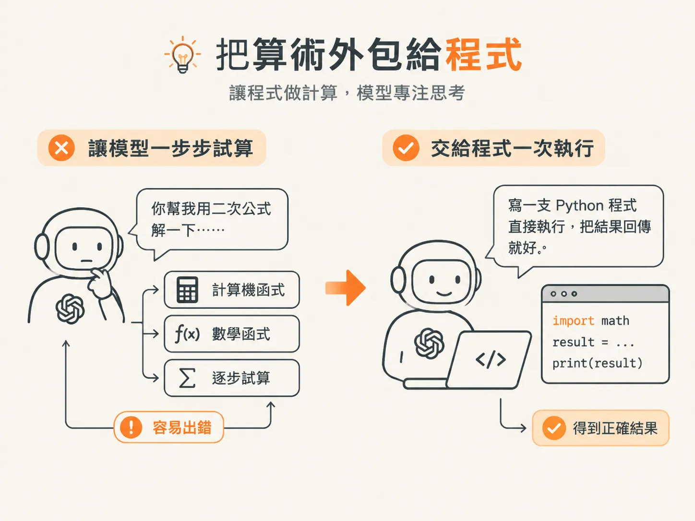
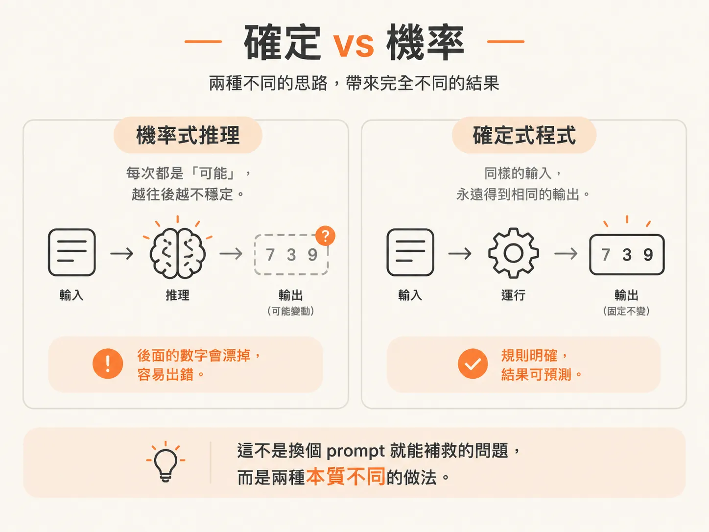
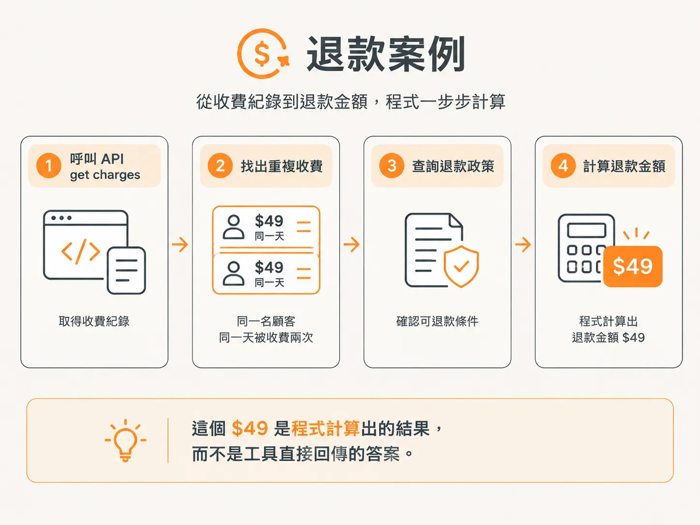
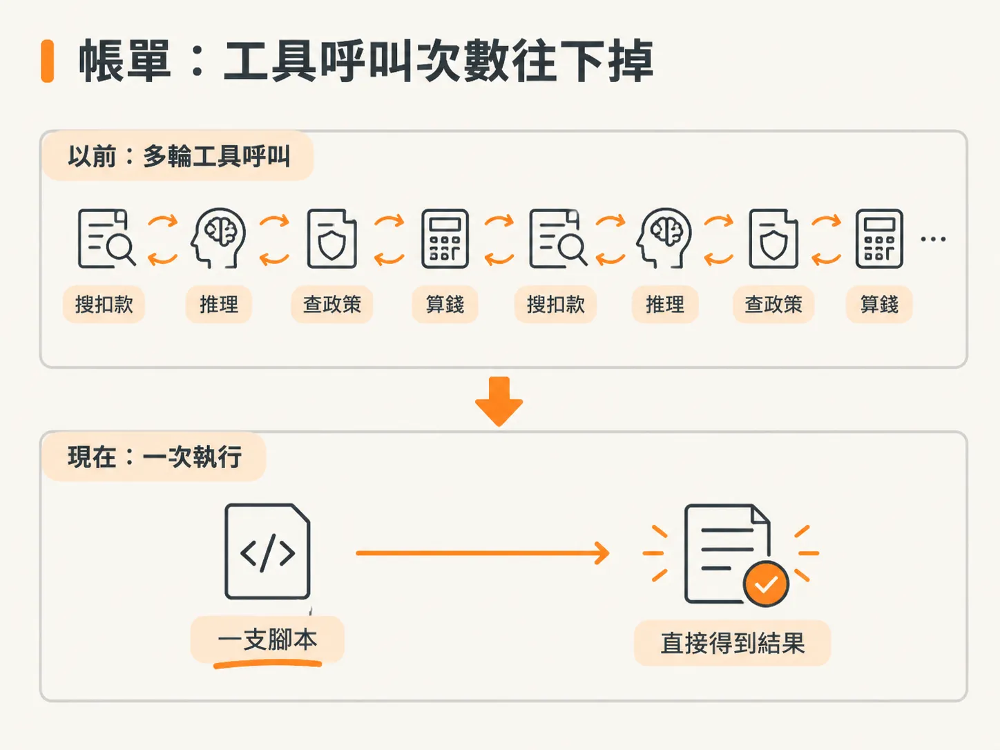

# Code mode 的帳單：把算術外包給程式

上一節的結論是：讓模型自己寫程式跑一次，勝過一輪一輪的工具來回。這一節看的是同一件事的另一面——模型最不擅長的，其實是算術本身。

你可能遇過這種情況：給 agent 一整套計算工具，加法一個、開根號一個，甚至連解一元二次方程式都有專用工具。

接著，你只能看著它一個工具接一個工具地試，邊「推理」邊計算，最後卻還是把數字算錯。

與其讓模型自己算，不如把算術這件它最不擅長的事，交給它最擅長的事：寫程式。

模型很會寫程式，卻不太擅長數數。素材裡一再強調：大型語言模型（LLM）寫程式的能力，遠比直接處理數字好得多。

所以，想讓 agent 更快做出決策，最直接的方法就是讓它寫程式。

不必問模型「你幫我用二次公式解一下」，再塞給它一堆計算機函式讓它慢慢試；讓它寫一支 Python 程式直接執行，把結果回傳就好。



## 確定與機率

關鍵差別在「確定」跟「機率」。

用推理做算術時，模型採用的是機率式運作。算到某個地方，它可能開始產生幻覺，數字也會一個接一個地偏掉。

作者最不喜歡在 LLM 呼叫裡塞日期，因為日期中的數字一多，模型就很容易算錯。

程式則是 deterministic，也就是「確定性的」：只要輸入完全相同，就會得到完全相同的輸出，不會在過程中漂移。

這不是換個 prompt 就能補救的問題，而是兩種本質不同的做法。



## 只要修改 system prompt

做法其實很簡單，只要修改 system prompt，加上一句話：

「如果你需要算術，請使用 run code tool，寫一段 JavaScript，並在 async wrapper function 裡執行。」

這句話沒有標準答案，你可以照需求調整。重點是讓 agent 知道：需要算術時，別自己硬算，寫程式來算就好。

## 退款案例：$49 是「算」出來的

示範中，agent 寫了一段程式。

它先呼叫 `get charges` 取得收費紀錄，再把紀錄列出來，找出重複收費的情況。接著，它搜尋知識庫裡的退款政策，最後才進行數學計算。

結果出來了：退款金額是 **$49**。

背後的情況是，同一名顧客在同一天被收費兩次，而且兩筆都是 $49。這個 $49 並不是工具直接回傳的答案，而是程式計算出來的結果。



<!-- derived -->

```javascript
async function findRefund() {
  const charges = await tools.getCharges(); // 拿收費紀錄
  const refund = charges.reduce((sum, c) => sum + c.amount, 0); // 數學在程式裡做
  return refund; // 結果是 $49
}
```

## 工具呼叫次數變少了

如果不用 code mode，你得先提供 `search charges` 這類工具，再讓 agent 自己一步步推理和計算。這樣不但比較慢，也更容易出錯。

現在，透過一段程式，就能一次完成「抓取紀錄、查詢政策、計算金額」這幾件事。工具呼叫次數變少了，處理速度和準確度也都提高，而且程式是在安全的 VM sandbox 裡執行。



這項技術目前仍在 bleeding edge，也就是相當前沿、還沒普及。

作者說，他認識的人裡，真正把這種做法搬上 production 的還不多。但這不代表沒人在做，已經有人開始做了。

不管是不是 production，有一件事不會變：模型寫的那段程式，不能直接跑在你的機器上。下一節就來蓋這個沙箱。
