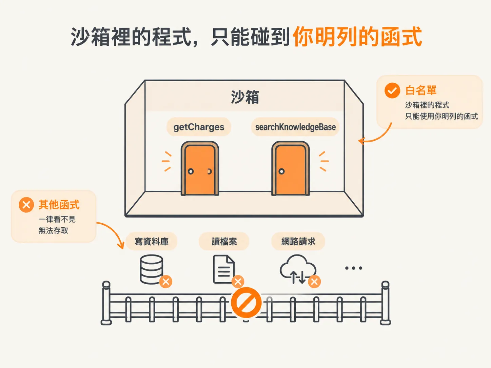
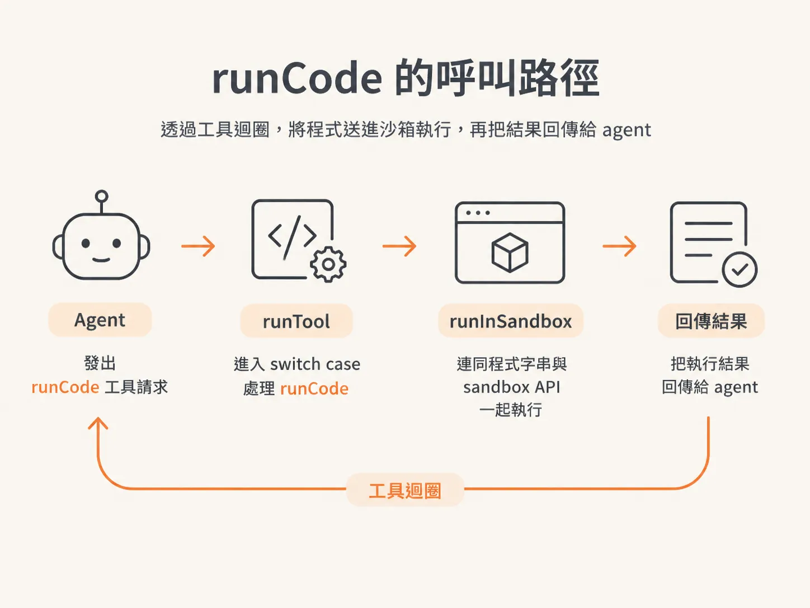
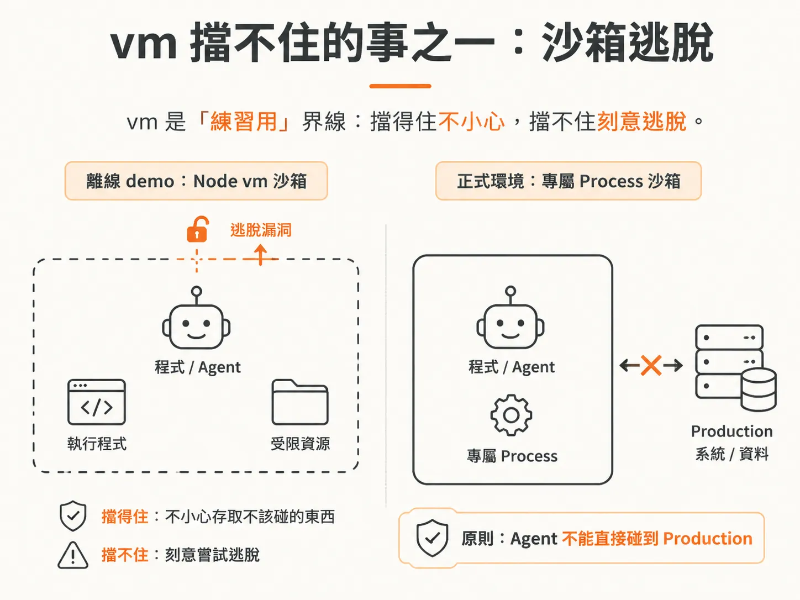
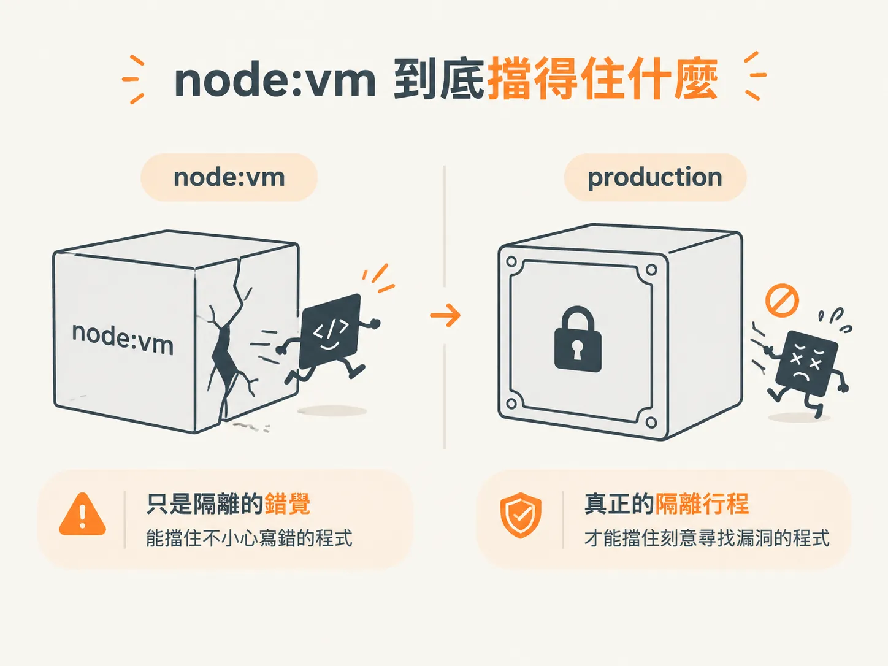

# runCode 接回 tool 迴圈，以及 vm 擋不住的事

到目前為止，你已經有一個沙箱：`runInSandbox` 使用 Node 的 `vm` 模組，把一段程式關進受限的小環境裡執行。

但這個沙箱目前像個沒人接的電話。tool 迴圈裡沒有任何工具會呼叫它，agent 也就無法要求「幫我執行這段程式」。

這一節要補上的，正是這個缺口：

1. 新增 `runCode` 工具，讓 agent 能要求執行一段程式。
2. 把 `runCode` 接回 `runTool` 的 `switch case`。
3. 看清楚 `vm` 擋不住的兩件事：沙箱逃脫風險，以及一個雖然寫好、卻沒有真正接上的 timeout。

## 為什麼要讓 agent 執行程式？

有些事情，與其交給語言模型（LM）計算，不如直接寫一段程式處理。

最典型的例子就是金額。這一節的 demo 做了一個叫 `charge` 的工具，負責進行金額的加減運算。理由很直接：LM 連「strawberry 有幾個 R」都不一定數得準，算錢這種事，還是交給函式比較安心。

所以與其讓 LM 變得更會算，不如讓它能把計算交給程式。要做到這件事，就需要一個能執行程式的工具。

## 沙箱 API：開放給沙箱使用的函式

程式送進沙箱後，不能想碰什麼就碰什麼。

`runInSandbox` 執行程式時，會帶入一組 sandbox API。這組 API 就像一張允許清單，列出「沙箱裡的程式可以使用哪些函式」。程式只能使用清單上的函式，其他資源一律拿不到。

<!-- derived -->
```ts
// 沙箱 API：程式在沙箱裡只能呼叫這幾支函式
const sandboxAPI = {
  // 用 customerId 找出該客戶的 charge 清單
  getCharges(customerId: string) {
    return charges.filter((c) => c.customerId === customerId)
  },
  // 搜尋知識庫
  searchKnowledgeBase(query: string) {
    return searchKB(query)
  },
}
```

`getCharges` 接收一個 `customerId`，從 `charges` 清單中找出這個客戶的資料。`searchKnowledgeBase` 接收一個 `query`，用來搜尋知識庫。

底下的 `searchKB` 原本就已經寫好了，這裡只是把它抽成一個 helper，讓沙箱 API 和其他地方都能共用。

這兩個函式各自做了什麼其實不重要，重要的是這個動作本身：你正在替沙箱列出一份清單，明確規定裡面的程式可以碰哪些東西。

清單以外的資源，就擋在門外。



## runCode：agent 手上的執行程式工具

接著定義 `runCode` 工具，並把它提供給 agent 使用。

<!-- derived -->
```ts
// runCode：agent 可以呼叫它，要求在沙箱裡跑一段 JavaScript
const runCodeTool = {
  name: 'runCode',
  description:
    '執行一段 JavaScript 程式（async function body），在程式內取得並分析資料。' +
    '你可以用 await tools.getCharges(customerId)、await tools.searchKnowledgeBase(query)，' +
    '可以 console.log，也可以用 return 回傳任何 JSON 值。',
  input: { code: 'string' },
}
```

這個工具的 input schema 很簡單，只有一個欄位：`code`，也就是要執行的程式字串。

`description` 則要告訴 agent，程式裡有哪些工具可以使用，例如：

- `await tools.getCharges`
- `await tools.searchKnowledgeBase`
- 印出內容
- 使用 `return` 把結果交回來

作者明說，這個工具本身「不怎麼有趣」。重點在下一步：把它接回 tool 迴圈。

## 接回 `runTool` 的 `switch case`

有了工具，還需要有人處理工具請求。

請求會進入 harness 的 `runTool`，接著在 `switch case` 裡新增一個分支。

<!-- derived -->
```ts
async function runTool(call) {
  switch (call.name) {
    case 'runCode':
      // 把程式連同沙箱 API 一起送進沙箱執行
      return runInSandbox(call.input.code, sandboxAPI)
    case 'getCharges':
      return charges
    case 'searchKB':
      return { results: searchKB(call.input.query) }
  }
}
```

`runCode` 這個 case 做的事情很單純：呼叫 `runInSandbox`，把 agent 提供的程式字串，也就是 `call.input.code`，和 sandbox API 一起送進去。

沙箱執行完成後，再把結果回傳給 agent，讓 agent 繼續往下處理。

作者也順手補上另外兩個 case：

- `getCharges` 直接回傳 `charges`
- `searchKB` 用物件包住結果後回傳，和其他工具的格式保持一致

整套流程其實可以濃縮成兩步：

1. 定義工具。
2. 在 `runTool` 裡處理這個工具。

定義好 `runCode`、處理好它的 case 之後，agent 就能透過 tool 迴圈，把程式送進沙箱執行，再把結果拿回來。



## `vm` 擋不住的事之一：沙箱逃脫

先談談沙箱的安全界線。

作者的警告很直接：你必須確保 agent 活在一個「逃不出去」的沙箱裡。

你不會把陌生人直接帶進 production 環境。同樣地，也不該把 agent 丟進 production 環境。它如果在你的電腦上搞砸，情況就已經很糟；如果是在 production server 上搞砸，後果只會更嚴重。

真正的產品有許多現成的沙箱方案。但這個 demo 使用的是離線版本，也就是 Node 的 `vm` 模組。

作者也特別提醒，`vm` 過去曾出現過讓 agent 逃出沙箱的漏洞。即使那些漏洞可能已經修補，對這個離線練習來說，仍然可以先拿來使用。

但如果要上正式環境，就不會直接靠 `vm` 扛住風險，而是把執行工作交給另一個專門處理沙箱的 process。

白話講，`vm` 提供的是「練習用」的界線，不是「production 級」的界線。它可以防止程式不小心碰到不該碰的東西，卻不能保證程式刻意嘗試逃脫時仍然安全。



## `vm` 擋不住的事之二：timeout 寫了卻沒接上

有人在課堂上問：能不能設定 timeout，避免 agent 的程式陷入無限迴圈，最後把 server 卡住？

答案是：timeout 機制已經寫好了，但目前還沒有真正用上。

sandbox 裡有一個 timeout 選項，預設值是 2 秒。你可以傳入 `options`，再透過 `timeoutMs` 設定時間。

底下的實作使用 `Promise.race`，同時準備兩條路：

- 一條執行你的程式
- 另一條是時間一到就 `reject` 的 Promise

誰先完成，誰就獲勝。程式先執行完，就回傳結果；如果 timeout 先到，就會 `reject` 並丟出錯誤。

<!-- derived -->
```ts
// sandbox 內建的 timeout：Promise.race 看誰先完成
function runInSandbox(code, api, options = { timeoutMs: 2000 }) {
  return Promise.race([
    execute(code, api), // 你的程式
    new Promise((_, reject) => setTimeout(() => reject(new Error('timeout')), options.timeoutMs)),
  ])
}
```



但回到剛才的 `runTool` `switch case`，就會發現問題：那個呼叫 `runInSandbox` 的地方，根本沒有把 `options` 傳進去。

所以現在實際執行時，使用的仍然是預設值，而不是你真正想設定的 timeout。

缺口就在這裡：timeout 機制躺在 sandbox 裡，卻沒有從 tool 迴圈這一端接上。

它已經寫好，也確實能用，只是目前還沒被用起來。demo 和 production 的差距，常常就藏在這種沒接上的小地方。
