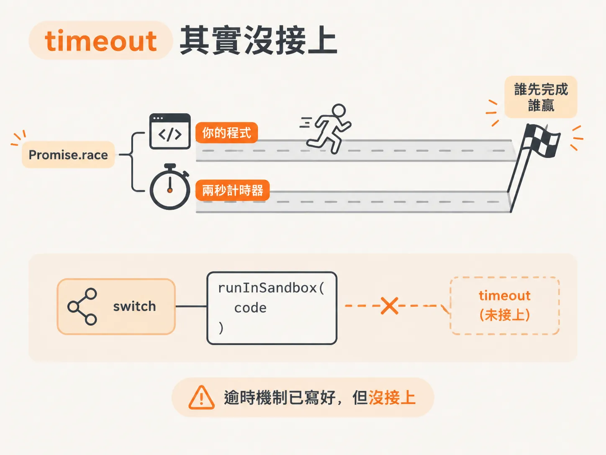

# runCode 接回 tool 迴圈，以及 vm 擋不住的事

上一課完成了 `runInSandbox`：把一段字串當成程式碼，放進受限環境裡執行。

但只有這個函式還不夠。agent 不知道自己有這項能力，harness 也不知道該怎麼把「執行程式」接回原本的工具迴圈。

這一課會補上這兩個缺口，也會正視一個重要問題：`node:vm` 這個沙箱，其實不是真正的安全邊界。

## 先決定沙箱裡有哪幾扇門

要讓 agent 使用 `runInSandbox`，第一步是決定沙箱裡的程式可以呼叫哪些函式。

素材把這組函式稱為 **sandbox API**。它不是提供給 agent 直接使用的，而是提供給「沙箱裡執行的那支程式」使用。

這裡的例子和計費有關。`charge` 需要對金額進行算術運算，而算術正好是 LLM 不擅長的事。素材甚至調侃，模型連 `strawberry` 裡有幾個 `r` 都可能數錯。

這類工作，應該交給真正的函式處理。因此，沙箱裡只放兩扇門：

<!-- derived -->
```ts
const sandboxAPI: SandboxAPI = {
  getCharges: (customerId: string) =>
    charges.filter((c) => c.customerId === customerId),
  searchKnowledgeBase: (query: string) => searchKB(query),
};
```

`getCharges` 接收 `customerId`，回傳這個客戶的費用；如果查不到資料，就回傳空陣列。

`searchKnowledgeBase` 則接收查詢字串，搜尋知識庫。素材在實作時，把 `searchKB` 抽成共用的 helper，讓沙箱 API 和外部程式共用同一份邏輯。

sandbox API 這個物件的意義就是白名單：沙箱裡的程式只能碰到你明列出來的函式，其他一律看不見。


*AI 生成示意圖*

## runCode：把「寫程式」包成一個 tool

有了 API，接著要讓 agent 知道自己可以寫程式。

做法很直接：新增一個叫做 `runCode` 的 tool。

它的 description 會這樣告訴模型：

> run a JavaScript program, an async function body to fetch, analyze data available inside the program.

翻成白話，就是：你可以寫一支非同步的 JavaScript 程式，透過 `await tools.getCharges` 和 `await tools.searchKnowledgeBase` 取得資料，也可以用 `console.log` 印出內容，或用 `return` 回傳結果。回傳值可以是任何 JSON。

它的 input schema 只有一個欄位，就是 `code`——要執行的程式碼本身。

<!-- derived -->
```ts
const runCode = {
  description:
    "run a JavaScript program, an async function body to fetch, analyze data available inside the program.",
  input: { code: "string" },
};
```


*AI 生成示意圖*

不過，定義 tool 還不代表功能完成。tool 寫好了，harness 還不知道該怎麼處理它，因此還要回到 `runTool`，在 `switch` 裡新增一個 `case`。

## 加一個 case，就是加一個 tool

素材把「新增工具」整理成一個固定流程：

1. 先定義 tool。
2. 再在 `runTool` 的 `switch` 裡處理它。

`runCode` 的 `case` 很短：

<!-- derived -->
```ts
switch (tool) {
  case "runCode":
    return runInSandbox(code, sandboxAPI);
  case "getCharges":
    return charges;
  case "searchKB":
    return { result: searchKB(query) };
}
```

這條路徑會把 agent 傳來的 `code` 字串，連同 sandbox API 一起交給 `runInSandbox`。

素材在輸入時碰到一個小錯：`runInSandbox` 其實接收三個參數——`code`、API 和 `options`。不過第三個參數是選用的，所以只傳前兩個也可以。

`getCharges` 和 `searchKB` 這兩個 `case`，則讓 agent 不必寫程式，也能直接呼叫函式。它們正好對應到沙箱 API 裡的兩扇門。

所以，每次要新增工具，基本上都是重複同一件事：先定義它，再在 `runTool` 裡處理它。

素材的總結很簡單：先公開沙箱需要使用的 API，再到 `runTool` 裡處理這些工具。


*AI 生成示意圖*

## node:vm 到底擋得住什麼

講到這裡，得先潑一盆冷水。

上一課選用 `node:vm`，是因為它方便，不是因為它安全。

素材的立場很清楚：agent 應該待在一個逃不出去的沙箱裡。道理就像你不會把陌生人直接丟進 production 一樣——你也不會想把 agent 丟進正式環境。

在自己的電腦上出錯已經夠麻煩；如果是在正式伺服器上出錯，後果只會更糟。

不過，素材沒有使用商業沙箱產品，而是用 `node:vm` 做出一個離線版本，並直接承認：`node:vm` 曾經出現過能讓 agent 逃出沙箱的漏洞。即使後來可能已經修補，這仍然不能當成正式環境的安全保證。

「沒關係，我們照用，反正是你的 agent」這句話的重點在於：這是教學版本，離線跑跑可以；真的要上 production，就得換成其他執行方式。

素材提到，正式環境大概會使用獨立的 process 來執行這些程式。

換句話說，`node:vm` 提供的是隔離的錯覺，不是隔離的保證。它可以擋住不小心寫錯的程式，卻擋不住刻意尋找漏洞、試圖逃脫的程式。


*AI 生成示意圖*

## timeout 其實沒接上

最後一個缺口，是讀者提出的問題：

能不能設定 timeout，避免 agent 跑無限迴圈，最後把伺服器掛住？

答案是：有這個機制，但目前沒有真的用上。

`runInSandbox` 裡其實早就寫好逾時處理。預設時間是兩秒，也可以透過 `options` 傳入 timeout 的毫秒數。

它使用 `Promise.race`：同時啟動兩件事，一件是執行你的程式，另一件是「時間到就 reject」的計時器。誰先完成，誰就贏。

<!-- derived -->
```ts
function withTimeout(promise, timeoutMs) {
  return Promise.race([
    promise,
    new Promise((_, reject) =>
      setTimeout(() => reject(new Error("timeout")), timeoutMs),
    ),
  ]);
}
```

問題出在前面的 `switch`。

素材自己也指出，呼叫 `runInSandbox` 時沒有傳入 `options` 物件，因此 timeout 參數根本沒有被帶進去。

機制寫好了，線卻沒有接上。

如果真的丟一支無限迴圈的程式進去，它還是會一路執行，直到 process 掛掉。原本應該提供兩秒保護的 timeout，這時就形同虛設。



*AI 生成示意圖*

這一課想留下的重點是：

`runCode` 接回 tool 迴圈後，agent 就能寫程式來解題，這部分只需要幾行程式。

真正困難的是邊界管理：

- `node:vm` 不是真正的安全邊界。
- timeout 機制雖然存在，卻還沒有接到實際呼叫上。
- demo 能執行，不代表 production 真的撐得住。
