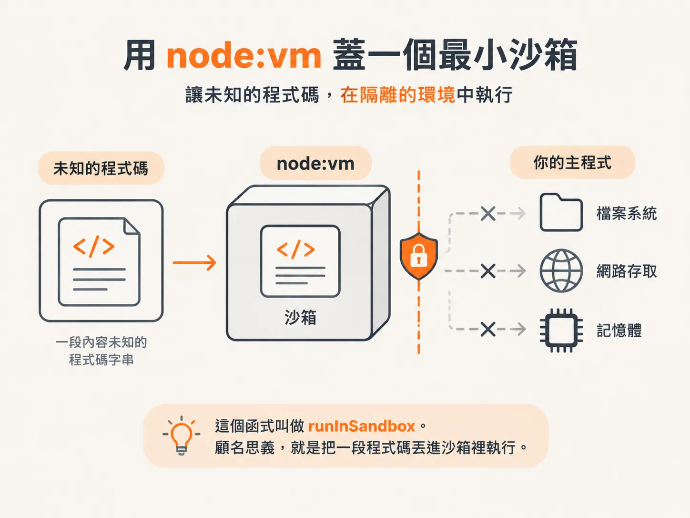
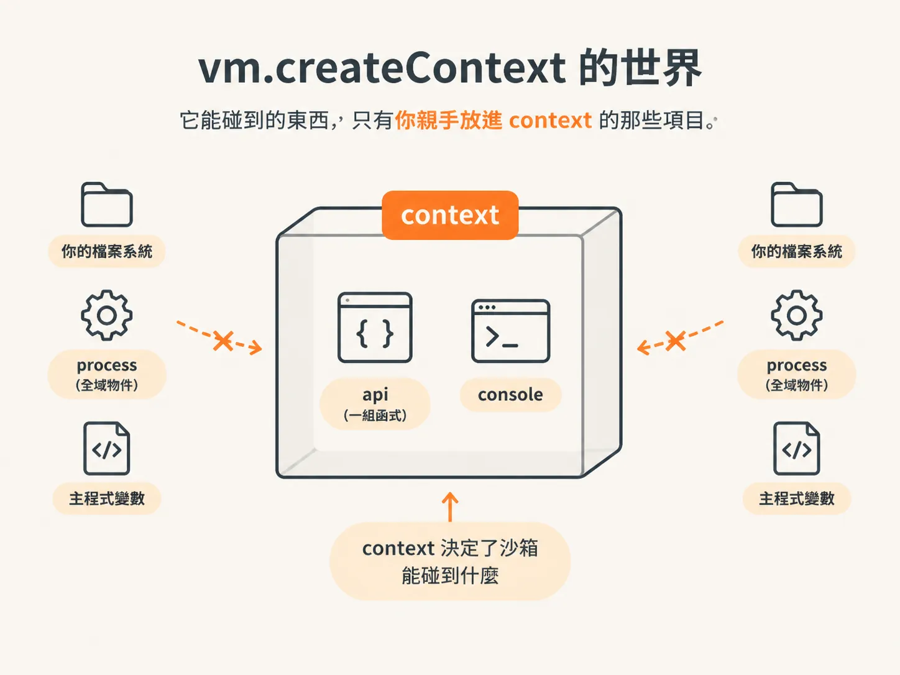
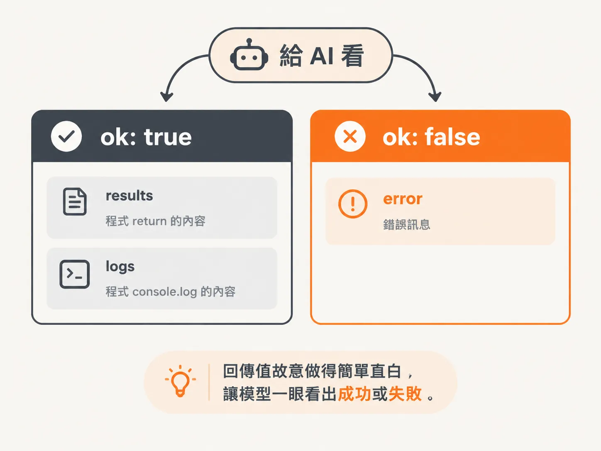

# 用 node:vm 蓋一個最小沙箱

上一課結尾留下一個問題：模型寫出的程式是 untrusted code，不能在 host 上直接跑。那這段程式究竟要在哪裡執行？

做法是畫出一條界線，讓程式在我們的 process 裡跑，卻碰不到外面的東西。這條界線，就是本課的主角：`runInSandbox`。

它接收一段字串形式的程式碼，放進一個幾乎空白的房間裡執行，只提供我們允許的 API；時間一到，就停止這段程式。聽起來像魔法，但拆開來看，其實只是 Node 內建的 `node:vm` 模組，再加上幾個小機制。

## 三種輸入：code、api、options

先從函式簽名開始，把邊界講清楚。`runInSandbox` 會接收三個東西：

- `code`：一段字串，也就是模型寫出的程式。它不是函式，也不是 AST，而是一段文字。
- `api`：一張函式地圖。沙箱裡能使用的工具都列在這裡；沒有列進來的工具，沙箱裡看不到。
- `options`：目前只有一個可選欄位：`timeoutsInMilliseconds`。預設值是 2 秒。這個時間夠讓一支小程式跑完，但不至於讓它長時間卡住你的 process。

還有一樣東西不會從參數傳進來，卻會伴隨整段執行過程：`logs`。

`logs` 是一個字串陣列，用來接住沙箱裡 `console.log` 印出的內容。模型看不到你的終端機，所以如果你想知道它算了什麼，只能透過這個陣列收集結果。

<!-- derived -->
```ts
import vm from "node:vm";

type SandboxResult = {
  ok: boolean;
  results?: unknown;
  logs: string[];
  error?: string;
};

type SandboxAPI = Record<string, (...args: unknown[]) => unknown>;

async function runInSandbox(
  code: string,
  api: SandboxAPI,
  options?: { timeoutsInMilliseconds?: number },
): Promise<SandboxResult> {
  const timeoutsInMilliseconds = options?.timeoutsInMilliseconds ?? 2000;
  const logs: string[] = [];
}
```

`api` 的型別其實很單純，卻值得特別注意：

- key 是模型在程式裡呼叫的名稱。
- value 是對應的函式。

沙箱的權限不是靠一套複雜的權限系統，而是取決於一件事：**你到底放了哪些東西進這個物件。**

## 空房間：`vm.createContext`

接著來建立執行環境。`vm.createContext()` 會建立一個全新的環境，也就是 sandbox environment。

重點在於：它跟你的 process 不共享全域物件。你外面的變數、`require`、`process`，在裡面通通不存在，除非你親手放進去。



*AI 生成示意圖*

因此，建立沙箱時只放入兩樣東西：

- `api`：上一節提到的函式地圖，也是沙箱裡唯一的能力來源。
- `console`：我們自己建立的 console。它的 `log` 不會把內容印到終端機，而是先把參數轉成字串、用空格串起來，再放進 `logs` 陣列。

<!-- derived -->
```ts
  const context = vm.createContext({
    api,
    console: {
      log: (...args: unknown[]) => {
        logs.push(args.map((a) => String(a)).join(" "));
      },
    },
  });
```

這裡有一個容易忽略的決定：連 `console` 都是我們自己重寫的。

真正的 `console.log` 會把文字印到伺服器終端機。模型寫出的程式可能千奇百怪，你不會希望它的除錯訊息直接灌進自己的 log。與其祈禱它乖乖使用，不如從源頭就把輸出導向 `logs`。

具體做法是使用 `args.map`：把每個參數轉成字串，原本已經是字串的就略過，最後再用空格 `join` 成一句話。

## 把程式碼包成 async IIFE

房間準備好了，但程式碼仍然只是一段裸字串。

模型寫的程式常常需要 `await`：呼叫 API、等待資料回來，再繼續計算。不過，直接把裸程式碼交給 `vm.runInContext`，不會自動幫你包成 async 函式；這時候，頂層的 `await` 會直接造成語法錯誤。

所以在執行前，還要多做一個動作：把程式碼包進 async IIFE。

IIFE 是 immediately invoked function expression 的縮寫，意思是「宣告後立即執行的函式」。外層寫成 `(async () => { ... })()`，再把原本的程式碼整段放進大括號裡。

<!-- derived -->
```ts
  const wrapped = `(async () => {
${code}
})()`;
```



*AI 生成示意圖*

這樣一來，模型寫出的程式就位在 async 函式裡，可以自然地 `await` API，等待完成後再 `return`。

這個包裝的目的很單純：讓模型更容易寫非同步程式，不必一直提醒它「你現在是在 async 函式裡」。

## 執行，然後用 `Promise.race` 逾時

現在可以真正執行程式了。

`vm.runInContext` 會接收三個參數：

1. 包裝後的 `wrapped`
2. `context`
3. `{ timeout }`

這個 `timeout` 是 vm 層的防護。當程式執行超過指定時間，vm 就會中斷它。

執行後會得到一個 Promise。素材先把它存進 `pending`，暫時不使用 `await`。

<!-- derived -->
```ts
function withTimeout<T>(promise: Promise<T>, ms: number): Promise<T> {
  return Promise.race([
    promise,
    new Promise<never>((_, reject) =>
      setTimeout(() => reject(new Error(`sandbox timeout: ${ms}ms`)), ms),
    ),
  ]);
}
```

之所以先不 `await`，是為了讓程式和逾時計時器同時開始。我們另外寫一個 `withTimeout`，它的核心就是 `Promise.race`：

把「程式碼的 Promise」和「倒數計時的 Promise」一起丟進賽局，誰先完成，就採用誰的結果。計時器先結束，就 reject；程式碼先跑完，就取得程式結果。


*AI 生成示意圖*

這個函式本身其實沒什麼特別，也和 AI 沒有直接關係。它只是個工具函式，卻能擋住最常見的翻車情況：模型寫出無窮迴圈，讓你的 server 一直卡住。

整段執行會放在 `try/catch` 裡。等這場賽局分出勝負後，再依照結果回傳資料：

<!-- derived -->
```ts
  try {
    const pending = vm.runInContext(wrapped, context, {
      timeout: timeoutsInMilliseconds,
    });
    const results = await withTimeout(pending, timeoutsInMilliseconds);
    return { ok: true, results, logs };
  } catch (error) {
    return { ok: false, logs, error: error instanceof Error ? error.message : String(error) };
  }
}
```

## `ok: true` 與 `ok: false`

最後來看，為什麼回傳值要設計成 `{ ok: true, ... }`，而不是直接把結果丟出去。

因為這份結果是要交回給 AI 看的。與其丟出一大串複雜資訊，不如用最直接、最不容易誤讀的方式表達。

模型不需要看到一整坨例外堆疊。它只要一眼判斷這支程式有沒有成功：

- `ok: false` 代表失敗，模型看到後就知道要重寫。
- 成功時附上 `results`，也就是程式 `return` 的內容，以及 `logs`，也就是程式呼叫 `console.log` 留下的內容。
- 失敗時則附上 `error`。



*AI 生成示意圖*

`logs` 無論成功或失敗都會回傳，這點也很重要。

程式出錯時，log 往往是唯一的線索。模型也要靠這些內容，才能知道自己是哪裡寫錯。

## 這一課到這裡，下一步是接回工具

到目前為止，`runInSandbox` 還只是一支獨立函式，尚未被其他程式呼叫。

如果要讓它真正擋在模型與程式執行之間，下一步還要把它接進 tool 迴圈：

1. 宣告一個叫 `runCode` 的工具。
2. 在 `runTool` 的 `switch` 裡加入一個 `case`。

這是下一課的內容，也會順便說明 `node:vm` 擋不住哪些事情。
