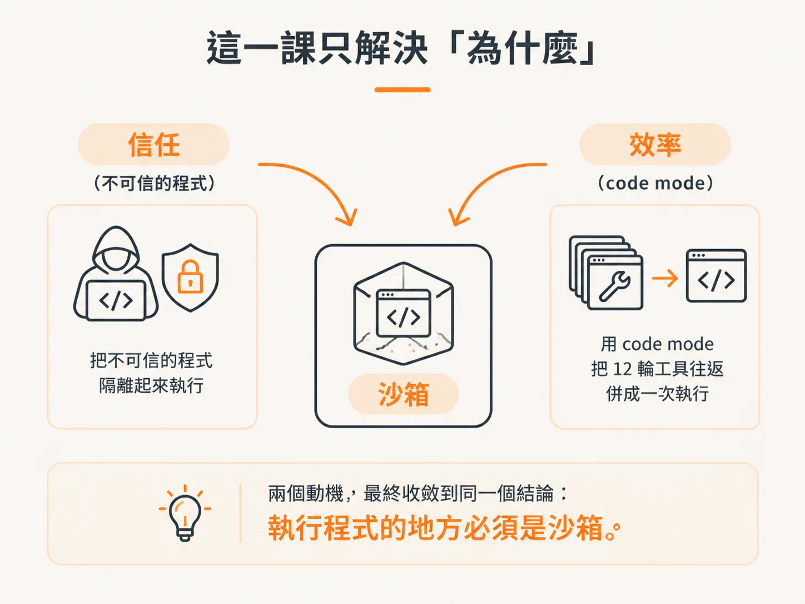

# 為什麼要讓模型自己寫程式跑

先講一句實話：這堂課教的東西，你不一定馬上用得到。

sandboxing、code mode 這些機制，都不是「沒有它，agent 就會壞掉」。素材裡的老師講得很直接：他只是把各種工具攤在桌上，示範「如果哪天你的 agent 遇到問題，這些東西可以派上用場」。

Claude Code 本身就是一個單一 agent。即使沒有這些機制，照樣能運作得很好。

所以，接下來的內容比較像是工具箱裡多放了一件工具，不是必考公式。帶著這個心態往下看，比較不會覺得「我是不是又要多設一堆東西」。

## 動機一：你信得過那段程式嗎

第一個情境是**信任**。

假設你的 agent 是寫程式型的，想執行一段 Bash；或者它是分析型的，撈完資料後要執行一條 SQL，再做一點算術。問題就來了：

**這段程式，你信得過嗎？**

你想讓它在自己的電腦上跑嗎？在自己的伺服器上跑嗎？素材裡的老師講得很白：大概不想。

那解法不是「叫模型不要寫程式」，而是給它一個隔離的地方——也就是 sandbox。

讓模型可以產生程式、執行程式，但執行範圍被框住。這是 sandboxing 的第一個動機：

把「要信得過才敢執行」，變成「先隔離起來再執行」。

*AI 生成示意圖*

## 動機二：12 輪工具，還是一次執行

第二個情境是**效率**。

素材用一個畫面來說明：現在的 agent 每呼叫一次工具，就是一輪（turn）。畫面上排了 1 到 12，總共 12 輪，也代表 12 次 token。

就算想辦法平行化，也許能把流程壓到 3 輪，但本質沒有改變：

呼叫工具、等待回應、模型再次推理，接著再呼叫工具、再等待。

12 輪中的每一輪，模型都要停下來思考一次。這正是 code mode 想解決的問題。

code mode 這個詞是 Claude 命名的，但有很多不同版本，基本上說的是同一件事：

與其讓模型一輪一輪地呼叫工具、等待回應，不如讓它自己寫一段程式，把這些工具串成一個函式，一次執行，直接取得最後結果。

**12 輪的工具往返，換成一次執行。**

這就是 code mode。

*AI 生成示意圖*

## 寫程式很危險，所以要有沙箱

這裡有個明顯的矛盾：

code mode 讓模型寫程式，而寫程式正是動機一裡提到的「危險」所在。兩條線因此接在一起。

sandboxing 給模型一個能產生並執行程式的邊界；code mode 則讓這項能力變得有價值，省下十幾輪工具往返。

但危險性又會把我們拉回 sandbox：你不能讓一個會寫程式的 agent，毫無防備地在自己的環境裡執行程式。

素材裡有一句很務實的話：

你連讓它在自己的電腦上出錯，都會覺得很糟。等它在 production 伺服器上出錯，那才真的糟。

所以，agent 要住在一個逃不出去的 sandbox 裡。就像你不會把陌生人直接放進 production 環境一樣。

*AI 生成示意圖*

## 這一課只解決「為什麼」

先不要急著寫 code，先把兩個動機收攏起來：

- sandbox 有兩個動機：**信任**，也就是把不可信的程式隔離起來執行；以及**效率**，也就是用 code mode 把 12 輪工具往返併成一次執行。
- 這兩個動機背後，其實是同一個動作：讓模型寫程式，然後執行程式。
- 但「寫程式」本身具有危險性。因此，動機一和動機二最後會收斂到同一個結論：**執行程式的地方必須是沙箱。**

*AI 生成示意圖*

下一課要看的，是 code mode 為什麼不只是省時間——把算術交給程式，往往比交給模型自己推算更可靠。
