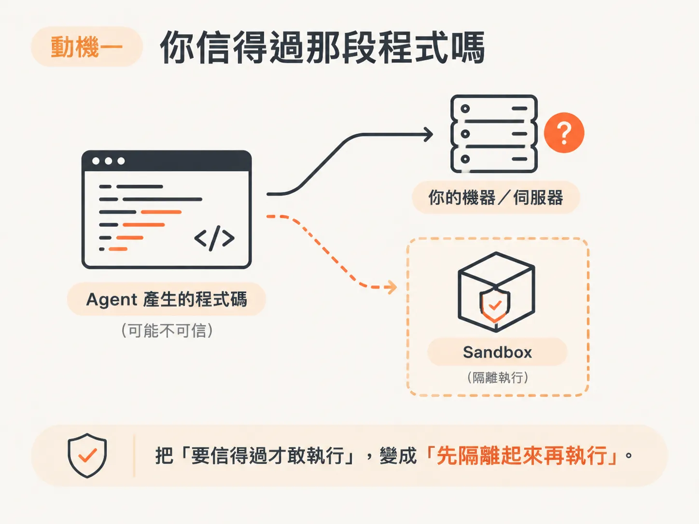
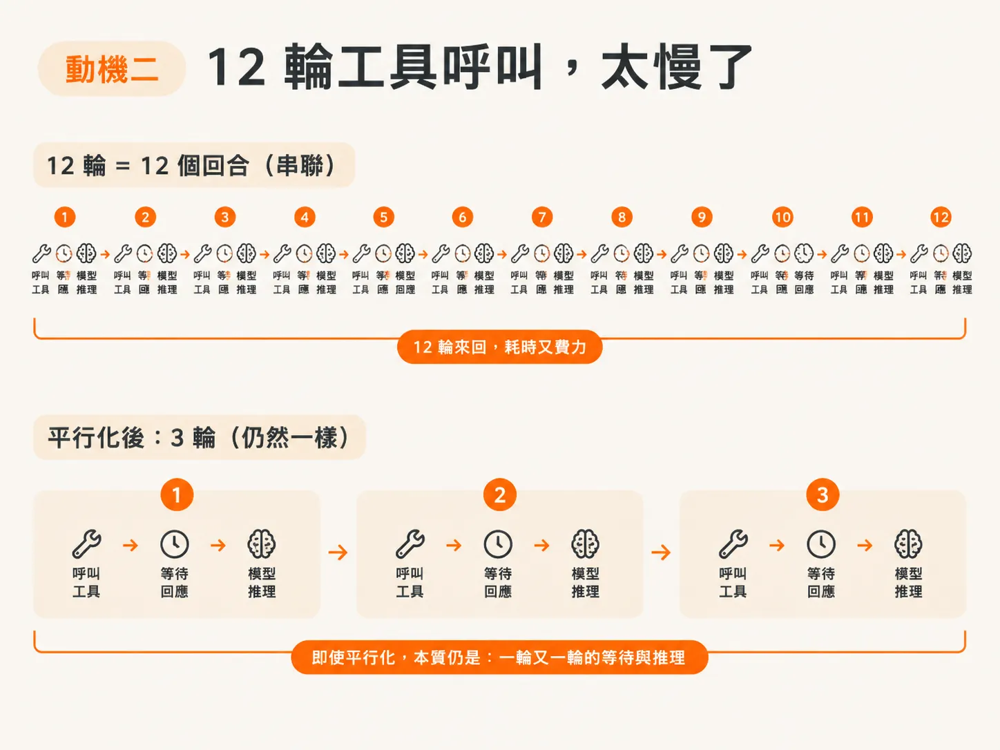
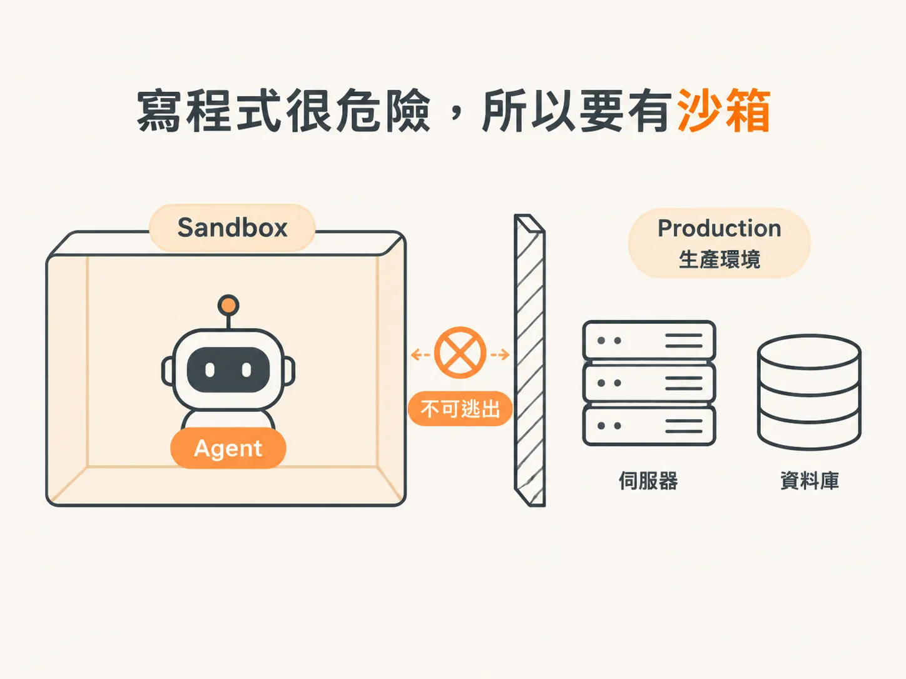

# 為什麼要讓模型自己寫程式跑

當你的 agent 開始會「動手」之後，很快就會遇到一個讓人不太安心的問題：

它產生的程式碼，你敢直接讓它在自己的電腦上執行嗎？

這篇從 sandbox 的兩個動機談起，最後再講 code mode：為什麼後來會讓模型自己寫程式跑。

## 這些不是必備品

先說在前面：sandbox、code mode 都不是 agent 一定要具備的功能。

Scott Moss 講得很直接：Claude Code 就只是一個單一 agent，即使沒有這些機制，也能運作得很好。

這些功能比較像工具箱裡的工具：遇到對應的問題再拿出來用，不是「沒裝，就代表你的 agent 很差」。

所以接下來的重點不是讓 agent 變複雜，而是搞清楚這些工具各自解決什麼問題。

## 動機一：你不敢讓模型直接跑程式碼

第一個動機，和「信任」有關。

當模型要求執行一段可能有危險的程式碼時，問題就會浮現出來。

例如，coding agent 想執行 Bash；或者分析型 agent 讀取資料後，想下 SQL 查詢、做一些算術運算。這時你會想：我該怎麼相信這段程式碼？

你敢讓它跑在自己的電腦上，或直接跑在伺服器上嗎？大概不敢。

因此，你需要先製造一個隔離環境，把模型「產生程式碼，再執行程式碼」的動作關在裡面。這種做法就是 sandboxing。

## 動機二：12 輪工具呼叫，太慢了

第二個動機，來自一個叫作 code mode 的概念。

這個詞是 Claude 那邊創造的，但其他地方也有類似的做法，本質上差不多。

先想像 agent 呼叫工具的過程：

它先呼叫工具、等回應，把結果交回 LLM 推理；接著 LLM 再呼叫下一個工具，繼續等回應。這個流程一輪接一輪，不斷重複。

每一次工具呼叫，都是一個回合（turn）。

Scott Moss 用具體數字舉例：12 個工具呼叫，就是 12 個回合。就算把工作平行化，也許能把 12 輪壓到 3 輪，本質上還是一樣：你得一輪又一輪地呼叫、等待、推理，再呼叫下一個工具。

## 換個想法：把工具串成一段程式碼

code mode 問的是：能不能不要一直這樣來回？

與其讓 LLM 一個工具接著一個工具慢慢呼叫，不如讓 LLM 自己寫一段程式碼，把這些工具串成一個函式。

接著只要執行一次，就能直接取得最終結果。

也就是說，把 **12 輪工具呼叫，變成一次執行**。code mode 要做的，就是這件事。

## 但寫程式碼本身又很危險

回到最開頭的問題：這仍然是在寫程式碼，而執行程式碼本來就可能有危險。

所以，你不能讓 agent 隨隨便便就這麼做，而是一定要搭配一些安全機制。

sandbox 的第一個動機和第二個動機，也在這裡接上了：

你想讓模型自己寫程式、自己執行，就更需要把它關進一個受控的環境裡。
