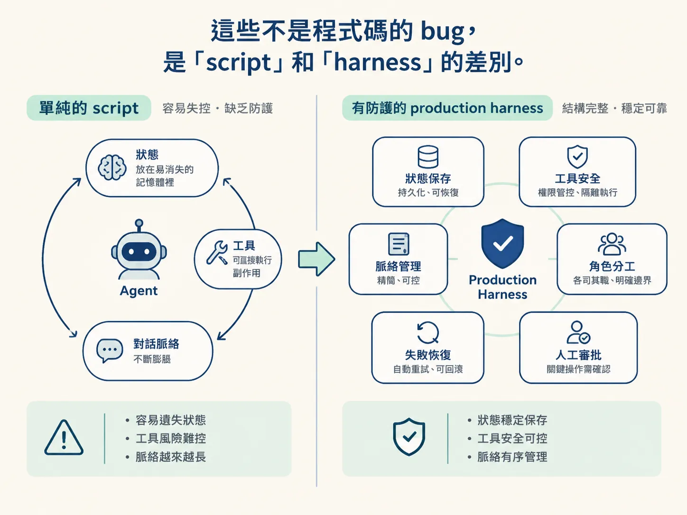

# Demo agent 為什麼一進 production 就死

那個 agent 在 demo 裡很神。你貼上三個客服工單，它分類、查知識庫、寫回覆、送出，全部正確。上台示範三次都沒問題。

上線第一天，它寄了三封未經審核的信給客人；伺服器重啟後，它完全不記得剛才做到哪；工單變成五十張，它開始變慢、變貴、開始亂回。

## Demo 裡的 agent，其實就是一個 while 迴圈

課程講義把這個版本叫 brittle agent：一個 `while` 迴圈，中間夾一次 LLM 呼叫。模型要工具，就執行工具、把結果塞回 messages，再跑下一圈；模型不叫工具，就回傳文字、結束。

<!-- source: sources/agent-harness/20260915/harness-engineering/lessons/01-intro-to-harness-engineering/index.md#L37-L45 -->
```ts
while (true) {
  const response = await model(messages);
  if (response.toolCall) {
    const result = await tools[response.toolCall.name](response.toolCall.args);
    messages.push(result);
    continue;
  }
  return response.text;
}
```

這個迴圈沒有錯，它只是把「一次模型呼叫」重複很多次。問題是它把狀態放在記憶體裡、讓工具直接產生副作用、讓歷史只增不減，還讓同一個 agent 同時做帳務、技術支援、業務。

## 六個斷點

講義把 production 會出事的地方列成六條，每一條都對應後面某一個 harness 模組：

- **Process crash → 狀態全失、LLM 重新計費。** 因為 `messages` 只活在 process 裡。
- **Tool 什麼都能做 → runtime 不安全。** `sendReply` 在模型要求的那一瞬間就真的寄信，沒有人擋。
- **Context 只會長大 → 變慢、變貴、品質下降。**
- **一個 agent 做全部 → 沒有專業化、沒有隔離。**
- **Sub-agent 失敗或不同意 → 沒有恢復機制。**
- **Approval 卡住 server → 架構壞掉。**

這些不是程式碼的 bug，是「script」和「harness」的差別。


*AI 生成示意圖*

## 為什麼「能跑」不等於「能上線」

把 demo 跑起來之後，講義要你親手弄壞它：跑到一半按 Ctrl-C，看狀態怎麼消失；看它怎麼在沒有審批的情況下寄信；丟五十張工單，看 context 和帳單一起長大；意識到同一個 agent 同時扮演三個角色。

這四個 demo 之後，後面的課程才有意義：durable execution、sandbox、memory、routing、supervision、approval，每一個都在補其中一個洞。

## 這門課的主線

講義的第一句話就寫了：我們今天不是在造 agent，是在造那個能跑任何 agent 的東西。Agent 是 crash-test dummy，harness 才是主角。

所以接下來每一步，我們都會先讓 naive 版本失敗一次，再補上對應的 harness 模組，最後把這個模組對到 production 世界裡真正的工具，例如 Temporal、Inngest、e2b、LangGraph、Mastra。
