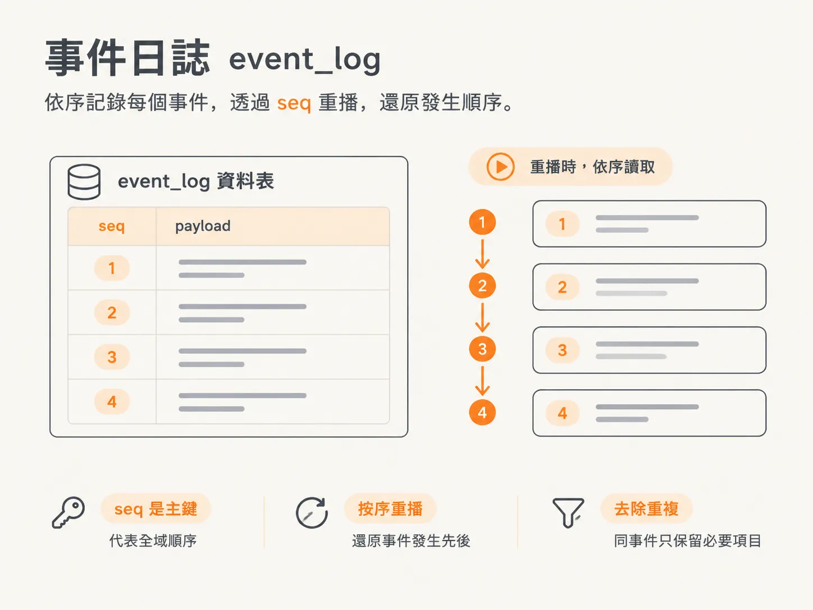
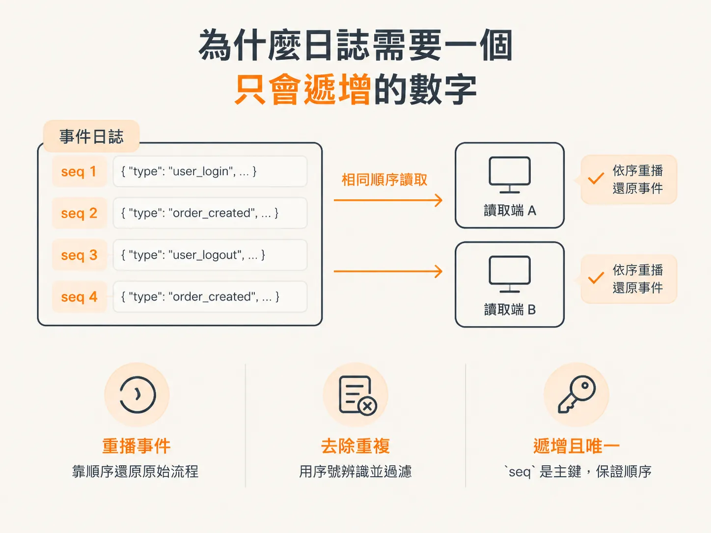
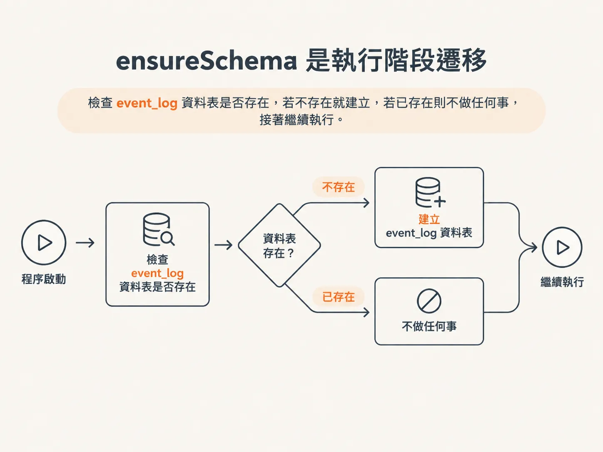
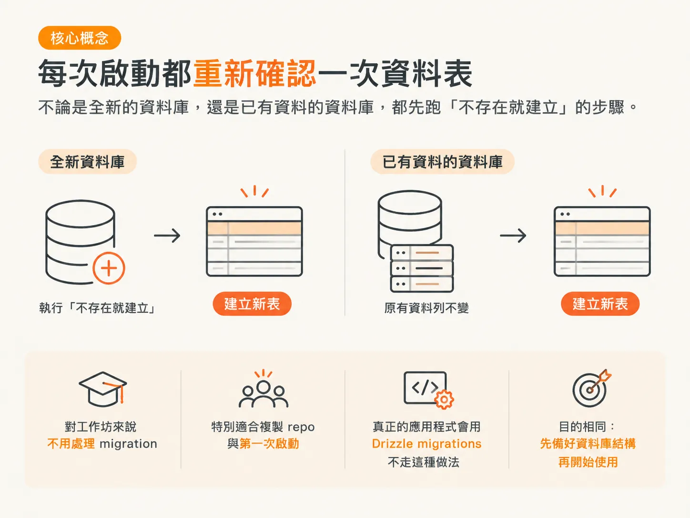

# event_log：用 seq 定序的事件日誌

上一步讓 runtime 能跳過已經完成的工作，但還有一個問題：事件目前只是路過記憶體，就被送往用戶端。這張表要處理的就是這件事，而整個檔案短到一次就能讀完。

## 一個檔案，三項工作

`harness/db.ts` 做三件事：建立資料庫連線、定義資料表，還有確保程式啟動時資料表已經存在。

<!-- source: sources/agent-harness2/20261029/harness-engineering/harness/db.ts#L1-L39 -->
```ts
import { drizzle } from "drizzle-orm/postgres-js";
import postgres from "postgres";
import { pgTable, bigserial, jsonb } from "drizzle-orm/pg-core";
import type { AgentEvent } from "@shared/events";

const connectionString = process.env.DATABASE_URL;
if (!connectionString) {
  throw new Error("DATABASE_URL is not set — copy .dev.vars.example to .dev.vars.");
}

// postgres.js connection (Neon requires SSL, carried in the URL). We keep the
// pool small — this is the durable event log, not a high-traffic app DB.
const client = postgres(connectionString, { max: 5 });
export const db = drizzle(client);

// The DURABLE event log. In Lesson 1 the event stream lived in a memory array
// that vanished on restart. Now every event is a row here, so the inspector can
// replay the whole timeline — including work that happened before a crash.
export const eventLog = pgTable("event_log", {
  seq: bigserial("seq", { mode: "number" }).primaryKey(), // global order
  data: jsonb("data").$type<AgentEvent>().notNull(),
});

// Create the table on boot. Keeps the workshop migration-free; in a real app
// you'd use Drizzle migrations instead.
export async function ensureSchema(): Promise<void> {
  await client`
    CREATE TABLE IF NOT EXISTS event_log (
      seq  bigserial PRIMARY KEY,
      data jsonb NOT NULL
    )
  `;
}

// Wipe the durable log (the "Clear" button in the inspector). Wired up in the
// memory lesson.
export async function clearEventLog(): Promise<void> {
  await client`TRUNCATE event_log`;
}
```

## 先看資料庫連線

`process.env.DATABASE_URL` 是 Node 讀取環境變數的方式。這裡的值，就是你上一步放進 `.dev.vars` 的那組連線網址。

接著是一個基本檢查：沒有 `DATABASE_URL` 就直接拋錯，講清楚缺了什麼，不要繼續往下走。程式一啟動就明確失敗，總比第一次查資料時才冒出讓人摸不著頭緒的錯誤好。



`postgres(connectionString, { max: 5 })` 會建立資料庫連線，`drizzle(client)` 則把它包起來，讓你能用 TypeScript 操作資料表。連線池刻意設得很小，因為這是事件日誌，不是需要承受大量流量的應用程式資料庫。

## 兩個欄位

資料表叫 `event_log`，只有兩個欄位，各有各的工作。

**`seq`** 管排序。它是 `bigserial`，會自動遞增，同時也是主鍵。理由很單純：重播事件要照原本的順序；遇到重複的事件，也靠它去掉。尾端日誌只有在你分得出哪一行先出現的時候才有用。



**`data`** 是事件內容，使用 `jsonb` 儲存。Postgres 支援 JSON，因此你可以把一般的 JSON 物件放進欄位裡，概念上有點像文件型資料庫。這就是事件本身。

`$type<AgentEvent>()` 這段程式很容易被誤解。它不會改變資料庫裡的任何東西，只是告訴編輯器：你在程式裡操作 `.data` 時，該把它當成什麼資料結構。對 Postgres 來說，這仍然只是一般的 JSON 物件，完全不知道 `AgentEvent` 的存在。



不過，`notNull()` 是真的寫進資料庫的限制。事件不能是空的，資料庫層級就會擋掉沒有內容的寫入。

## 啟動時建立資料表

用 `pgTable` 描述資料表，只是把資料表告訴 TypeScript，並不會真的建立資料表。

建立資料表是 `ensureSchema` 的工作。它用 tagged template 直接跑原始 SQL：`CREATE TABLE IF NOT EXISTS event_log`。表不存在就建，已經存在就什麼都不做。

Scott Moss 稱這是一個小型的 runtime migration。工作坊因此不用處理 migration，這在大家複製 repo、第一次啟動的時候特別重要。他是在做課程時踩到錯誤，才補上這段。真正的應用程式會用 Drizzle migrations，不走這種做法，但目的相同：任何程式開始用資料表之前，資料庫結構都得先備好。



另外還有 `clearEventLog`，把整張表清空。Inspector 的 Clear 按鈕之後會接上它。先放在這裡，是因為事件日誌不只要記得住，也要清得掉，才能重新開一條乾淨的時間線。

## 這些內容和代理程式無關

有件事值得講清楚：上面每一行，換成任何需要資料庫的應用程式都寫得出來。資料表、欄位、型別，還有重複執行也不會出錯的建表流程，沒有一行知道代理程式是什麼。

這也是它該放在 `harness/db.ts` 的原因：harness 裡負責持久化的部分，就是一層普通的基礎設施。代理程式專屬的決定要等下一步才會出現，也就是什麼時候寫一筆資料，事件又該照什麼順序寫。

## 事件匯流排仍然在記憶體裡

表已經在了，但目前還沒有任何程式把事件寫進去。事件匯流排（bus）還是伺服器裡那個記憶體版本。

下一步會把它搬進 harness，順便調換順序：先寫事件，再通知監聽器。順序一翻過來，重新連線的用戶端就能從某個 `seq` 讀日誌，接著從斷掉的地方繼續。
