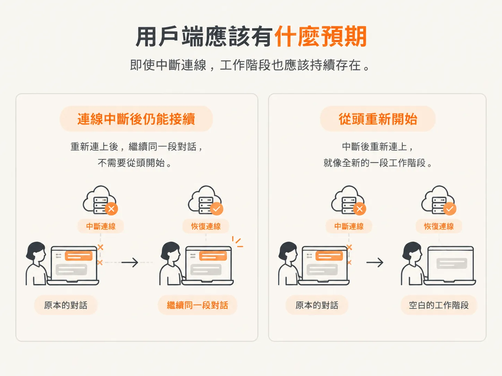
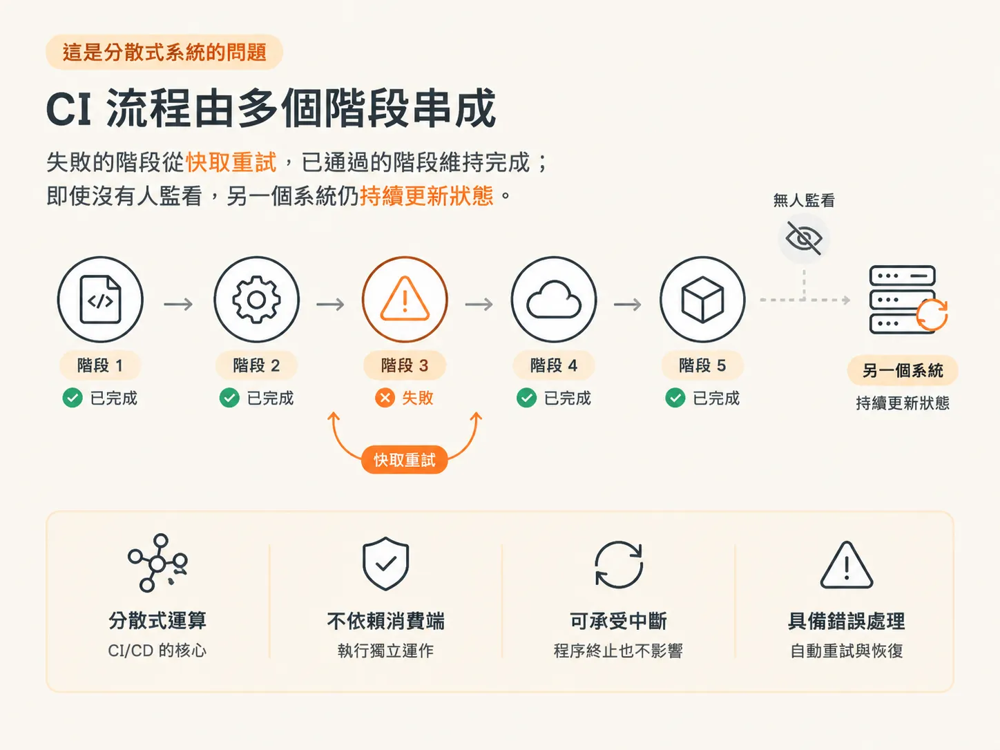
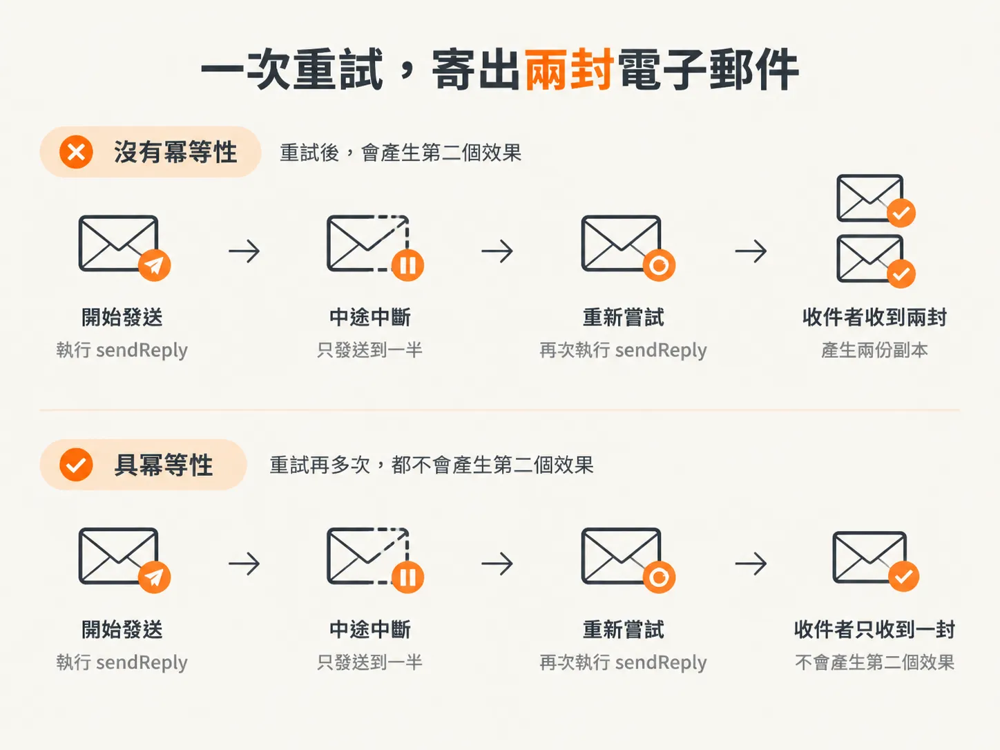
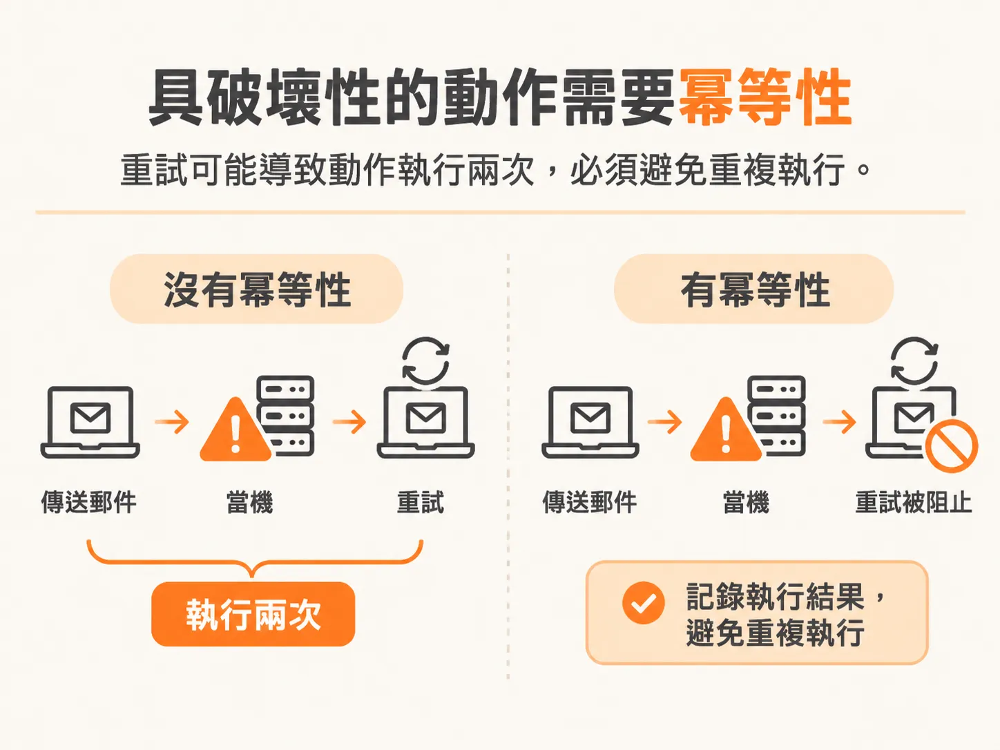

# 重啟之後，完全不知道發生什麼

你已經完成三次工具呼叫，其中一封電子郵件也寄出去了。模型正思考下一步該做什麼。

接著，程序突然中止。你重新啟動它。

你問代理程式剛才在做什麼，它卻答不出來。它不會說：「我剛好做到第二步和第三步之間。」它什麼都說不出來，因為已經沒有任何東西可以讀了。

這不是模型本身的問題，而是少了一層機制。

## 工作階段不該取決於誰正在看

想像一下，你正在和 ChatGPT 對話，結果它思考到一半時 Wi-Fi 斷線了。重新連線後，你會希望回到原本的工作階段，繼續剛才的對話。

反過來也是一樣：如果伺服器故障後重新啟動，你仍然會期待原本的工作階段還在。

Scott Moss 把這整套機制稱為**持久化執行（durable execution）**：我們在執行某件事，而這次執行必須能存下來、撐過故障，出錯之後還能恢復。

能恢復，是因為執行過程中有東西被寫了下來。他稱這個做法為**檢查點（checkpointing）**。檢查點留下足夠的資訊，讓新的程序知道自己做到哪裡，接著往下執行，而不是從頭開始。

定義要抓準：檢查點不是整台機器的完整紀錄，只保留那些值得回頭的執行節點，以及已經產生的結果。

## CI/CD 就是你已經在使用的例子

如果你覺得分散式運算太抽象，不妨看看 CI/CD。你推送一個 commit，檢查工作會在別的程序、別的系統上執行，最後再把結果回報給 GitHub。

CI 流程通常會分成多個階段，而這些階段可以重試、重新播放，有些還能使用快取。當其中一個階段失敗時，你只需要重試那個階段，不必把其他階段全部重做。

而且不管你頁面有沒有開著，流程都會持續把目前狀態更新到 GitHub。如果 CI 系統故障，設計良好的系統也該能恢復，從中斷的地方繼續跑。

代理程式也得達到同樣的標準：執行過程不能綁在某個使用者、某個用戶端，或某個正在看的人身上，而且要撐得住程序中斷和錯誤。

## 做兩次，可能比一次都沒做更糟

來看一個更棘手的情境。你正在執行 `sendReply`，途中出了問題，接著開始猜：那封回覆到底寄出去了嗎？你不確定，所以又試了一次——結果它真的又寄出一封。

銀行轉帳也是同樣的情況。轉帳過程中斷了，你重新操作一次，結果這筆錢又被轉了一次。

所以動作需要具備**冪等性（idempotency）**：重試再多次，也不能產生第二次效果。周圍的工作重播幾次都一樣，這個動作只能真的發生一次。

有些動作一旦執行，就再也收不回來。你不可能在對方打開電子郵件之前，進入他的收件匣把信撤回。這類動作具有破壞性，因此必須做到**恰好執行一次（exactly once）**。

## 我們的代理程式現在到底壞在哪裡

目前每則訊息都只存在記憶體裡。我們只是把事件串流傳送給用戶端，背後沒有任何持久化層。如果事件在傳送途中出了問題，你不會知道，也補不回來。它沒有晚點才出現這回事，就是消失了。

因此，代理程式重新啟動後，完全不知道剛才發生了什麼。這不只是忘了細節：它根本沒有任何紀錄可以重新播放。這段對話只在程序還活著的時候存在。

兩種症狀，其實是同一個原因：

- 用戶端斷線或重新整理頁面，這段期間傳送出去的所有事件都遺失了。
- 伺服器重新啟動，連訊息清單本身也消失了。

解法是加一層儲存。把事件寫到某個地方，之後才能重新播放，從中斷的地方接著做。故障發生的時候，紀錄還在。

## 接下來要做什麼

「加一個資料庫」並不是真正的決定。真正要決定的是：哪些工作要包成可以重播的單位、重播時直接跳過？哪些工作得留在這個單位之外？

這就是下一個問題。我們會加上以 Postgres 為後端的持久化儲存；但在寫入第一筆資料之前，得先把執行環境拆成一個個能自己帶著輸入與輸出的步驟。
