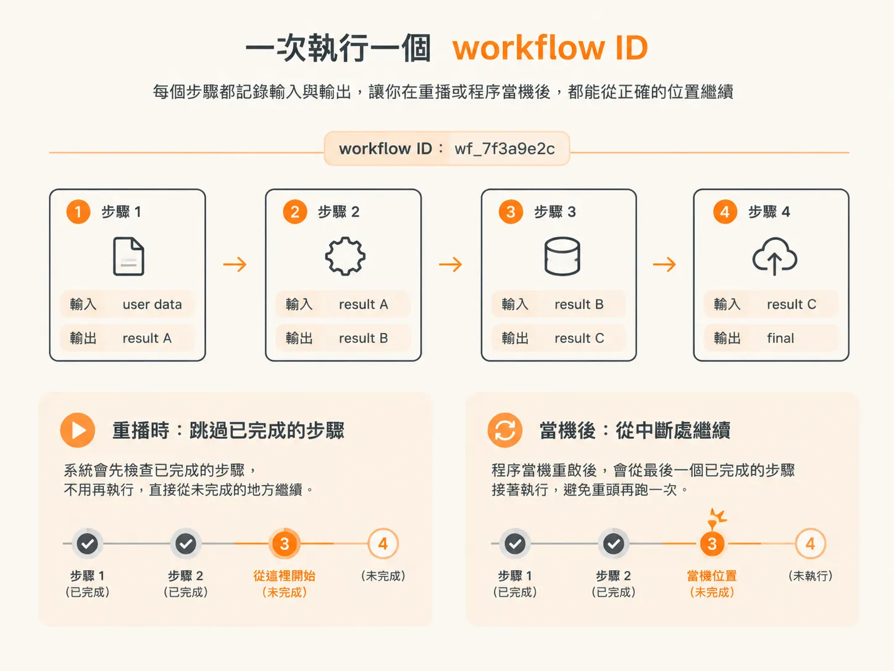
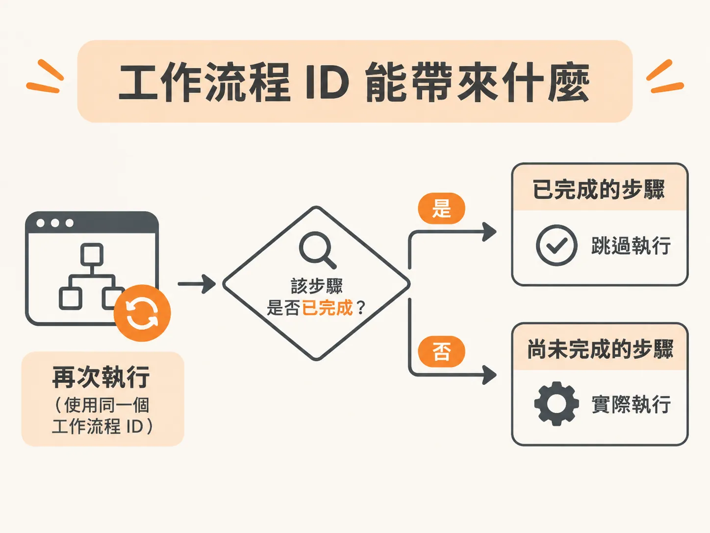
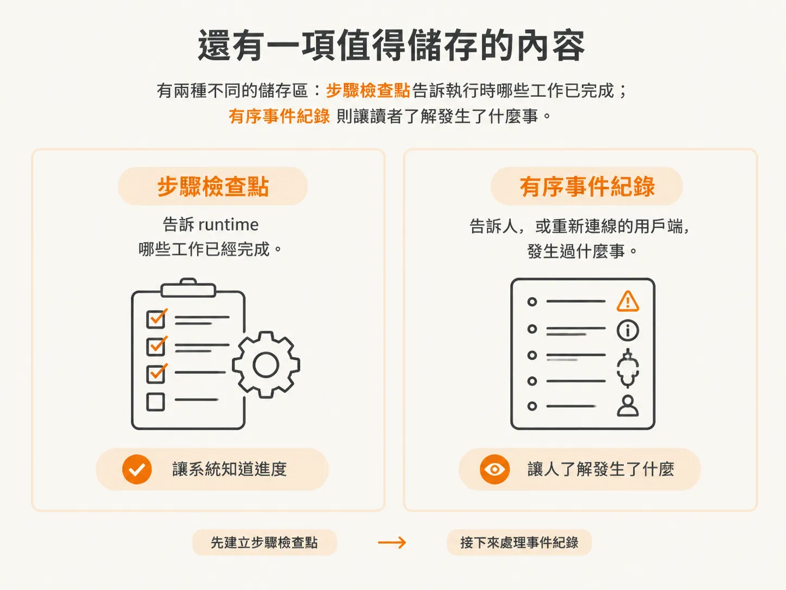
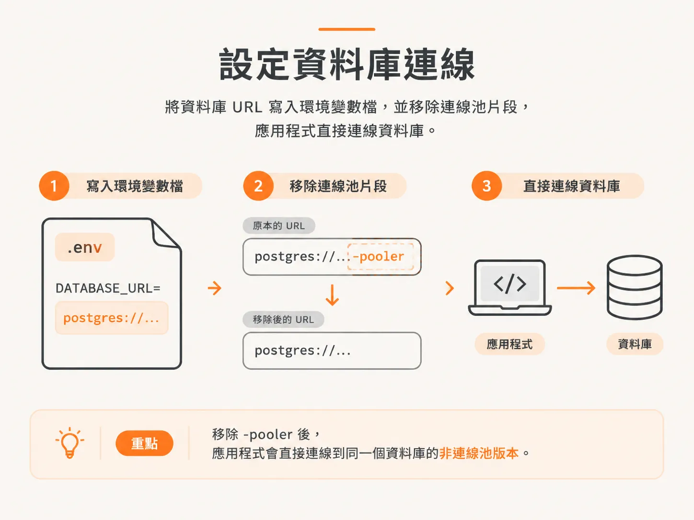

# 把 runtime 變成 step

上一個步驟停在一個決定上，還沒開始動手：資料還沒寫進任何資料表，你得先決定哪些工作要包成可以重播的單位，重播時才有辦法略過已經完成的部分。

DBOS 已經替我們回答了這個問題：它包裝的單位就叫 **step（步驟）**。

## DBOS 實際上做了什麼？

DBOS 以 Postgres 為底，建立能持久化執行的工作流程。這句話資訊量不小，值得拆開看。

你建立的每個工作流程都由一組步驟組成。DBOS 會記下每個步驟的輸入與輸出。需要重播時，工作流程先看已經完成的部分，不用全部再做一次；程序當機重啟後，也能從中斷的地方接著跑。

這正好接回上一個步驟的問題：郵件不會再寄一次，因為負責寄信的步驟已經留下輸出紀錄，不用重跑。

## 它是資料庫，不是服務

這個領域有不少產品：Cloudflare 有一套，Inngest 是另一套，還有 Upstash Workflows、Vercel Workflows，以及規模可能最大的 Temporal。它們都提供持久化執行，核心概念大致相同。

差別在狀態放在哪裡。這些產品多半是要付費使用的服務，或是得另外部署、獨立執行的工具。DBOS 把資料庫當成骨幹。Scott Moss 選它，是因為幾乎不用大改現有程式碼，而且用資料庫通常比架服務或 Docker 容器簡單得多。

這個選擇有個很實際的好處：出事時你可以直接打開資料庫看資料列。你和系統狀態之間，沒有供應商的管理介面擋著。

## 把 runtime 拆成一個個步驟

真正的改動是：把目前的 runtime 拆成一個個步驟，把它們的輸入與輸出記錄進資料庫。

之後出錯重試時，不會從頭來。系統先看各步驟的結果，問一個很便宜的問題：這個 workflow ID 之前是不是已經做過這件事？答案是肯定的，就直接跳過。

**workflow ID** 是串起整次執行的識別碼，步驟則是其中一個個檢查點。這就是上一個步驟講的檢查點，只是現在有了實際存放的位置，也有可以拿來查的鍵值。

但有一件事 DBOS 不會替你處理：這些步驟得具備冪等性。同一個步驟再跑一次，結果也要一樣。這是分散式運算的通用習慣，不是 DBOS 的特有功能。runtime 可以跳過已經記錄過的步驟，卻救不了一個每次呼叫都會執行不可逆操作的步驟。

## 兩種資料會寫入 Postgres

這個方案有兩個部分，而且很容易混在一起。

第一個是工作流程狀態：哪些步驟跑過、用了什麼輸入、產生了什麼輸出。這部分 DBOS 自己寫。

第二個是事件日誌：我們觸發的每個事件都記下來，當成系統實際做過什麼的歷史。它一樣放在 Postgres，用 Drizzle 當 ORM。Drizzle 是和資料庫溝通的 SDK，這裡不深入介紹。

分開是有理由的：一個告訴你哪些工作已經完成；另一個按照發生順序，記下代理程式說了什麼、做了什麼。

## 連接 Postgres

你需要一個 Postgres 資料庫。本來就在用本機資料庫的話，直接用它。沒有的話，`neon.new` 可以在瀏覽器裡給你一組連線網址，不用建帳號，資料庫免費使用 72 小時。

把這組網址放進 `.dev.vars` 或 `.env`，變數名稱設為 `DATABASE_URL`。

有個細節漏掉，可能要多花一小時排錯：網址裡如果有 `-pooler`，把它拿掉。那段代表資料庫連線池，本機跑 DBOS 時，連線池會讓設定變複雜。刪掉之後，走的是非 pooling 的連線。

接著裝 DBOS SDK、Drizzle 和 Postgres，然後建立 `harness/db.ts`。檔案裡從 `drizzle-orm/postgres-js` 匯入 Drizzle，從 `postgres` 套件匯入 `postgres`，沒什麼複雜的。檔案很小，但它是 harness 的一部分，該進專案儲存庫，不該隨手丟在暫存腳本裡。

## 還缺少什麼？

現在 runtime 已經會跳過先前完成的工作，但事件在送往用戶端的路上，還是只暫存在記憶體裡。

下一個步驟要建立存事件的資料表：`event_log`，裡面有排序欄位和 JSON 內容，啟動時會檢查資料表在不在，不在就建一張。
