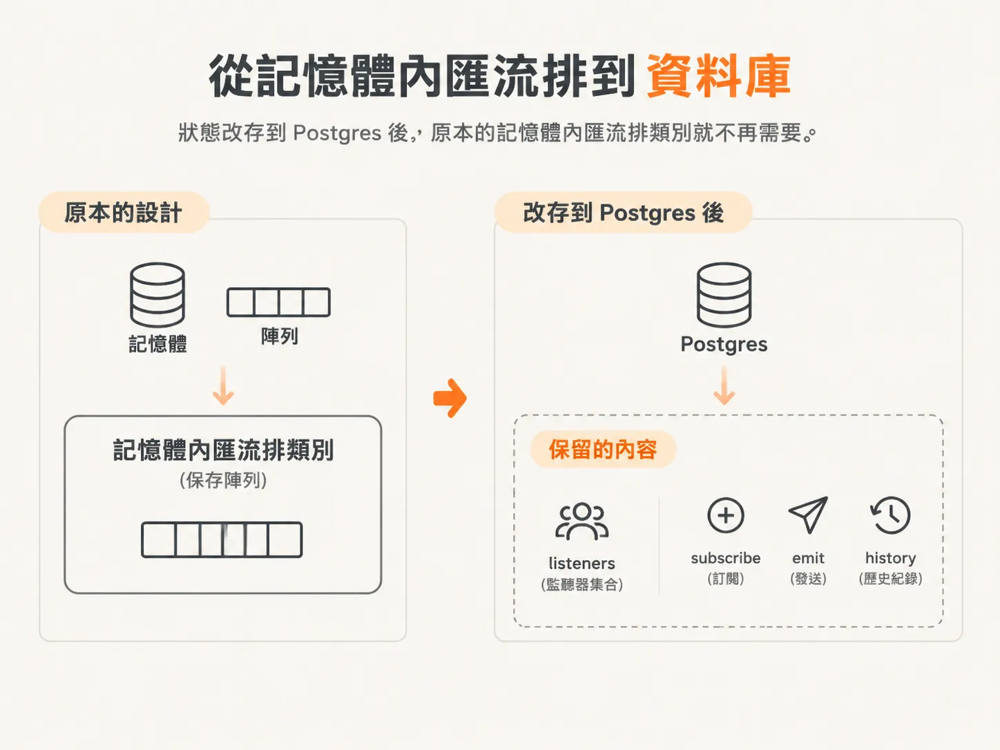
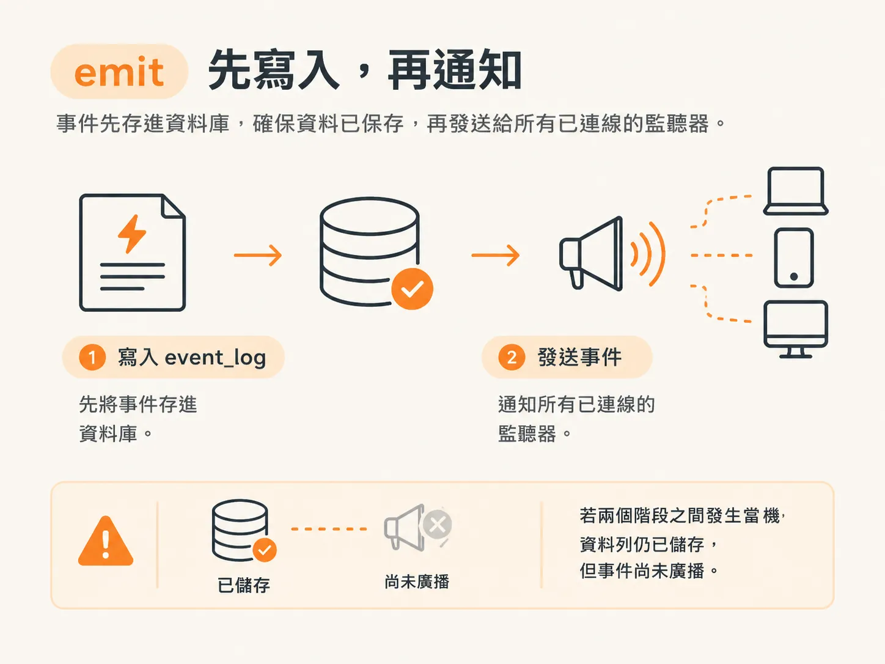
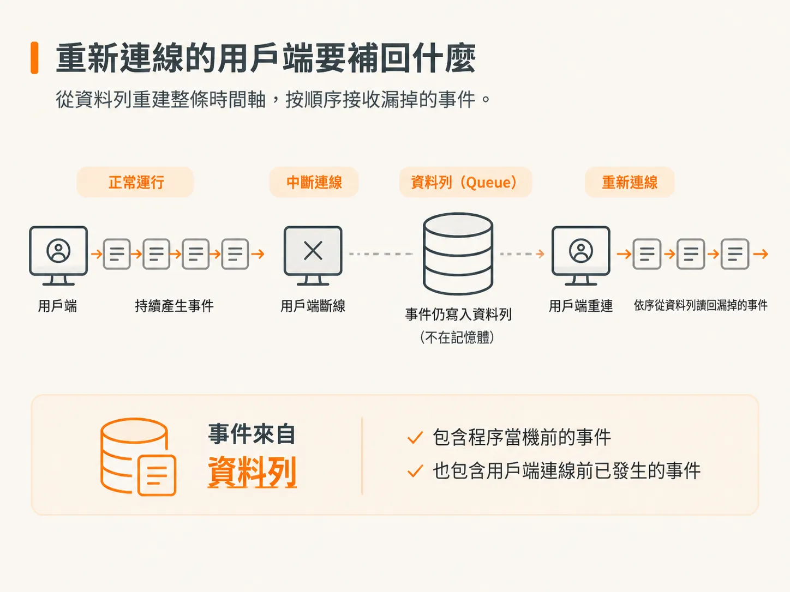
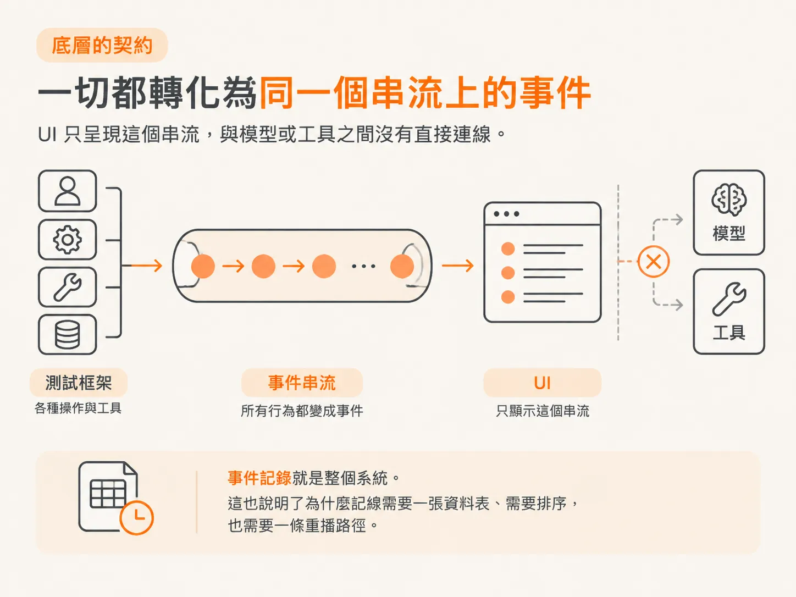

# 先落地，再廣播

上一步建立的資料表已經存在，但伺服器裡仍然有一個以記憶體保存資料的事件匯流排。這一步要把兩者接在一起，而整個修改只需要動一個小檔案。



## 搬出去，再縮小

先動手把 `bus.ts` 從 `server/` 搬到 `harness/`，再修好伺服器進入點的匯入路徑。事件匯流排現在歸 harness：harness 負責執行，這個檔案負責讓執行結果被看見。

接著把原本的 class 刪掉。它本來存在，是因為資料放在記憶體裡；現在資料不靠記憶體保存，也就不需要它了。最後只剩三個函式：`subscribe`、`emit`、`history`。

## 檔案內容

<!-- source: sources/agent-harness2/20261029/harness-engineering/harness/bus.ts#L1-L29 -->
```ts
import { randomUUID } from "node:crypto";
import { db, eventLog } from "./db";
import type { AgentEvent, EventInput } from "@shared/events";

// The harness event bus. Two jobs now:
//   1. DURABLY persist every event to Postgres (so the timeline survives a crash)
//   2. broadcast it live to any connected inspector
//
// `emit` is async now — we write to the database before we hand the event out.

type Listener = (event: AgentEvent) => void;
const listeners = new Set<Listener>();

export function subscribe(listener: Listener): () => void {
  listeners.add(listener);
  return () => listeners.delete(listener);
}

export async function emit(input: EventInput): Promise<void> {
  const event: AgentEvent = { ...input, id: randomUUID(), ts: Date.now() };
  await db.insert(eventLog).values({ data: event }); // durable, ordered by `seq`
  for (const listener of listeners) listener(event); // live
}

// The full timeline so far, in order — read back from Postgres on every connect.
export async function history(): Promise<AgentEvent[]> {
  const rows = await db.select().from(eventLog).orderBy(eventLog.seq);
  return rows.map((row) => row.data);
}
```

## subscribe：監聽器集合，不是物件上的陣列

監聽器只是模組層級的一個集合。每個監聽器都代表一個已連線的用戶端。如果你寫過 WebSocket 伺服器，就知道這件事有多麻煩。

`subscribe` 會把監聽器加入集合，並回傳一個可以移除它的函式。這個回傳函式就是清理機制：訂閱的一方可以在用戶端離線時呼叫它。

沒有這個函式，集合就會一直留著已失效監聽器的參照，最後變成記憶體洩漏。可以把它想成 `useEffect` 回傳的清理函式；差別是這裡的清理不是善後，而是讓集合縮小的唯一方法。

## emit：先寫入，再廣播

現在的 `emit` 是 `async`，因為它在回傳之前，真的得先做完一些事。

函式先組出事件。呼叫端傳進 `EventInput`，事件匯流排再用 `randomUUID()` 補上 `id`、用 `Date.now()` 補上 `ts`。每個事件的編號和時間都由 harness 統一產生，不是由觸發事件的程式自己決定。

接著，執行順序就很重要：

1. `await db.insert(eventLog).values({ data: event })`，先把事件寫入 Postgres。
2. 逐一走訪監聽器並呼叫它們，再把事件即時送出去。

`await` 就卡在這兩步之間。資料寫完了，事件已經安全躺在資料庫裡，這時候才適合交給用戶端。

如果程序在寫入完成、廣播還沒開始的時候中斷，事件也已經存好了。用戶端重新連線後，用 `history` 就讀得到，不會漏掉。



這就是一開始要修的毛病：事件在用戶端看見之前，就已經寫進資料庫，不會只停在記憶體裡，連一瞬間都沒有。

## history：重播事件

`history` 讀出 `event_log` 的全部資料列，照 `seq` 排序，再從每一列取出 `data`。`seq` 只拿來排序，最後不會出現在回傳結果裡。呼叫端拿到的就是一串照發生順序排好的事件。

重新接續工作的時候，呼叫的就是這個函式。整條時間軸都能從資料列重建，包括程序當機前發生的事，也包括這個用戶端連線之前就已經發生的事。



## 讓這一切成立的契約

這套設計只有在事件串流什麼都描述得到的時候才有意義。契約定義在 `shared/events.ts`。

<!-- source: sources/agent-harness2/20261029/harness-engineering/shared/events.ts#L59-L63 -->
```ts
// The harness stamps every event with an id + timestamp when it emits.
export type AgentEvent = EventInput & { id: string; ts: number };

// What harness code calls to push an event onto the stream.
export type Emit = (event: EventInput) => void;
```

`EventInput` 是聯集型別，包含 harness 能產生的所有事件，每種事件用 `EventType` 上的常數當識別。

你會寫 `EventType.ToolCompleted`，不是直接寫字串 `"tool.completed"`。這樣拼錯字編譯就會擋下來，編輯器自動完成也列得出目前有哪些事件。

檔案頂端的註解講了整體設計：harness 做的每件事都會變成串流上的事件；UI 不直接跟模型或工具講話，只負責把這條串流畫出來。

所以事件日誌得先有持久性。如果 UI 只是串流的投影，那串流就是整個系統。把串流放在陣列裡，等於做了一個程序收掉就消失的系統。



## 現在已經成立的事情

重開伺服器之後，時間軸還在，順序沒變，也讀得出來。用戶端重新連線，就能補回自己錯過的事件；因為它們是資料列，不是可能送到也可能掉的通知。

現在已經有兩層，各自回答不同的問題：

- DBOS 的工作流程狀態回答：「哪些工作已經完成，因此可以跳過？」
- `event_log` 回答：「發生了什麼事？順序又是什麼？」

第二個問題查資料表，第一個問題查工作流程的資料列。兩者都不需要程序一直活著。

但這兩層都判斷不了某個步驟能不能安全跑兩次。那還是我們的責任，也是 `sendReply` 必須包進會記錄執行結果的步驟、不能只丟在一個可能被重試的普通函式裡的原因。
