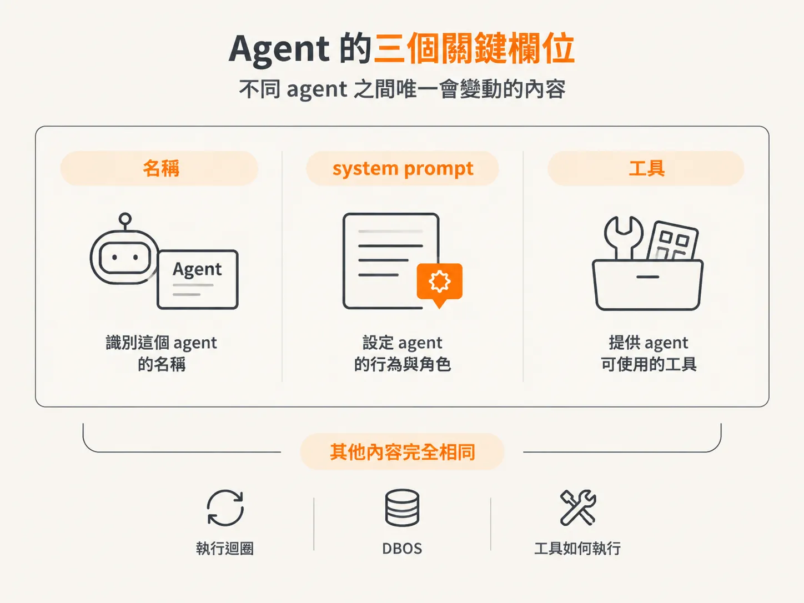
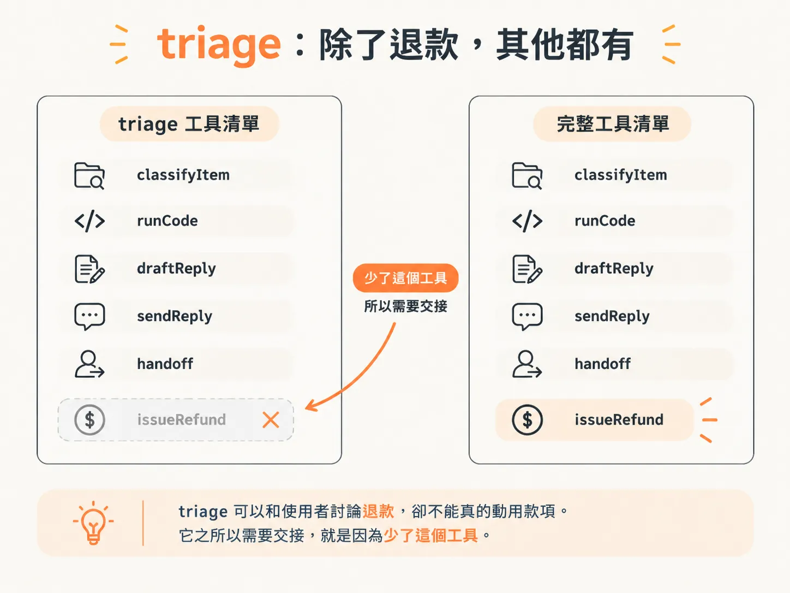
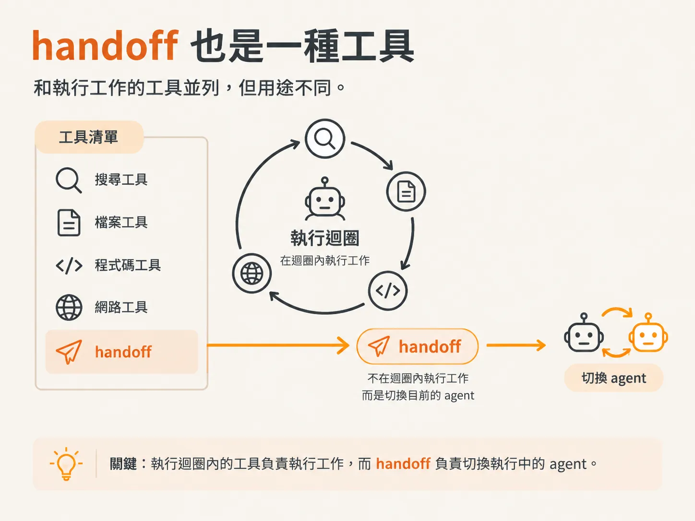

# Agent 只是 name、system prompt 和 tools

上一節留下了一個問題：如果 handoff 代表把控制權完整交給另一個 agent，那我們究竟能交接給什麼？答案比想像中簡單：Agent 只有三個資料欄位。

## 把迴圈變成基本元件

目前，執行迴圈只是一個函式。它執行一個回合、呼叫工具，然後重複這個流程。要讓多個 agent 一起運作，我們得先把這個執行迴圈抽象成 agent 定義，做成能重複建立的基本元件。

每個 agent 都跑相同的持久化迴圈，只是各自有自己的記憶、對話、工作流程和工具。彼此之間不共享任何東西。

## 只有三個欄位，沒有其他

這個型別定義在 `harness/agents.ts`。一個 agent 由名稱、system prompt 和一組工具組成。其他所有事情，包括執行迴圈、DBOS、工具如何執行，對每個 agent 都完全相同。



<!-- source: sources/agent-harness2/20261029/harness-engineering/harness/agents.ts#L4-L38 -->
```ts
// An agent is just a name, a system prompt, and the subset of tools it's allowed
// to use. The runtime runs ANY agent through the same durable loop — so adding a
// specialist is data, not new machinery.
export type Agent = {
  name: string;
  systemPrompt: string;
  tools: ToolSet;
};

// The generalist. Note what it does NOT have: issueRefund. It can talk about a
// refund, but it isn't allowed to move money — that's the whole reason it hands
// off.
export const triageAgent: Agent = {
  name: "triage",
  systemPrompt: `You are a support triage agent.

For each work item:
1. Classify it with classifyItem.
2. If it needs data lookup or math, use runCode (you have tools.getCharges and tools.searchKnowledgeBase inside it).
3. Draft a reply with draftReply, then send it with sendReply.

IMPORTANT: you are NOT allowed to issue refunds. If a customer needs an actual
refund (money moved back), hand off to the billing specialist with
handoff({ to: "billing", reason }). Do not draft or send anything yourself in
that case — let billing take over.

Handle the items, then briefly summarize what you did.`,
  tools: {
    classifyItem: tools.classifyItem,
    runCode: tools.runCode,
    draftReply: tools.draftReply,
    sendReply: tools.sendReply,
    handoff: tools.handoff,
  },
};
```

只有三個欄位會因 agent 而異。其他實作方式可能會讓不同 agent 使用不同的安全限制或執行邏輯；但在這個 harness 裡，runtime 只會因名稱、system prompt 和工具而不同。新增專家 agent，只要提供資料，不必打造新機制。

## Triage：除了錢，什麼都處理

triage agent 是通才。它的名稱是 `triage`，system prompt 指示它分類、使用 `runCode` 查詢資料，再草擬回覆並寄出去。

但它沒有 `issueRefund`。這正是重點：它可以和使用者討論退款，卻不能真的動用款項。它之所以需要交接，就是因為少了這個工具。



## Billing：只處理金錢相關工具

billing agent 是專家。它的名稱是 `billing`，system prompt 會提醒它，`issueRefund` 一旦執行就無法復原，而且會動用真實款項。

它的工具清單裡有 triage 沒有的 `issueRefund`。兩個 agent 都有 `runCode`、`draftReply` 和 `sendReply`，因為每個 agent 都應該能回覆使用者。權限差異只有一項：billing 有 `issueRefund`，triage 沒有。

<!-- source: sources/agent-harness2/20261029/harness-engineering/harness/agents.ts#L43-L65 -->
```ts
export const billingAgent: Agent = {
  name: "billing",
  systemPrompt: `You are the billing & refunds specialist. issueRefund is
IRREVERSIBLE and moves real money, so be careful — but it IS your job.

When a refund is needed, ALWAYS do all of this — never just describe it:
1. Use runCode (tools.getCharges) to verify the duplicate charge and the exact amount.
2. Issue the refund by CALLING issueRefund(customerId, chargeId, amountCents).
3. Draft and send a confirmation with draftReply + sendReply.

Then briefly summarize what you did. Do not stop after only acknowledging — act.`,
  tools: {
    runCode: tools.runCode,
    issueRefund: tools.issueRefund,
    draftReply: tools.draftReply,
    sendReply: tools.sendReply,
  },
};

export const agents: Record<string, Agent> = {
  triage: triageAgent,
  billing: billingAgent,
};
```

## handoff 也是一種工具

注意，triage 的工具清單裡有一個 `handoff` 項目。要不然 agent 要怎麼交接給另一個 agent？要讓 agent 擁有某種能力，就得提供相應的工具。因此，`handoff` 也是一種工具，和 `classifyItem`、`sendReply` 一起列在清單裡。

奇怪的地方就在這裡：一般工具會在執行迴圈裡執行工作，但 `handoff` 不會。它的作用是換掉目前正在執行的 agent。接下來的問題是：一個在執行迴圈內執行的工具，怎麼切換執行迴圈本身？


