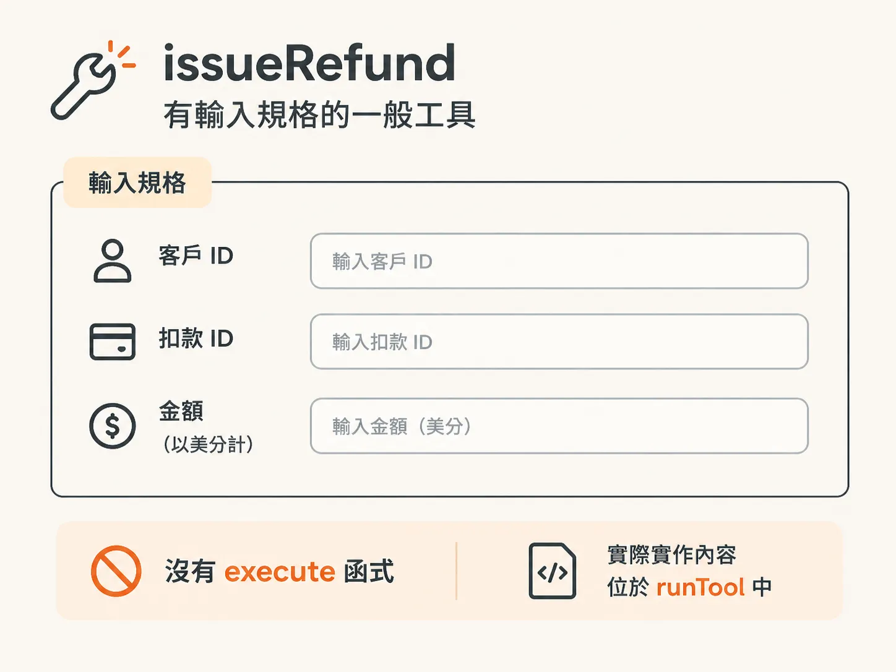
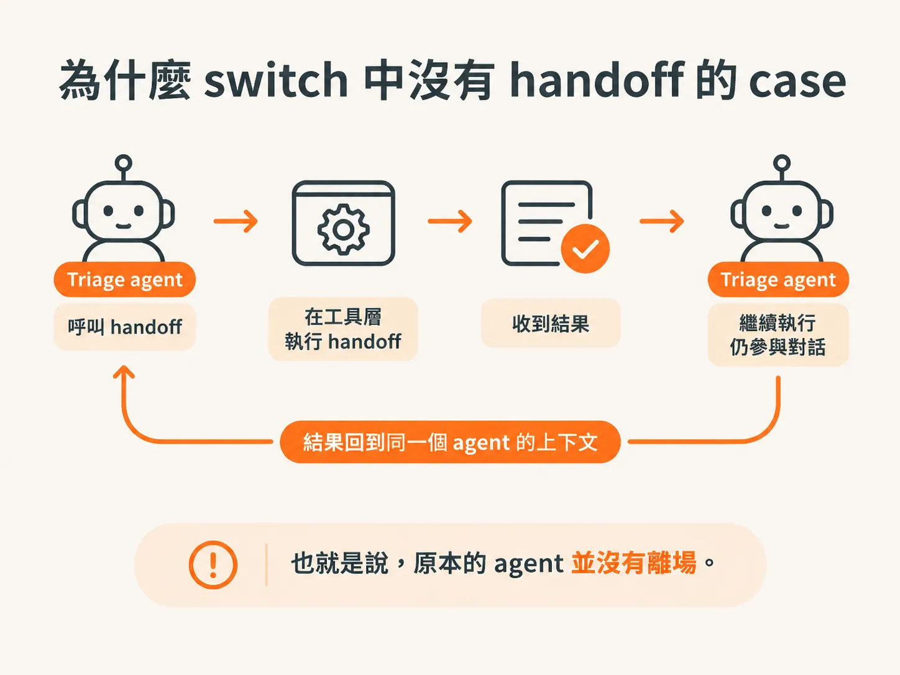
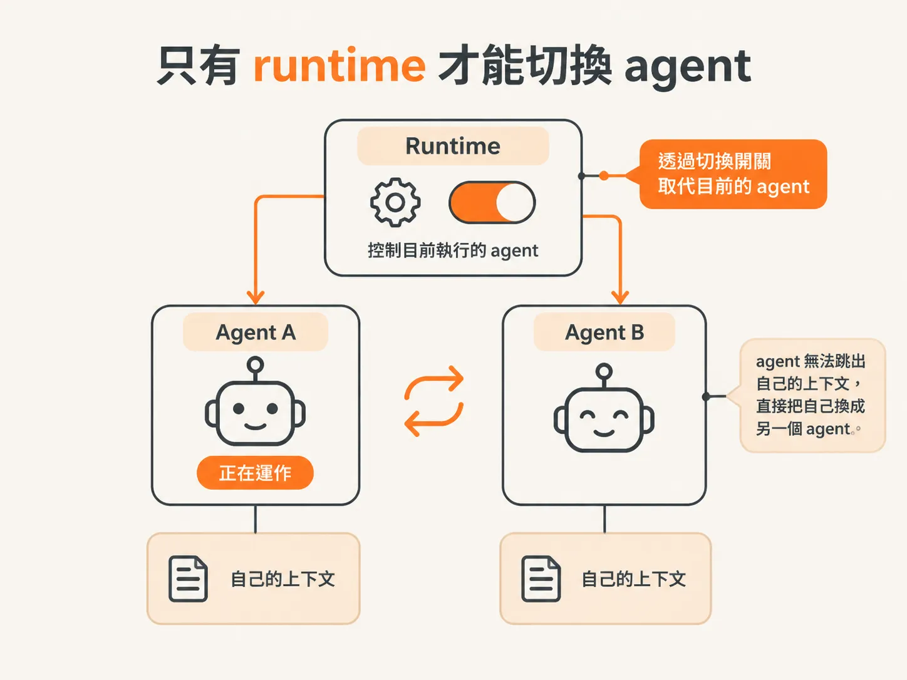

# handoff 是工具，但切換留在 runtime

上一段最後留下了一個疑問：`handoff` 明明在工具清單裡，但工具是在執行迴圈內運作的。工具怎麼可能把正在執行的 agent 換掉？答案是：它自己辦不到。先來看這兩個工具，再說明為什麼其中一個不會照一般方式執行。

## issueRefund：有輸入規格的一般工具

打開 `harness/tools.ts`。`issueRefund` 看起來和其他工具一樣，有描述和輸入規格。輸入規格包含三個欄位：客戶 ID、扣款 ID，以及以美分計算的金額。



這個工具沒有 `execute` 函式。前面已把工具本體移到 `runTool` 裡，讓每個工具都能在 workflow 步驟中執行。

<!-- source: sources/agent-harness2/20261029/harness-engineering/harness/tools.ts#L79-L87 -->
```ts
  // Privileged: only the billing specialist gets this. Moves real money.
  issueRefund: tool({
    description: "Issue a refund to the customer. IRREVERSIBLE — this moves real money.",
    inputSchema: z.object({
      customerId: z.string(),
      chargeId: z.string(),
      amountCents: z.number(),
    }),
  }),
```

描述裡兩次強調，這項操作無法復原，而且會動用真實款項。這是在提醒模型，不是實際的防護措施。真正的防護是：只有 billing 的工具清單裡有這項工具。

## handoff：只有輸入規格，沒有執行內容

`handoff` 的結構也一樣：有描述和輸入規格。輸入規格包含兩個欄位：`to`，也就是要交給哪個 agent；以及 `reason`，也就是交接原因。

<!-- source: sources/agent-harness2/20261029/harness-engineering/harness/tools.ts#L89-L95 -->
```ts
  // Hand the conversation to a specialist agent. The harness intercepts this —
  // it switches the running agent rather than executing a tool.
  handoff: tool({
    description:
      "Hand off the conversation to a specialist agent when the task needs a capability you don't have (e.g. issuing a refund → billing).",
    inputSchema: z.object({ to: z.enum(["billing"]), reason: z.string() }),
  }),
```

注意，`to` 目前是只有一個值的列舉：`billing`。之後新增 agent 時，也要把對應的值加進這個列舉。

## 為什麼 handoff 不在 switch 裡處理

`issueRefund` 在 `runTool` 裡有對應的處理分支，`handoff` 卻沒有。這是刻意的安排。

如果在工具層處理 handoff，結果只會回到 agent 的上下文裡。triage agent 呼叫 `handoff`、收到結果後，還是會繼續執行。也就是說，原本的 agent 並沒有離場。



這就不對了。handoff 的意思是：原本的 agent 結束工作並交出任務，不再從旁監督。因此，這個工具不能照一般方式執行，處理流程必須往上交給更高一層。

## 只有 runtime 能切換 agent

只有 runtime 能控制目前由哪個 agent 執行。agent 無法跳出自己的上下文，直接把自己換成另一個 agent；事情不是這樣運作的。



因此，我們要在 runtime 的某個位置檢查：這次工具呼叫是不是 `handoff`？如果是，就在那裡切換正在執行的 agent。切換是 harness 的邏輯，不是模型推理的結果。

Scott Moss 提到，核准流程也是同樣的模式。你不會讓 agent 自己決定某件事是否需要核准，因為它可能自己幻想出要不要呼叫核准工具。你會希望 harness 看到某個工具標示為「需要核准」時，就每次都以固定方式處理。

這裡的規則也一樣：模型選擇 `handoff`，但由 harness 執行切換。接下來要寫的，就是這段切換邏輯。
