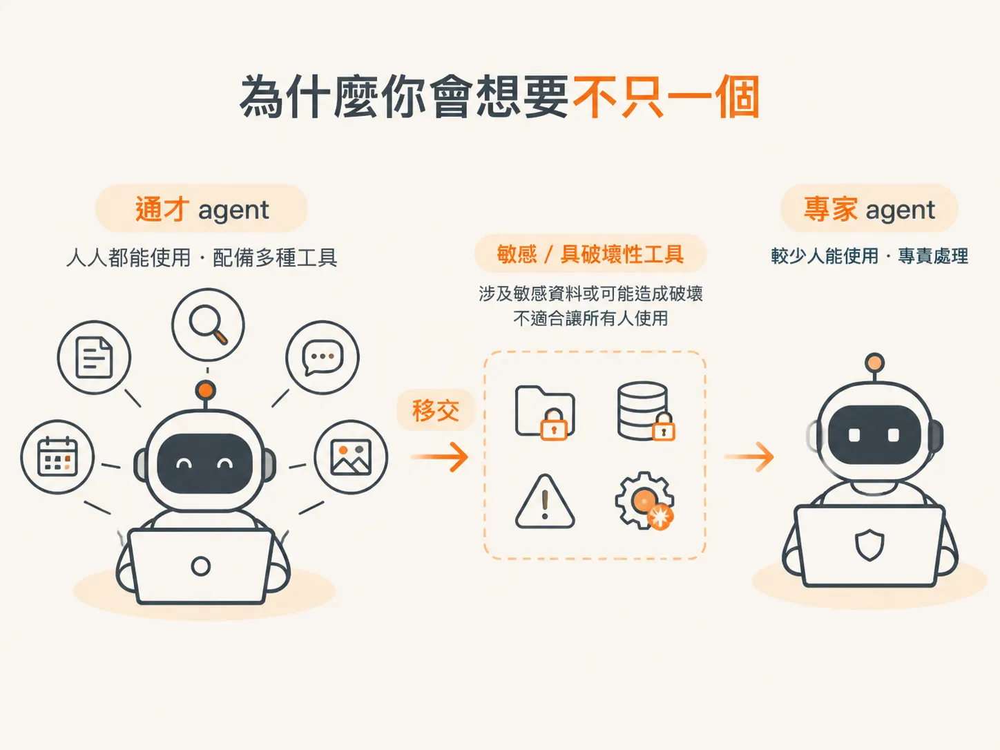
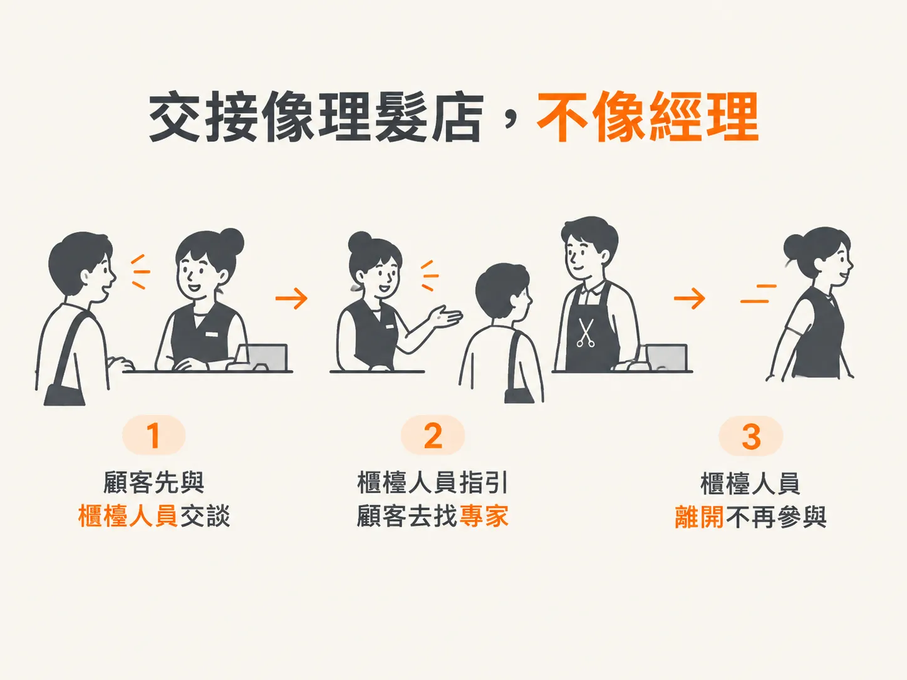
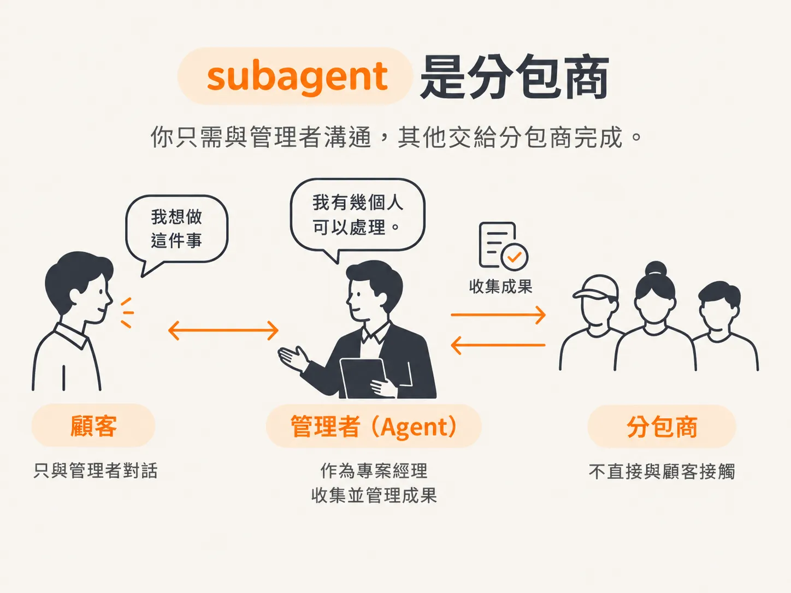

# Handoff 是交棒，不是叫 subcontractor

大多數系統一開始只有一個 agent：判斷收到的工作項目、草擬回覆，再把回覆送出去。Scott Moss 說得很直接：一個 agent 處理各種任務，通常就夠了。繼續使用單一 agent，並沒有做錯什麼。

## 為什麼需要不只一個 agent？

問題通常出在兩個地方。第一是工具太多。工具一增加，agent 就容易卡在該選哪一個。

第二是權限。有些工具涉及敏感資料或可能造成破壞，不適合讓公司裡每個人都能使用的 agent 持有。這類工具應該交給另一個 agent。

因此，拆分 agent 有實際理由：安全性、工具種類多到難以管理，或是團隊分工，例如一個團隊負責這個 agent，另一個團隊負責那個 agent。但沒有什麼硬性門檻，像是「工具超過二十個，就一定得拆成另一個 agent」。所有事情都交給一個 agent 處理，也完全行得通。

所以，路由和交接不是一開始就該急著使用的功能。這就像還沒有任何客戶，就先買最貴的 AWS 主機。除非真的遇到問題，否則沒必要這麼做。

## Agent swarm 並不是答案

你常聽到多 agent 系統，這個想法本身沒有問題。但它很容易一路變成 agent swarm：一群 agent 圍著同一個目標忙個不停。Scott Moss 說，這是實驗室喜歡宣傳的幻想，因為他們可以藉此收費。

實際上，很少有問題真的需要一大群 agent。除非你在做化學研究，或試著折疊一種新蛋白質，否則 swarm 大概不是你的解方。如果一個能力夠好的主要 LLM，加上完善的執行框架，都解決不了你的問題，那麼 swarm 也不會突然找到答案，只會讓你燒更多錢。

## Handoff 像理髮店，不像主管

那麼，handoff 到底是什麼意思？不是因為第一個 agent 不夠聰明，而是任務本身不同：需要不同權限、不同的安全限制，或由不同團隊負責。

想像你走進一家理髮店，沒有預約，只問現在有沒有人能幫你剪頭髮。櫃檯的人看了一下，說：「那位理髮師現在有空，可以幫你剪。」你一開始先和一個人說話，但眼下有更適合的人能接手，所以第一個人把你轉交給對方。

交接出去的人就此退出。他不再介入，也不會監督後續工作，任務也不會再回到他手上。這是控制權的完整移交。

## Subagent 是分包商

Subagent 則不一樣。這時主要 agent 扮演專案經理。你告訴經理想做什麼，經理說：「我有幾個人可以處理。」而你之後仍然只和經理溝通。

經理會找分包商來做事，再把成果彙整後回報給你。你始終只需要和同一個主要窗口聯絡，分包商則不會直接出現在你面前。

## 同一個 agent，可以扮演不同角色

這兩種做法沒有哪一種絕對比較好。同一個 agent 在某個流程裡可以是交接的對象，在另一個流程裡也可以是 subagent。差別只在控制權由誰掌握：是完整交出去，還是留在負責派工的主管手上。

這個差異會影響我們怎麼設計系統。如果 handoff 是把控制權完整交給另一個 agent，接下來就得先弄清楚：agent 到底是什麼，才能把控制權交給它。下一步，我們會把它整理成資料。
