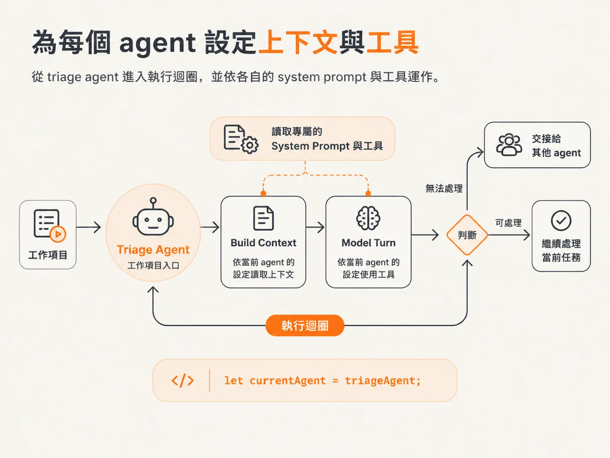
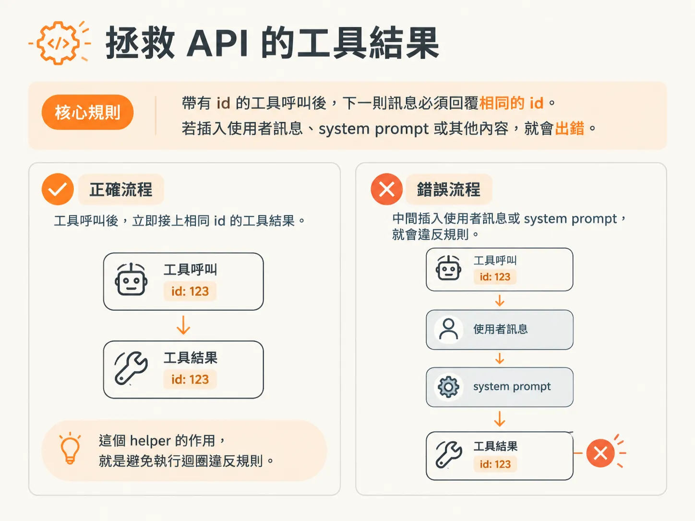
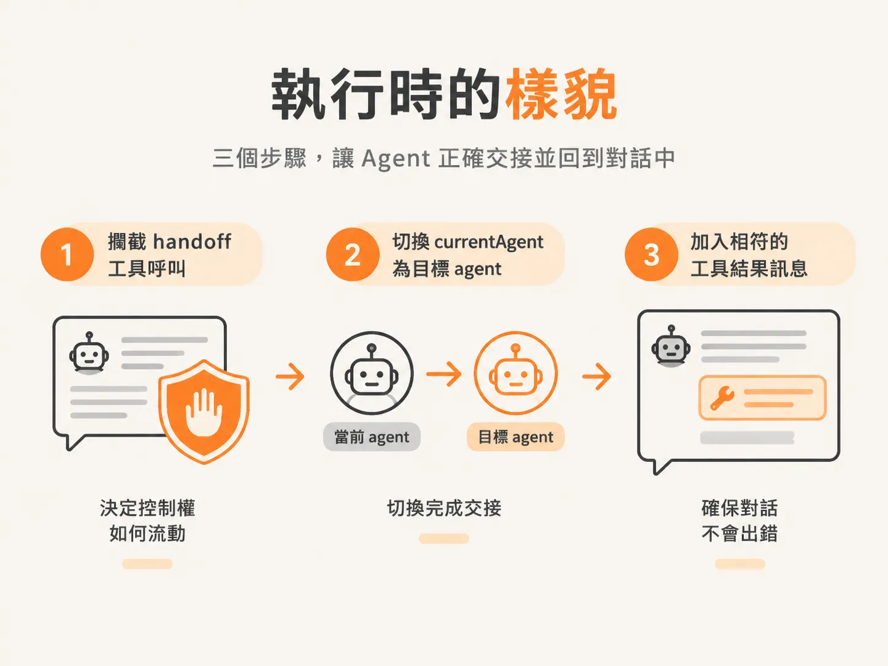

# 攔截 handoff、切換 agent、補 tool result

上一步提到，runtime 必須切換 agent。這一步會分成三個部分：攔截呼叫、切換目前執行的 agent，再補上一筆工具結果。少了最後一步，API 就會出錯。

## 讓每個 agent 都有自己的上下文和工具

切換 agent 之前，執行迴圈必須能執行目前的 agent，而不是寫死某一個 agent。現在 `buildContext` 的第一個參數是 system prompt，`modelTurn` 則會接收工具集合，讓每一輪都使用目前 agent 的工具。

<!-- source: sources/agent-harness2/20261029/harness-engineering/harness/runtime.ts#L28-L33 -->
```ts
async function modelTurn(
  workflowId: string,
  context: ModelMessage[],
  agentTools: ToolSet,
): Promise<Turn> {
  const result = streamText({ model, messages: context, tools: agentTools });
```

執行中的 agent 一開始是 triage。triage 是所有工作項目的入口：它會先處理能處理的事，遇到不允許處理的情況就交接給其他 agent。只要這一行：`let currentAgent = triageAgent;`。



每一輪都會載入目前 agent 的上下文，並讓它執行一輪。

<!-- source: sources/agent-harness2/20261029/harness-engineering/harness/runtime.ts#L129-L131 -->
```ts
    // 2 + 3. Hydrate the CURRENT agent's context and run one turn over it.
    const context = buildContext(currentAgent.systemPrompt, input, summary, turns);
    const turn = await DBOS.runStep(() => modelTurn(workflowId, context, currentAgent.tools), {
```

## 攔截呼叫並切換 agent

模型回傳結果後，執行迴圈會逐一檢查工具呼叫。如果呼叫名稱是 `handoff`，執行迴圈就會直接執行切換，而不是呼叫一般工具。

接著，它會讀取目標 agent `to` 和交接原因 `reason`，並把目前 agent 的名稱記錄為 `from`，再發出 `AgentHandoff` 事件，讓 UI 顯示 agent 已切換。最後，將 `currentAgent` 改成目標 agent；如果找不到目標，就繼續使用目前的 agent。

<!-- source: sources/agent-harness2/20261029/harness-engineering/harness/runtime.ts#L149-L165 -->
```ts
    for (const call of turn.toolCalls) {
      if (call.toolName === "handoff") {
        // The harness intercepts handoff: switch the running agent, don't run a tool.
        const to = String(call.input.to ?? "");
        const reason = String(call.input.reason ?? "");
        const from = currentAgent.name;
        await DBOS.runStep(
          () => emit({ type: EventType.AgentHandoff, workflowId, from, to, reason }),
          { name: `handoff-${call.toolCallId}` },
        );
        currentAgent = agents[to] ?? currentAgent;
        turnMessages.push(
          toolResultMessage(call, {
            ok: true,
            message: `You are now the ${to} specialist. Take over and FINISH the task by calling the tools you need — do the work, don't just acknowledge the handoff.`,
          }),
        );
```

## 不能少的工具結果

只切換 agent 還不夠。模型要求呼叫名為 `handoff` 的工具，因此訊息陣列也必須加入一則回覆，對應這次工具呼叫。

`toolResultMessage` 會建立這則回覆。它接收工具呼叫和一個值，並回傳一則 `role` 為 `tool` 的訊息，其中包含相同的 `toolCallId`、相同的 `toolName`，以及輸出內容。

<!-- source: sources/agent-harness2/20261029/harness-engineering/harness/runtime.ts#L72-L79 -->
```ts
function toolResultMessage(call: ToolCall, value: JSONValue): ModelMessage {
  return {
    role: "tool",
    content: [
      { type: "tool-result", toolCallId: call.toolCallId, toolName: call.toolName, output: { type: "json", value } },
    ],
  };
}
```

這項規則不能違反：如果 LLM 發出的工具呼叫帶有 ID，下一則訊息就必須回覆該 ID。若改送使用者訊息、system prompt，或其他內容，工具呼叫就會出錯。這個 helper 的作用，就是避免執行迴圈違反規則。



## 實際執行時會看到什麼

成功運作時，log 會顯示交接過程：從 triage 轉到 billing。事件中會附上交接原因：客戶的 pro plan 月租方案被重複扣款。接著由 billing 接手；它的工具清單中包含 `issueRefund`。

整個功能只有三個步驟：攔截 handoff 呼叫、切換 `currentAgent`，再加入相符的工具結果。攔截決定控制權如何流動，切換完成交接，而工具結果則確保對話不會因此出錯。



至此，handoff 的流程就完整了。handoff 不是 subagent，而是一次控制權的完整移交：它使用 agent 資料中的三個欄位，再由 runtime 攔截呼叫、替換目前執行的 agent。
