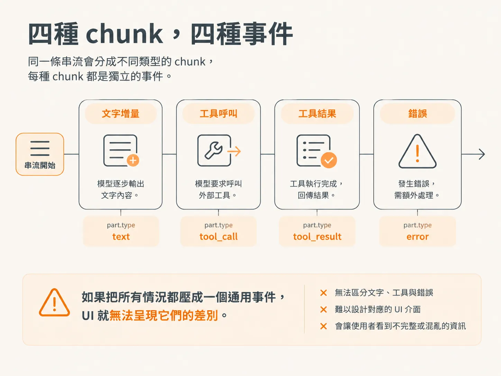
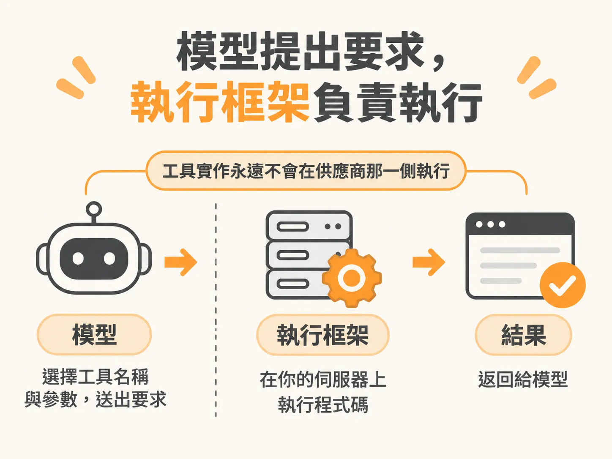
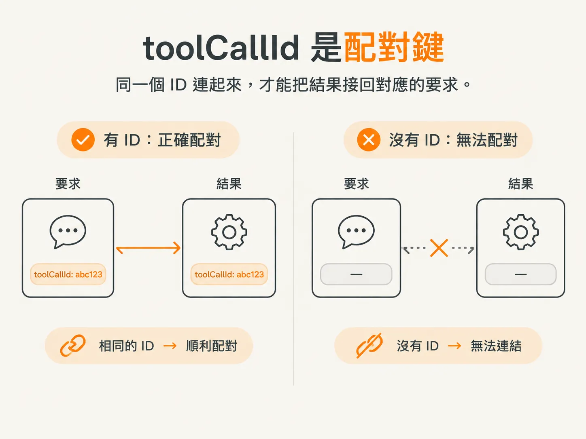
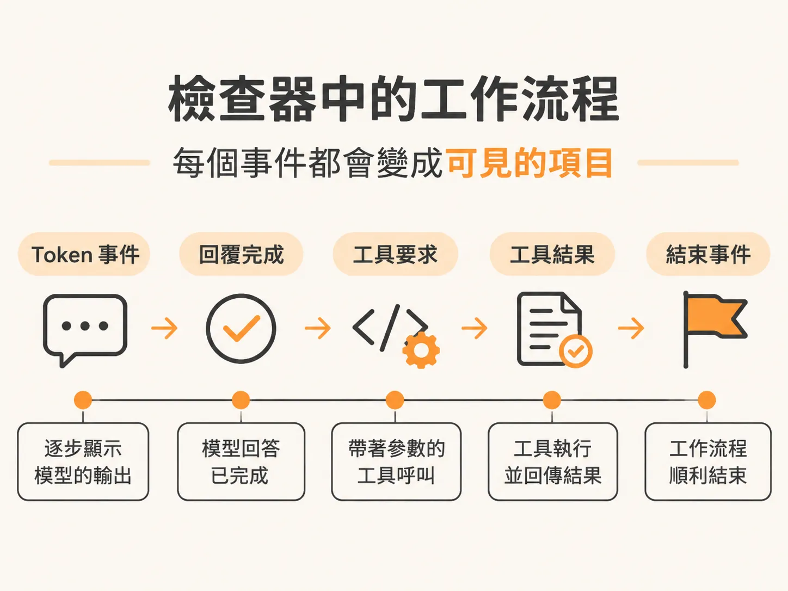

# 把串流的 chunk 變成事件

上一節留下一個缺口。

我們會呼叫 `streamText`，也會逐一讀 `result.fullStream`，但目前只處理文字這一種 chunk。串流裡其實有好幾種 chunk，每一種對畫面上的使用者都代表不同的事。

所以這一節的問題很單純：

**收到一個 chunk 時，執行框架該送出哪一種事件？**

## 一條串流，四種 chunk

串流可以迭代，所以 `for await` 會照資料抵達的順序，一個 chunk 一個 chunk 往下讀。

每個 chunk 都有自己的類型，類型記在 `part.type`，由模型供應商決定。OpenAI 相容的 API 開始串流時，不會憋到最後才一次送出全文，而是分批送 chunk。這些 chunk 並不是同一種東西。



這裡會處理四種 chunk：

- **文字增量（text delta）**：也就是模型正在產生的 token
- **工具呼叫（tool call）**：顧名思義，模型要求執行某個工具
- **結果（result）**：工具執行完畢後回傳的結果
- **錯誤（error）**：可能是觸發速率限制、我們的程式出錯，或模型供應商服務中斷

每種 chunk 都該有自己的事件，因為它們在 UI 上長得就不一樣。

工具呼叫要顯示成工具區塊，錯誤要顯示成錯誤訊息，文字增量則是一邊收一邊接到回答後面。

把所有 chunk 壓成一種「發生了某件事」的事件，UI 就沒東西可呈現了。

所以迴圈主體會改成看 `part.type` 的 `switch`。這是這一節的核心，下面只是把四種情況一個一個補上。

## 串流的重點不是串流，是讓使用者知道進度

開始看四種情況前，先繞一小段路。這件事現在弄懂，後面可以少卡很多次。

這裡的 `emit` 送出的是 WebSocket 訊息：模型產生的是 Node 風格的串流，我們把它轉送到 WebSocket 上。

這背後當然有一整層傳輸架構，但對這個執行框架來說不是重點。

你要讓前端定期去查事件資料表、改用第三方 WebSocket 服務，甚至整套換掉都行。真正重要的是：用指定的模型、訊息和工具呼叫 LLM，然後把還在跑的工作流程更新給所有關心它的人。

這些更新怎麼送，是系統架構的決定，不是執行框架的決定。別卡在這裡。

但也別因為串流看起來多一點工，就乾脆不做。

不做串流，這些程式碼真的都可以省：等模型生出最後回應，再一次丟進 UI。

但這樣的產品沒有人會付錢，也不會是你自己想使用的產品。

## 第一種情況：文字增量就是一個 token

最簡單的情況是 `text-delta`。

這代表有 token 到了，模型正在回答。為了讓前端用同一套方式處理串流，我們送一個模型增量事件，裡面帶工作流程 ID 和文字本身，也就是 `part.text`。

就這麼簡單。

每個 token 都會變成一個事件。之後打開檢查器，你會看到這些增量一個接一個進來，那正是使用者在畫面上看到的東西。

## 第二種情況：模型提出要求，你負責執行

工具呼叫是最需要講清楚的一種，因為幾乎所有人一開始都會把分工搞反。

先講清楚：執行函式的不是 LLM。

OpenAI 沒有把你的 `sendReply` 放在它的伺服器上等你呼叫。你的函式會執行，只因為你自己的伺服器執行了它；而伺服器會執行，是因為模型提出了要求。



這也是我們一開始要把 `tools` 傳給 `streamText` 的原因。

當模型回傳「請執行這個工具」時，工具定義裡必須有三項資訊：

1. **名稱**：模型才能指出要使用哪個工具
2. **描述**：模型會根據描述判斷是否該選用這個工具
3. **參數格式**：模型才知道要傳入哪些參數

接下來的工作就交給你。

你的程式要把這個要求接上真正的動作，再把結果交回給模型：

「你剛才要求我用這些參數執行那個工具，這是執行後的結果。」

模型負責決定；執行框架負責把事情真的做完。

有些供應商提供跑在他們伺服器上的工具，例如內建的網路搜尋；也有些工具是在使用者端執行。

這兩類先跳過，只談由我們自己執行的工具，因為只有這種才可能真的寄出電子郵件。

因此，這裡的事件名稱叫做 `tool_request`，而不是 `tool_call`。

命名是有講究的：模型是在**要求我們執行**某件事，不是它自己正在執行。

這個事件會帶上：

- 工作流程 ID
- `toolCallId`
- 工具名稱，讓 UI 顯示呼叫了哪個工具
- 參數，讓 UI 顯示工具收到哪些資料

最後那個欄位看起來可有可無，直到你真的要做人工批准畫面。

假設你把 `sendReply` 工具設計成必須經過人工批准才能寄出。如果批准提示只寫著：

「代理程式想寄出一封回覆，要核准嗎？」

使用者根本沒有辦法判斷。

要寄什麼內容？寄給誰？

你不能要別人批准一件他看不到內容的事。就像要人批准一筆轉帳，卻不告訴他金額。

所以參數要一起送出去，讓 UI 把即將執行的內容攤在要批准的人面前。

完全不送這個事件，UI 就不知道模型提過工具要求，工具區塊根本不會出現，輸入、結果、狀態全都沒得顯示。

## 第三種情況：結果必須帶上相同的 ID

收到結果 chunk 時，送出一個 `tool_completed` 事件。

事件裡要有工作流程 ID、chunk 帶的 `toolCallId`，還有當作結果的輸出。

`toolCallId` 是模型讀懂回覆的關鍵。

模型要求你執行工具時，會在自己那邊產生這個 ID。你得把它原封不動帶回來，模型才知道：

「這個工具結果，是屬於我剛才提出的哪一個要求。」

漏掉這個 ID，多數模型都會亂掉：它們只看到一個對不上任何要求的工具結果，不知道該怎麼辦。



做完之後，執行框架會把這些邏輯包在同一個函式裡：

<!-- source: sources/agent-harness2/20261029/harness-engineering/harness/runtime.ts#L53-L70 -->
```ts
// Execute one tool. Run as a DBOS step so its side effect runs exactly once.
async function toolStep(workflowId: string, call: ToolCall): Promise<Record<string, unknown>> {
  await emit({
    type: EventType.ToolRequested,
    workflowId,
    toolCallId: call.toolCallId,
    name: call.toolName,
    args: call.input,
  });
  const output = await runTool(call.toolName, call.input);
  await emit({
    type: EventType.ToolCompleted,
    workflowId,
    toolCallId: call.toolCallId,
    result: output,
  });
  return output;
}
```

把兩個事件放在一起看：

`ToolRequested` 會在工具執行前送出，`ToolCompleted` 則會在工具執行後送出，而且兩個都帶著同一個 `toolCallId`。

第一行那句註解，其實是在對下一個節點許承諾，不是在講這一節：

這個副作用只會執行一次，因為整個函式就是一個持久化步驟。

先記住這件事，後面還會再回來談。

## 第四種情況：錯誤也要讓使用者知道

最後一種情況是 `error`。

模型呼叫可能因為一堆跟程式無關的原因失敗。出錯時，工作流程不該默默死掉、什麼都不留。

這時要送出一個 `workflow_failed` 事件，內容包含工作流程 ID 和錯誤訊息。

錯誤值要先經過 `String(...)`。

`String` 會試著把你丟進去的任何值變成字串。可以想成比較可靠的 `toString`：值本身沒有 `toString` 也照樣處理，做法大致等同在值後面接一個空字串。

UI 需要的是字串，所以就直接給它字串。

## 檢查器會顯示什麼？

這四種情況都補上後，每一次 `emit` 都會變成一個看得見的事件。

打開檢查器，你就能走完整個執行流程：

- 每個 token 的文字增量
- 模型完成回答的時間點
- 模型提出工具呼叫的時刻
- 工具執行後回傳的結果

這大概是你最接近模型視角的一個畫面，接下來處理這個節點時也會一直用到它。



完整組合後的 `switch` 如下：

<!-- derived -->
```ts
for await (const part of result.fullStream) {
  switch (part.type) {
    case "text-delta":
      await emit({ type: EventType.ModelDelta, workflowId, text: part.text });
      break;

    case "tool-call":
      await emit({
        type: EventType.ToolRequested,
        workflowId,
        toolCallId: part.toolCallId,
        name: part.toolName,
        args: part.input,
      });
      break;

    case "tool-result":
      await emit({
        type: EventType.ToolCompleted,
        workflowId,
        toolCallId: part.toolCallId,
        result: part.output,
      });
      break;

    case "error":
      await emit({
        type: EventType.WorkflowFailed,
        workflowId,
        error: String(part.error),
      });
      break;
  }
}
```

注意，這個迴圈並不負責判斷一個要求是不是好主意。

模型要求執行工具時，執行框架就回報這個要求，然後執行工具。模型要求同一件事兩次，這段程式也不會攔。

現在把 Demo 跑起來，看看這樣做要付什麼代價。
