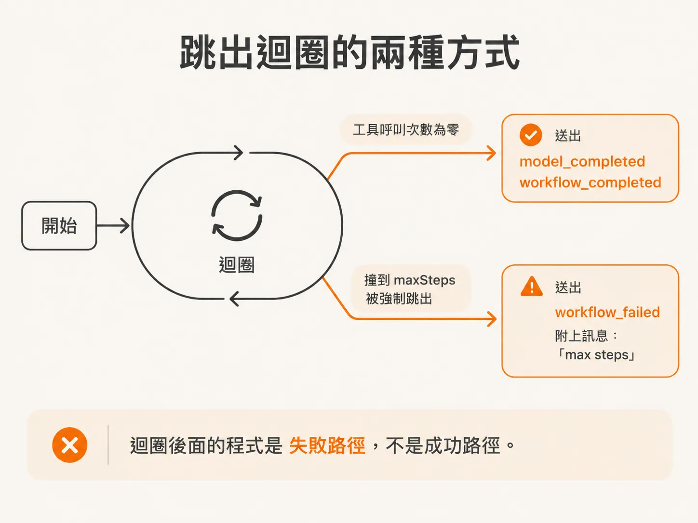
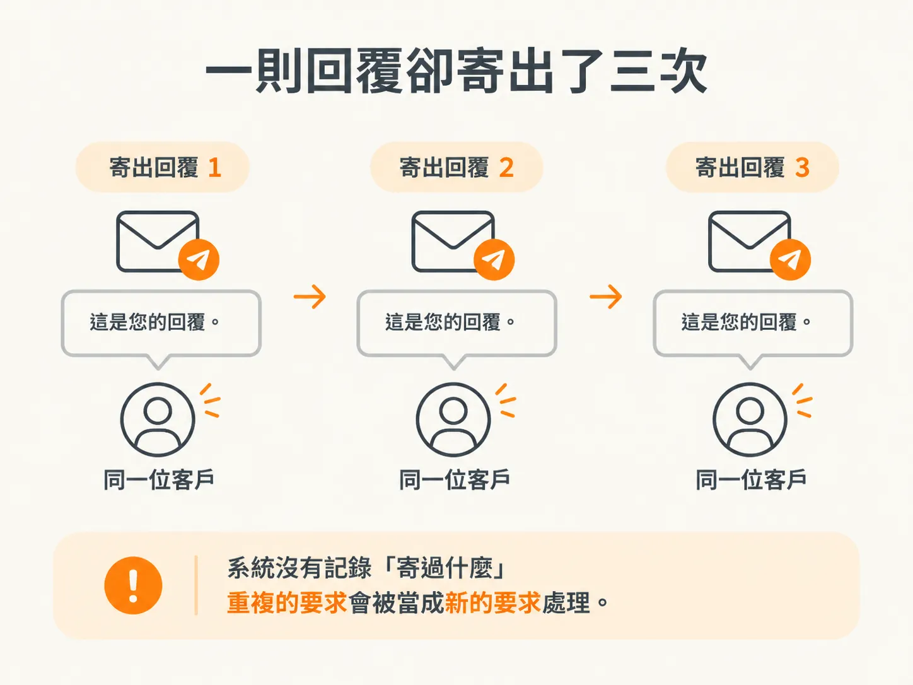
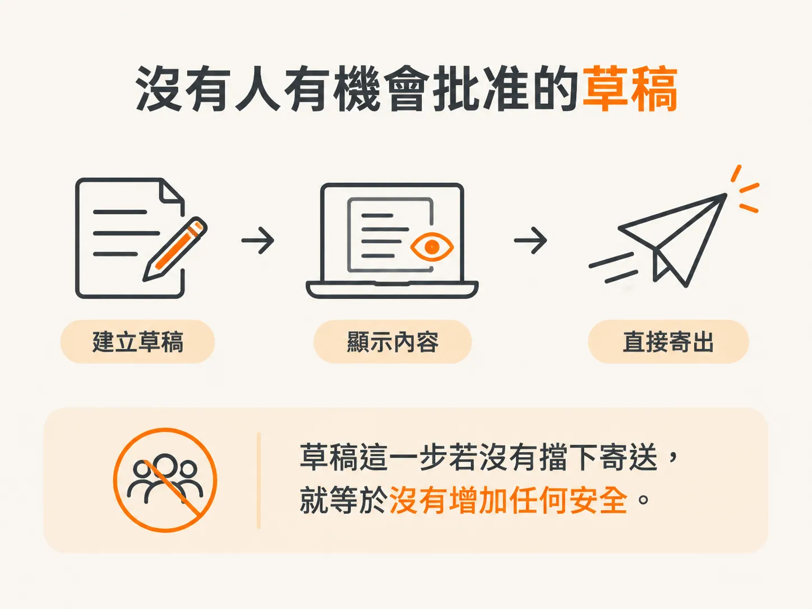
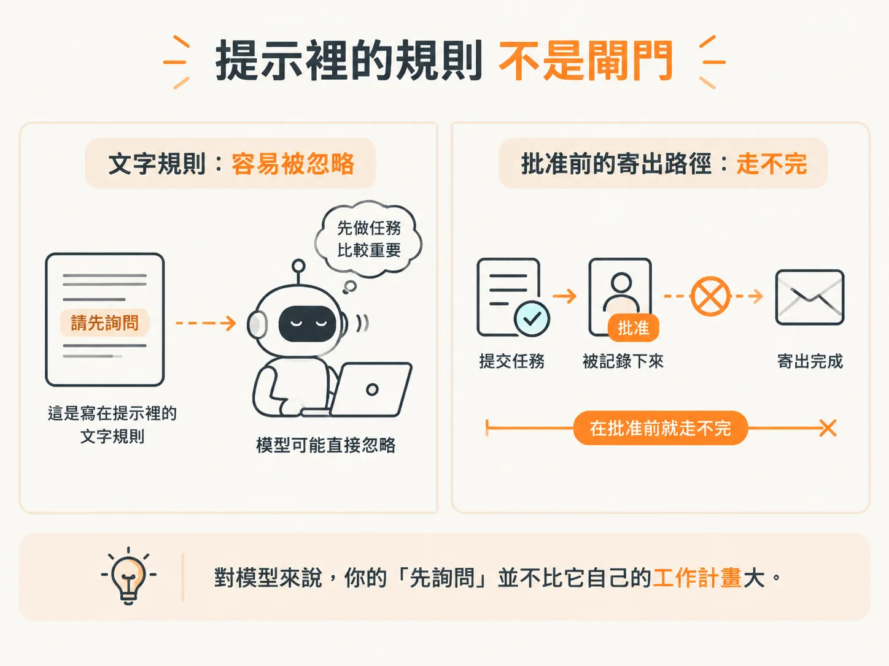

# Demo 裡重複送出的信與沒人批准的呼叫

上一節最後留下一個警告：迴圈只會回報模型要求了什麼，卻沒有任何程式判斷這些要求該不該執行。這一節，你會親眼看到這樣做的代價。

開始跑 Demo 之前，還有一個分支要補：它決定流程最後用什麼狀態收尾。

## 迴圈的兩種離開方式

串流讀完後，執行框架會問模型到底提出了哪些要求：

<!-- derived -->
```ts
const toolCalls = await result.toolCalls;
```

這裡一定要 `await`，理由和前面一樣：它也是串流，得等串流結束，最後的工具呼叫清單才會齊。

接著是分支判斷。

工具呼叫的數量是零，代表工作做完了：模型已經給出答案，沒有別的事要辦。這時我們取出最後的文字，送出帶工作流程 ID 和文字的 `model_completed`，再送 `workflow_completed`，然後離開迴圈。

這個 `return` 是唯一的正常出口。

所以迴圈後面那段程式不是成功路徑，是失敗路徑。流程要是被帶出迴圈，代表它撞到 `maxSteps`，或出了別的問題。這裡就送 `workflow_failed`，附一句給使用者看的訊息；Demo 裡那句話是 `max steps`，因為那正是發生的事。



注意這條錯誤路徑補上了什麼。

沒有它，流程到了上限只會悄悄停下，你根本不知道為什麼。有了它，檢查器最後一筆事件會明白寫著：工作流程失敗了，而你該從哪裡開始查。

## 執行看看

把 API 金鑰填好，啟動伺服器和檢查器，從筆記複製範例提示，送出。

你現在跑的是乾跑。這一課的工具還沒接上執行邏輯：工具都定義好了，模型也能要求使用，但執行框架還不會真的去執行。

這次執行有用就用在這裡：把工具執行排除掉，你可以一段一段看到模型的意圖，還有它依序提出的工具要求。

代理程式先說要用這個工具，接著又要另一個。執行框架照單全收。模型一直要求下去，迴圈就會一路處理一長串工具呼叫，直到它自己停，或撞到 `maxSteps`。

跑完先別急著看最後一句話，去看時間軸，裡面有兩個問題。

## 問題一：同一封回覆寄了三次

第一個問題很明顯：重複。它寄出三封回覆，但其實一封就夠。



再看工具定義，就笑不出來了：

<!-- source: sources/agent-harness2/20261029/harness-engineering/harness/tools.ts#L74-L77 -->
```ts
  sendReply: tool({
    description: "Send the drafted reply to the customer. This really emails them.",
    inputSchema: z.object({ itemId: z.string(), draftId: z.string() }),
  }),
```

「這真的會寄信給對方」不是寫好看的。在完整的執行框架裡，這個名稱背後的執行器做的是：

<!-- source: sources/agent-harness2/20261029/harness-engineering/harness/tools.ts#L115-L118 -->
```ts
    case "draftReply":
      return { ok: true, draftId: `draft-${args.itemId}` };
    case "sendReply":
      return { sent: true, itemId: args.itemId, draftId: args.draftId };
```

所以每一次要求，都代表寄出一封信。

本來只要寄一封，現在送出三次，客戶就收到三封信，而且第二封、第三封的內容很可能跟第一封一模一樣。乾跑時你會在檢查器裡看到三個區塊；接上執行器之後，這三個區塊就是三次真的寄送。

迴圈沒在數寄了幾次，沒做去重，也不會確認這封一模一樣的回覆是不是已經寄過。

這就是這個節點露出的第一個問題：迴圈不記副作用。對它來說，重複的要求還是新的要求。

## 問題二：根本沒有人批准

第二個問題更嚴重：這件事沒有經過任何人同意。



代理程式有草稿工具，也真的用了，你在時間軸裡看得到那份草稿。但它沒等任何人看過，就把回覆寄了出去。

那建立草稿、顯示給人看，意義在哪？

訊息會自動寄出，草稿就只是演一下。一個誰都不用通過的批准流程，根本不算批准流程。

這不是模型存心作惡。

回頭看你給它的目標：「回覆這些電子郵件。」在信真的寄出去之前，這件事就還沒完成，而它手上剛好有一個能寄信的工具。從模型的角度看，寄出去就是完成任務的唯一方法。

你真正的意圖（「寄出前我要先檢查」）從來沒寫進迴圈，只存在你腦子裡。

接下來，多數人會想抄一條捷徑：

那我在工具說明裡加一句「除非先詢問使用者，否則不要使用這個工具」，行不行？

這樣沒用。

把防護措施和安全規則寫在文字裡，最後一定會失敗。工具說明只是提示內容裡的另一句話，和「完成工作」的目標擺在同一層，它頂多提醒模型，沒辦法逼模型遵守。

寫在文字裡的規則，轉頭就可能被同一個讀到它的模型忽略。對模型來說，你的「先詢問」並不比它自己的工作計畫大。



執行框架得讓模型沒辦法自己做這個決定，不能只叫它「最好不要這樣」。

也就是說，寄信那段程式必須要求一個模型自己給不出的東西：一筆被記錄下來的批准。

這套機制我們會在課程後面做。現在先記住：光靠提示詞解決不了。

## 為什麼值得保留這個 Demo？

這樣的系統，現實裡沒有人會真的拿來用。

沒有人會信任一個突然失控、想做什麼就做什麼的代理程式，也沒有人會拿這種系統去提供服務。

這也正是這個 Demo 值得留在課程裡的原因，而不是把它整理乾淨、假裝問題不存在。它是一個小、可重複、看起來幾乎沒什麼危險的執行案例，卻把兩個在正式環境裡會放大好幾倍的問題攤開來：

- 副作用重複發生。
- 副作用在沒有人同意的情況下發生。

接下來課程裡的每一項設計，都在解你剛才看到的問題。

持久化事件紀錄，讓流程重啟後能接續執行，也讓你事後能證明發生過什麼。持久化步驟的邊界，讓工作流程重新播放時副作用仍然只跑一次。批准機制，讓寄信必須等真人點頭，而不是聽提示詞的話。沙盒，則替模型寫出來的程式劃一條它跨不過去的線。

這些都不是模型本身的功能，是執行框架的功能。而你剛才寫的那個迴圈，就是這些機制接進來的地方。

到這裡，你看到的是最誠實的版本：`streamText` 發出呼叫、串流轉成事件、模型可以提出任何它想要的工具要求。接下來真正要做的，是決定執行框架在一個要求變成一封電子郵件之前，要怎麼處理它。
