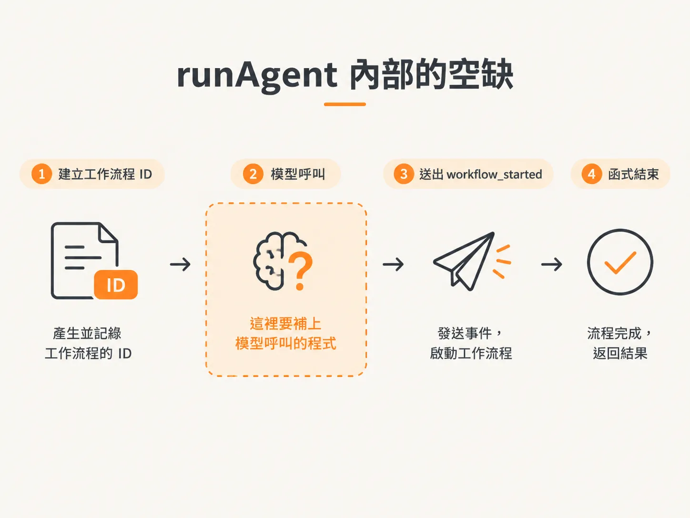
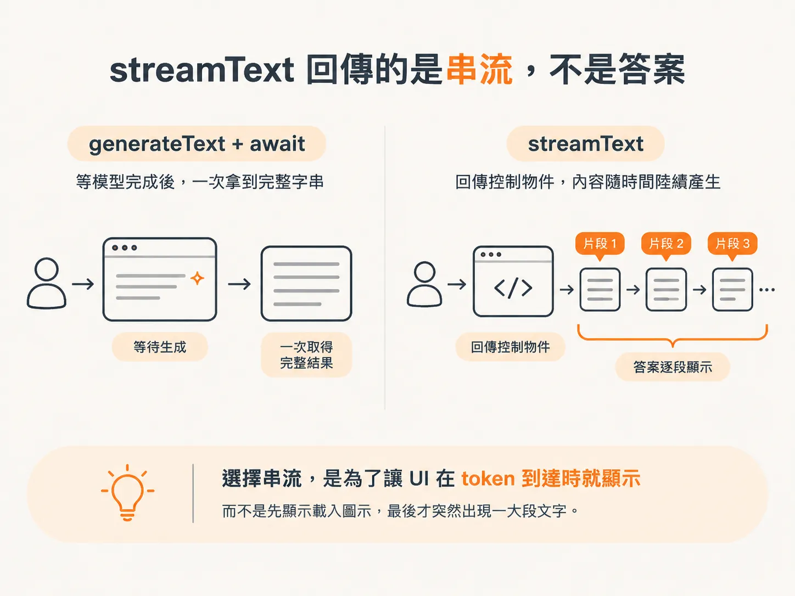
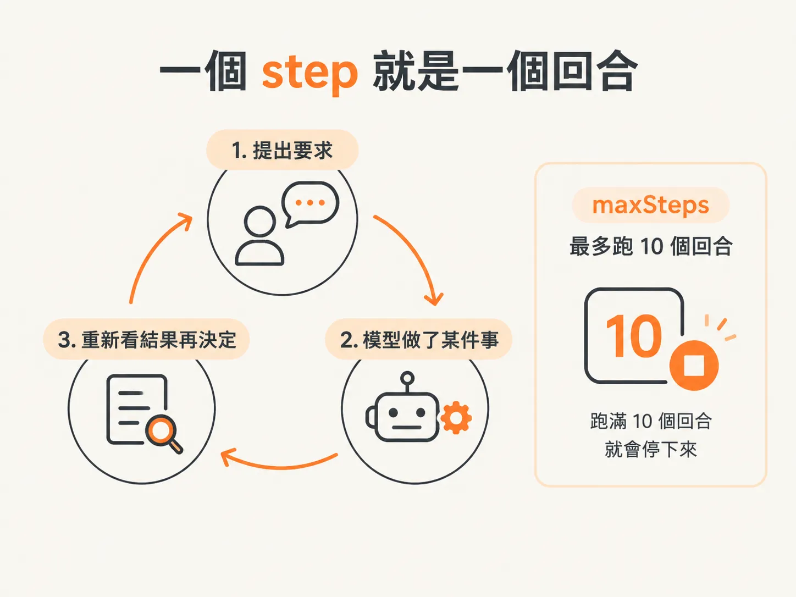
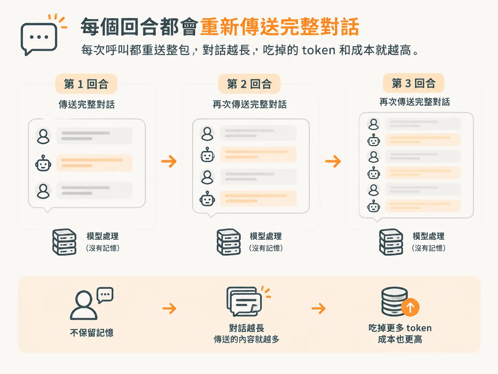

# streamText 與 maxSteps：一輪就是一個 step

打開 `runtime.ts`。檔案開頭有三個 `emit` 呼叫，內容都還是空的。`runAgent` 做得很少：建立工作流程 ID、送出 `workflow_started`，然後函式就結束了。

接下來要補的，就是中間那段缺口。



這一節要回答的問題說起來簡單，卻是整個流程的骨架：

> 使用者送出訊息後，到模型回答之前，程式實際做了什麼？

只要你能親手寫出這個迴圈，後面這個節點裡的問題（例如回覆送出兩次、工具未經批准就被呼叫）就都有對應的位置可以找。

## streamText 會送出對話，並回傳串流

`streamText` 把訊息清單送給模型供應商，再把模型的回答以串流傳回來。這就是它主要的工作。

無論你是在做聊天視窗，還是在執行背景代理程式，呼叫方式都一樣。

重點在回傳值。你不會 `await` 它，拿到手的是一個串流物件。你可以訂閱它，也可以逐段讀取，讓回答在模型還沒寫完時就一點一點進到你的程式。

如果你想等模型把整串字生完、一次拿到結果，可以改用 `generateText` 配 `await`。這裡選串流，是因為 UI 該在 token 到達時就顯示，而不是先轉一個載入圖示，最後突然蹦出一大段文字。



要 import 的東西很普通：模型、前面定義好的工具，還有 system prompt。

## maxSteps 是預算，不是功能

檔案開頭宣告一個 `maxSteps`，設成 10。

理由很直接：失控的 AI 會吃掉大量資源，帳單也跟著往上跳。這個上限是煞車踏板，不是什麼讓引擎跑起來的功能。

要理解這個數字，先要知道 step 是什麼。

一個 step 就是一個回合：你提出要求，模型做了某件事，然後根據結果再想一次。這整段算一個 step。

所以 `maxSteps` 設成 10，就是模型最多跑 10 個這種回合，再多就會被執行框架停下來。



這裡值得停下來講清楚。AI SDK 自己有 `maxSteps` 和 `maxRetries` 這兩個設定。打開它們，等於把迴圈交給 SDK 管，讓 SDK 自己去跑這些回合。

但這門課刻意不這麼做。

理由是控制權。我們要自己建執行框架，尤其是透過 WebSocket 送事件這段要自己處理。用 SDK 內建的迴圈，就得照它的 hooks 走，整個專案也會被綁在 SDK 的設計上。

我們只要 AI SDK 做一件事：呼叫 LLM。呼叫之後的所有事，都歸我們的執行框架管。

## 手動建立迴圈

在 `runAgent` 裡，建好工作流程 ID、送出 `workflow_started` 之後，接下來要準備訊息。

多數相容 OpenAI API 的 LLM 都吃一個 `ModelMessage` 陣列。每筆訊息就是一個物件，有 `role` 和 `content`。

一般會看到四種角色：

- `system`
- `user`
- `assistant`
- 工具呼叫所使用的角色

新版 SDK 把許多細節包裝起來了，但底層仍然是這個訊息陣列。

第一筆通常是 `system`，放 system prompt；第二筆是使用者的訊息，因為能進到 `runAgent`，就代表使用者剛啟動了一次工作流程。

接著建立迴圈：

<!-- derived -->
```ts
const messages: ModelMessage[] = [
  { role: "system", content: systemPrompt },
  { role: "user", content: input },
];

let step = 0;
while (step < maxSteps) {
  const result = streamText({ model, messages, tools });

  for await (const part of result.fullStream) {
    // handle each chunk as it arrives
  }

  messages.push(...(await result.response).messages);
  step++;
}
```

這裡不會對 `streamText` 本身使用 `await`，原因前面已經提過：它回傳的是串流。

串流本身是非同步可迭代物件，所以可以用 `for await` 一段一段讀，每個片段到了就處理。

內層那個迴圈才是所有重要決策發生的地方，也是下一節的主題；現在先記住它的位置就好。

## 為什麼每一回合都要重新送出完整對話？

串流結束後，我們會把模型自己的回覆訊息加入陣列：

<!-- derived -->
```ts
messages.push(...(await result.response).messages);
```

你可能覺得這一行多餘。模型剛剛才講完那些話，總該記得吧？

它不記得。

這段互動不會留在伺服器上。模型不知道你是誰，也不會自己記住先前的對話。每次呼叫，都得把完整的訊息歷史重新附上。

這也和供應商的資源配置有關：留著記憶要成本，他們寧可把資源花在推理上，不會替你保留三個回合前說過的話。



這會帶來兩個後續很重要的結果。

第一，在串流完成前，不能把模型回覆加入訊息陣列。

把還沒完成的內容放進去，下一個回合讀到的就是一段殘缺、甚至格式錯誤的對話。所以要等 `result.response`，等串流整個跑完，再把它裡面的 `messages` 攤開加進陣列。

第二，對話越長，執行速度和成本就越高。

因為每個回合都會往陣列裡多塞一些 token，然後整包再送一次。這不是迴圈寫錯，是這種 API 本來的運作方式。也因為這樣，這門課後面才要處理上下文壓縮。

## 完整檔案中的相同回合

這一節的正式版本在 `harness/runtime.ts`。

它長得不太一樣：接收的是準備好的上下文和這個代理程式的工具，最後回傳一個 `Turn`，不是直接改訊息陣列。

<!-- source: sources/agent-harness2/20261029/harness-engineering/harness/runtime.ts#L28-L51 -->
```ts
async function modelTurn(
  workflowId: string,
  context: ModelMessage[],
  agentTools: ToolSet,
): Promise<Turn> {
  const result = streamText({ model, messages: context, tools: agentTools });

  for await (const part of result.fullStream) {
    if (part.type === "text-delta") {
      await emit({ type: EventType.ModelDelta, workflowId, text: part.text });
    }
  }

  const rawCalls = await result.toolCalls;
  return {
    text: await result.text,
    toolCalls: rawCalls.map((c) => ({
      toolCallId: c.toolCallId,
      toolName: c.toolName,
      input: c.input as Record<string, unknown>,
    })),
    responseMessages: (await result.response).messages,
  };
}
```

不過核心還是手寫迴圈的三個動作：

1. 呼叫一次 `streamText`
2. 使用 `for await` 讀取 `fullStream`
3. 等待完整回覆產生

差別是這個版本把回覆訊息交回給呼叫端，不自己加進陣列。因為在真的執行框架裡，事件紀錄是呼叫端在管的。

但仔細看 `for await` 那一段：它只認 `part.type === "text-delta"`，送出 delta 事件，其他從串流回來的東西全被默默丟掉。

第一次跑，這樣寫可以接受；問題也正是從這裡開始：

串流裡不是只有文字，還有工具呼叫、工具結果和錯誤，UI 也得看見這些。

哪些片段該變成事件？工具結果又怎麼對回觸發它的那個要求？
