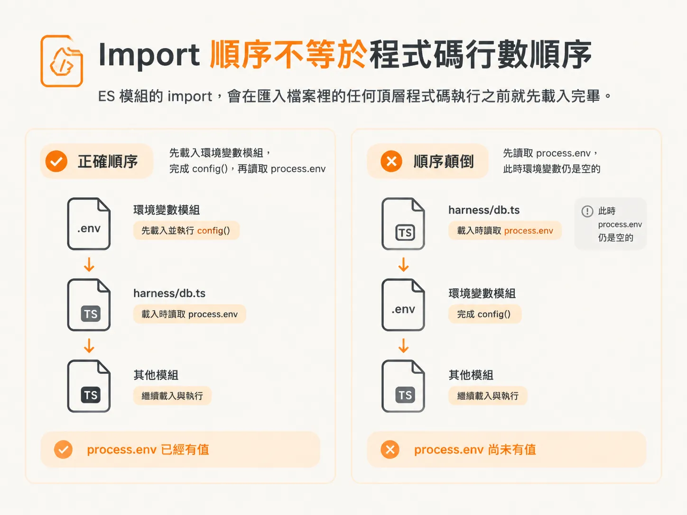
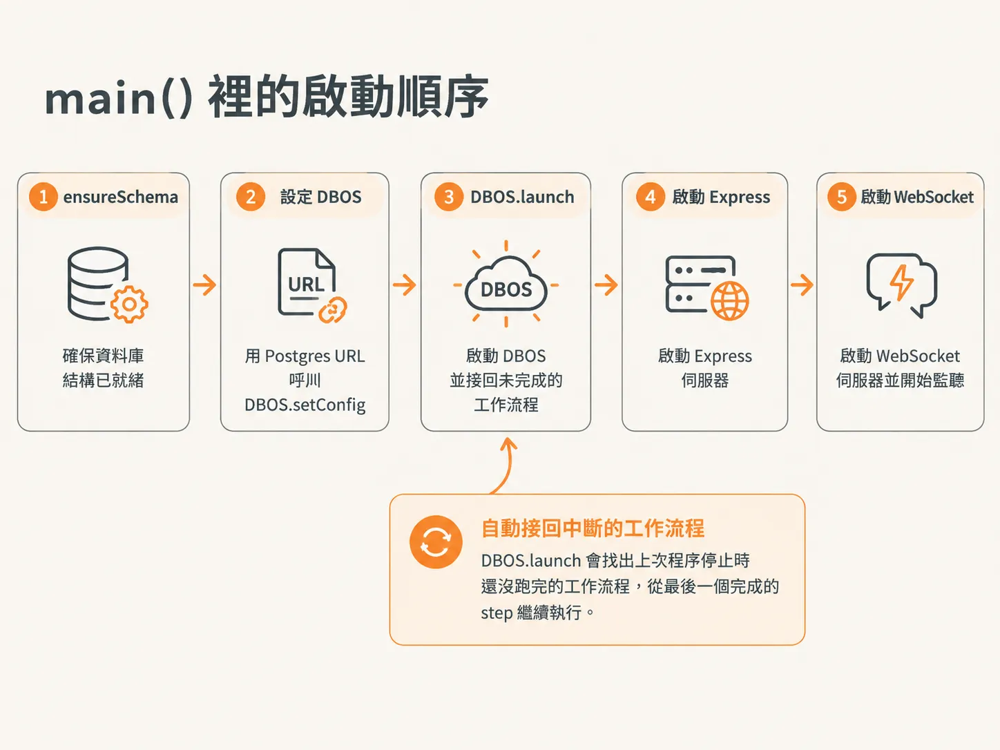

# 環境變數要比資料庫早一步載入

導入 DBOS 之前，伺服器一直運作得好好的。AI SDK 會幫你載入環境變數，所以沒有人需要操心 `DATABASE_URL` 什麼時候才會出現。

但只要多一個元件也要用這個變數，這份便利就到頭了。DBOS 在模組載入時就會讀 `DATABASE_URL`；那時還讀不到值，它拿到的就是 `undefined`，伺服器連監聽都還沒開始就停下來。

解法只有三行程式碼：先把載入順序修好，再用 `main()` 決定其他東西的啟動順序。

## Import 順序不等於程式碼行數順序

ES 模組的 import，會在匯入檔案裡的任何頂層程式碼執行之前就先載入完畢。



所以就算你在 `server/index.ts` 第 10 行才呼叫 `config()`，像 `harness/db.ts` 這樣的模組，還是會在第 10 行之前就去讀 `process.env`。環境變數載入器得先做完它的事，其他會讀環境變數的模組才能載入。

解法因此不是在檔案裡更早呼叫 `config`，而是拆出一個只負責載入環境變數的模組，讓它成為第一個被匯入的模組。

<!-- source: sources/agent-harness2/20261029/harness-engineering/server/env.ts#L1-L6 -->
```ts
import { config } from "dotenv";

// Load .dev.vars into process.env. This module is imported FIRST in the server
// (before anything that reads env at load time, like harness/db.ts) because ES
// module imports are evaluated before top-level statements.
config({ path: ".dev.vars" });
```

`config` 來自 `dotenv`，會把 `.dev.vars` 的內容複製到 `process.env`。這個檔案刻意不做別的事，這就是重點：如果在裡面加了其他副作用，那些動作也會跟著搶在伺服器其他部分之前執行。

接著讓 `server/index.ts` 一開頭就匯入它，並留一段註解說明為什麼它必須排第一。

<!-- source: sources/agent-harness2/20261029/harness-engineering/server/index.ts#L1-L2 -->
```ts
// MUST be first: loads .dev.vars before any module that reads env at load time.
import "./env";
```

## 用 main() 包住啟動流程

環境變數載入後，其餘啟動流程就可以收進同一個非同步函式。在你呼叫它之前，什麼都不會啟動。

第一個呼叫是 `ensureSchema()`：事件紀錄要用的資料表不存在，它就建一張。也就是說，就算忘了推 schema，它也會自己補上，不必手動跑資料庫遷移。正式環境大概不會這樣做，但在工作坊裡，這能省掉一個讓你第一次執行就卡住的步驟。

第二個呼叫是 `DBOS.setConfig`。先給應用程式一個名字，再把 `systemDatabaseUrl` 指向 harness 已經在用的同一個 Postgres 資料庫。

<!-- source: sources/agent-harness2/20261029/harness-engineering/server/index.ts#L16-L23 -->
```ts
async function main() {
  await ensureSchema();

  // Point DBOS at the same Postgres for its checkpoint store, then launch it.
  // launch() ALSO recovers any workflows that were mid-flight when the process
  // last died, resuming each from its last completed step.
  DBOS.setConfig({ name: "harness", systemDatabaseUrl: process.env.DATABASE_URL });
  await DBOS.launch();
```

這個節點的重點在 `DBOS.launch()`。除了啟動 DBOS，它還會找出上次程序停止時還沒跑完的工作流程，從最後一個完成的 step 繼續執行。



這種復原能力，是這個節點後面幾篇都在處理的事。

## 把伺服器其他部分也移進去

Express、CORS 標頭、WebSocket 伺服器，以及 `server.listen`，都搬進 `main()`，放在 `launch()` 之後。

它們以前是在模組載入時就執行。現在所有處理請求的路徑都要等耐久層就緒才建立，DBOS 還沒啟動之前，不會有任何 socket 接用戶端連線。

最後在檔案底部呼叫 `main()`。

<!-- source: sources/agent-harness2/20261029/harness-engineering/server/index.ts#L89-L92 -->
```ts
main().catch((error) => {
  console.error("failed to start:", error);
  process.exit(1);
});
```

`main()` 會回傳一個 promise，所以可以在同一個地方用 `catch` 處理啟動失敗：記下錯誤，再以結束代碼 1 結束程序。

資料表建好了，DBOS 啟動了，伺服器也在監聽。還缺的是啟動工作流程的動作：`main()` 裡沒有任何程式會開始工作流程，要等用戶端送訊息進來才會動。
