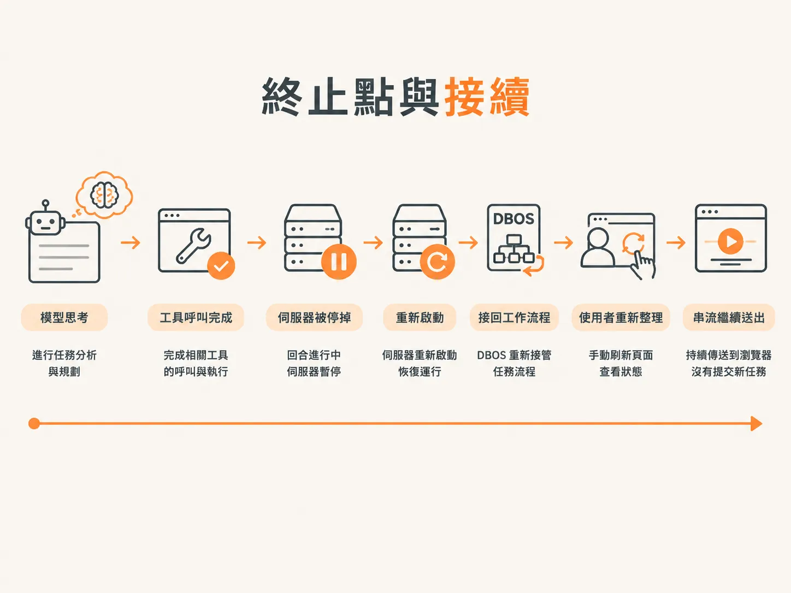
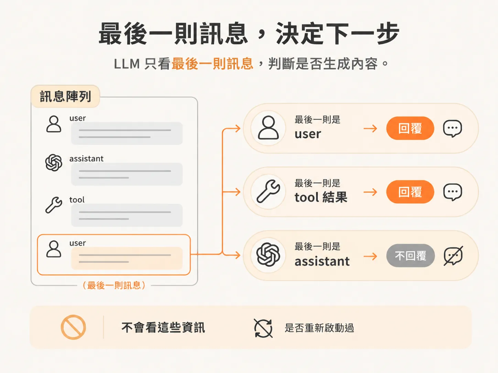

# 把 server 殺掉，再啟動，它自己接回來

重播畫面看起來沒問題，但上一步也說了，這樣不夠。畫面上有完整時間軸，只能證明紀錄裡有資料。真正有說服力的測試更直接：把執行工作流程的程序殺掉，看執行能不能自己接回來。

示範先啟動一項工作，等到關鍵時刻：模型正在思考，工具呼叫也確實執行了。就在這時候把伺服器停掉。

然後重新啟動、重新整理瀏覽器，看還剩下什麼。

## 畫面上發生了什麼

本來預期串流會跟著程序一起斷。一般來說，負責處理進行中 LLM 呼叫的伺服器一消失，確實就是這樣。

但這次沒有。串流居然繼續了。

這跟用戶端無關。用戶端只做了重新載入瀏覽器這件事，事件就繼續送來，既沒有建立新工作，也沒有重試。

關鍵在這裡：瀏覽器沒有重新啟動工作流程。等它重新連上時，伺服器上的工作流程早就又跑起來了。

## 模型為什麼能接著跑

LLM 看著訊息陣列的最後一則訊息，決定要不要生成內容。它不看時間，也不知道程序曾經重新啟動。

規則很簡單。最後一則訊息的角色是 `user`，就回覆。最後一則是工具結果，也回覆：我要求執行這個工具，對方已經把結果傳回來了。最後一則訊息的角色是 `assistant`，就不回覆，那等於自己回答自己，畫面上會連著出現兩則 assistant 訊息。

有了這條規則，系統不必特別設計一套恢復邏輯，也能重新接上工作。伺服器回來後，系統再把存下來的訊息交給模型。陣列最後一則是工具訊息，模型就照它唯一懂的方式，回應這則還沒完成的訊息。

它不知道那則訊息是三秒前收到的，還是當機前收到的。對它來說，整個世界就是這個陣列。

## 各自負責什麼

這個節點新增了四個部分，各自負責恢復流程裡的一環。

`DBOS.launch()` 會找回跑到一半的工作流程，從最後一個完成的 step 繼續。已記錄的 step 讓它不必重做已完成的工作：執行過的工具呼叫不會再跑一次。`on connection` 的重播把瀏覽器錯過的事件補回畫面。模型自己那條「看最後一則訊息」的規則，決定接下來做什麼。

這幾個機制都不會重播模型回合。只有恢復流程會這麼做，瀏覽器只是剛好在讀同一份紀錄。

## 前後差異

以前只要重新整理，執行中的工作就沒了。當時沒有任何耐久的儲存，也就沒有東西可以接回來。

現在時間軸不只撐過重新整理，伺服器被殺掉、重新啟動之後也還在。驗證方式沒什麼特別：模型回合跑到一半時殺掉伺服器，重新啟動，然後看串流自己繼續。

這就是這裡說的耐久性，一句話就能驗證：ID 沒變，已完成的 step 還是完成，執行也從中斷的地方接著跑。
