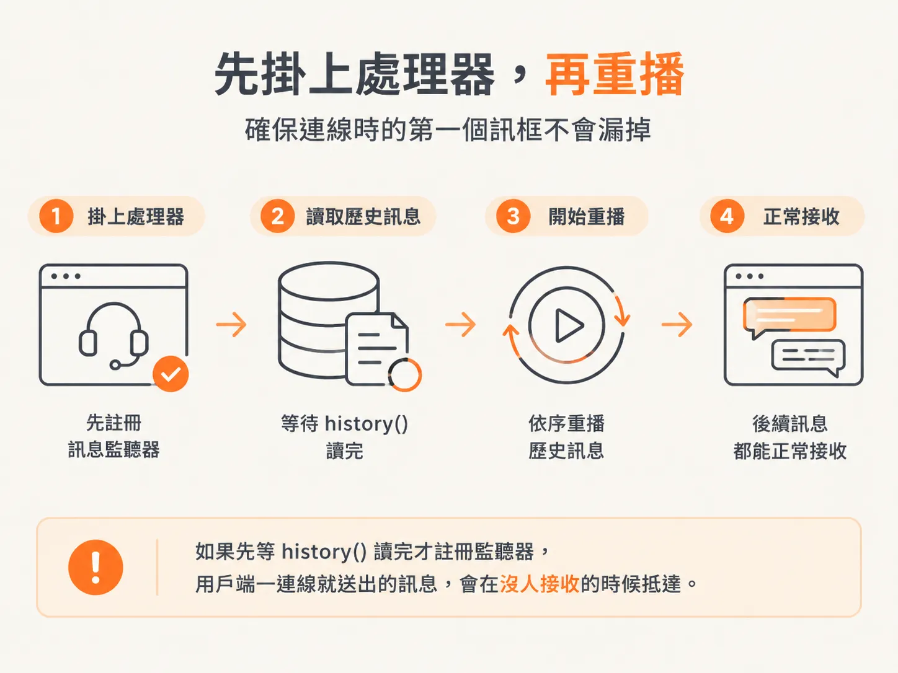
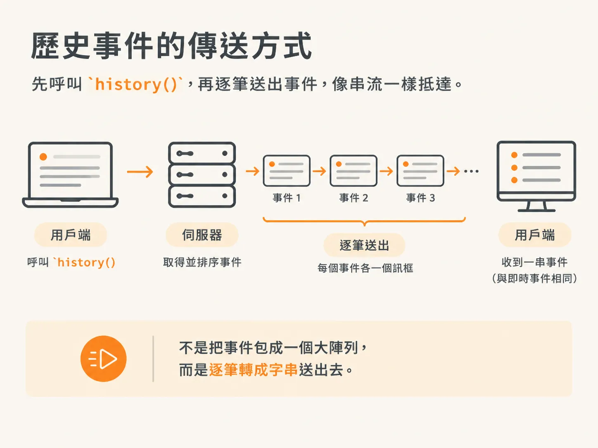

# client 一連上，就把 history 逐筆 replay

上一步留下了一個問題：工作流程在瀏覽器關掉時仍持續送出事件，這些事件寫進 Postgres，卻沒有人收。用戶端回來的時候，要怎麼補上這段空缺？

用戶端會落後有兩種情況：工作流程還在跑，瀏覽器關了；或是伺服器當機重啟，瀏覽器卻一直開著。不管哪一種，畫面上的東西都比資料庫舊。

兩種情況都會觸發 `on connection` 處理器，重播就放在這裡。

## history() 把事件紀錄讀回來

bus 現在有兩件事要做，`harness/bus.ts` 的註解寫得很直白：先把每個事件耐久保存，再即時廣播出去。

<!-- source: sources/agent-harness2/20261029/harness-engineering/harness/bus.ts#L19-L23 -->
```ts
export async function emit(input: EventInput): Promise<void> {
  const event: AgentEvent = { ...input, id: randomUUID(), ts: Date.now() };
  await db.insert(eventLog).values({ data: event }); // durable, ordered by `seq`
  for (const listener of listeners) listener(event); // live
}
```

資料庫寫完，才會通知任何監聽者。事件送到即時連線時，早就存進磁碟了；就算一毫秒後當機，也不會掉。

`history()` 負責讀：資料列全部取出來，依 `seq` 排序，再轉回事件。

<!-- source: sources/agent-harness2/20261029/harness-engineering/harness/bus.ts#L24-L29 -->
```ts
// The full timeline so far, in order — read back from Postgres on every connect.
export async function history(): Promise<AgentEvent[]> {
  const rows = await db.select().from(eventLog).orderBy(eventLog.seq);
  return rows.map((row) => row.data);
}
```

排序看的是 `seq`，不是時間戳記。`seq` 是資料庫寫入時指派的順序，所以重播會照事件實際寫入的先後來排。

## 先註冊訊息處理器

`history()` 要非同步讀資料庫；另一邊，socket 一連上，用戶端馬上就送出第一個訊息框。

<!-- source: sources/agent-harness2/20261029/harness-engineering/server/index.ts#L61-L64 -->
```ts
  wss.on("connection", async (socket: WebSocket) => {
    // Register the message handler FIRST — history() is an async DB read, and the
    // client sends as soon as it connects.
    socket.on("message", async (raw) => {
```

所以順序是先掛處理器，再開始重播。要是先等 `history()` 讀完才註冊監聽器，用戶端一連線就送出的訊息，就會在沒人接收的時候抵達。



重播的程式放在這個處理器下面，一樣在 `on connection` 裡。

<!-- source: sources/agent-harness2/20261029/harness-engineering/server/index.ts#L80-L81 -->
```ts
    // Replay the durable timeline (including a workflow DBOS is recovering).
    for (const event of await history()) socket.send(JSON.stringify(event));
```

呼叫一次 `history()`，再為每個事件各送一個訊息框。不是把事件包成一個大陣列，而是逐筆轉成字串送出去。用戶端收到的是一串事件，跟即時事件走同一種傳法。



迴圈的用意在這裡：用戶端只要一套程式碼處理收到的事件。重播和即時事件在傳輸時長得一模一樣，檢視器不必另外切一個「追上進度」模式。

## 兩種中斷，一條復原路徑

不論是伺服器重啟，還是用戶端重新啟動，等用戶端再連上，事件就會重播。

接著用戶端送出訊息，啟動一個工作流程。這次執行先前中斷過，就從停下來的地方繼續；沒中斷過，就是使用者剛送出的一次新執行。

要注意，重播不會推著工作流程往前跑，它只補畫面。工作流程能繼續，是 DBOS 在復原；重播只是剛好讀同一份事件紀錄。

所以這套設計很容易造假。畫面上滿滿的事件，只能證明紀錄裡有資料列，證明不了程序當機後還能接著執行。要驗證這一點，得真的把伺服器關掉。
