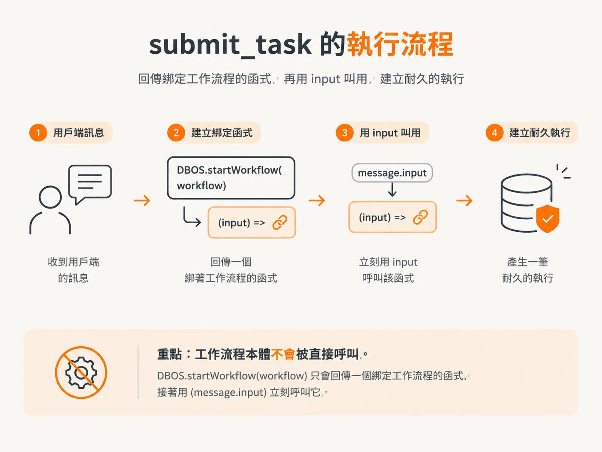
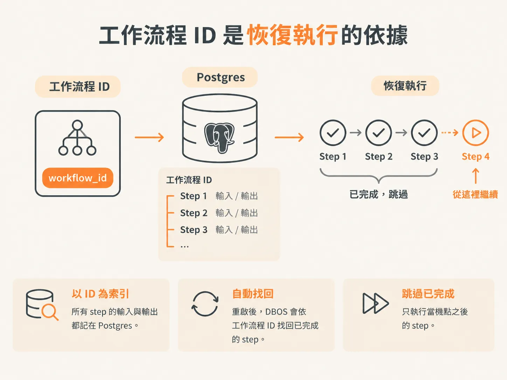

# 收到 submit-task 就啟動 workflow

上一步結束時，伺服器啟動了 DBOS，然後就一直等。`main()` 裡沒有任何程式會啟動工作流程，要等瀏覽器送訊息進來，工作才會開始。

使用者輸入訊息、按下 Enter，用戶端送出 `submit_task`。`on message` 處理器是系統裡第一個耐久入口點。

## 處理器啟動這次執行

處理器先解析原始訊框；JSON 格式壞掉就直接返回，什麼都不做。連訊框都讀不了，也沒有東西可以補救。

接著依訊息類型分流，跟這裡有關的只有一條分支：`submit_task`。

<!-- source: sources/agent-harness2/20261029/harness-engineering/server/index.ts#L72-L78 -->
```ts
      if (message.type === "submit_task") {
        // Pick the runtime: the single-agent loop, or the supervisor.
        const workflow =
          message.mode === "supervised" ? runSupervisorWorkflow : runAgentWorkflow;
        await DBOS.startWorkflow(workflow)(message.input);
      }
```

`DBOS.startWorkflow(workflow)` 不會直接執行工作流程。它回傳一個綁著那份工作流程的函式，緊接在後面的 `(message.input)` 就是拿 input 立刻呼叫它。



這種寫法乍看有點怪。逐字稿裡也講明了：回傳的函式可以先存進變數、下一行再呼叫，寫在同一行效果一樣。

只有走 `startWorkflow`，才會建立一筆耐久的執行紀錄。工作流程本體不是被直接呼叫，而是由 DBOS 依著這筆紀錄執行。

## Workflow 必須先註冊

`harness/runtime.ts` 裡的 `runAgentWorkflow` 不是原本那個函式，而是把 `agentWorkflow` 交給 `DBOS.registerWorkflow`、以 `agentWorkflow` 為名註冊之後的結果。

<!-- source: sources/agent-harness2/20261029/harness-engineering/harness/runtime.ts#L229-L231 -->
```ts
export const runAgentWorkflow = DBOS.registerWorkflow(agentWorkflow, {
  name: "agentWorkflow",
});
```

先註冊，裡面的 step 才有意義。DBOS 得先知道這些 step 屬於哪個工作流程，才記錄得下來。

這個名字也像一張提醒自己的便利貼：工作流程裡不在 step 內的程式碼，恢復時會再跑一次，所以每次都得有一樣的行為。把 `Workflow` 放進名字，就是提醒自己這件事。

## ID 由 DBOS 提供，不是呼叫端傳入

`input` 是字串。工作流程 ID 不是參數，工作流程直接跟 DBOS 讀。

<!-- source: sources/agent-harness2/20261029/harness-engineering/harness/runtime.ts#L90-L96 -->
```ts
async function agentWorkflow(input: string): Promise<string> {
  const workflowId = DBOS.workflowID ?? "unknown";
  await DBOS.runStep(
    () => emit({ type: EventType.WorkflowStarted, workflowId, input }),
    { name: "started" },
  );
```

`DBOS.workflowID` 沒有值就用 `"unknown"`。這次執行發出的每個事件都會帶著這個 ID，檢視器靠它把時間軸排好。

這個 ID 也是整套重新啟動機制的關鍵。

## 為什麼 ID 是恢復執行的起點

每個 step 的輸入與輸出，都以工作流程 ID 為索引記在 Postgres。當同一個執行流程在當機、重新部署或重啟之後恢復時，DBOS 就照這個 ID 找回 step 已記錄的結果，跳過它。



這個工作流程 ID 底下已經有這個 step 的紀錄，所以就跳過。機制就這麼單純，下一個節點就算把伺服器關掉，進度也不會消失。

這也是為什麼 step 必須具冪等性：同一個 step 再跑一次，結果必須一樣，否則記錄下來的狀態和實際狀態就對不上。

上面的 `emit` 呼叫是最簡單的例子。包在名為 `started` 的 `DBOS.runStep` 裡，`WorkflowStarted` 事件的結果就會被記下來。伺服器在事件發出後立刻當機，恢復時也不會再發一次。

現在任務可以啟動、留下紀錄，中斷後還能恢復。至於瀏覽器看得到什麼，是另一回事：檢視器在工作流程執行時保持連線、接收事件；你關掉分頁，事件照樣寫進 Postgres，只是沒有人在聽。那用戶端晚點才連上，會收到什麼？
