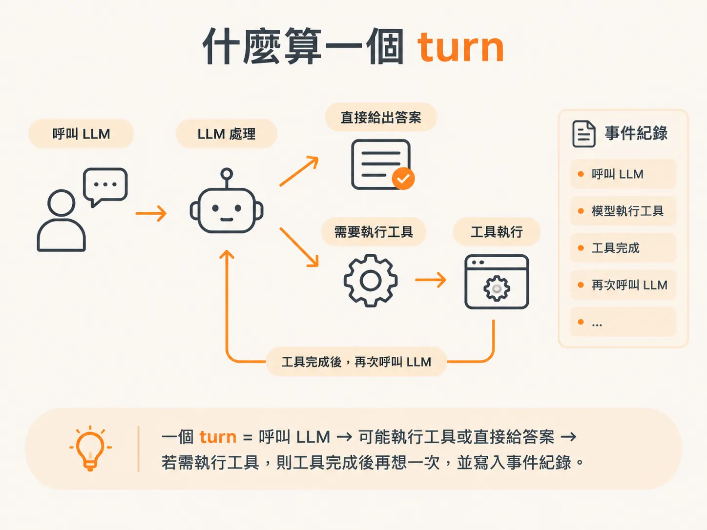
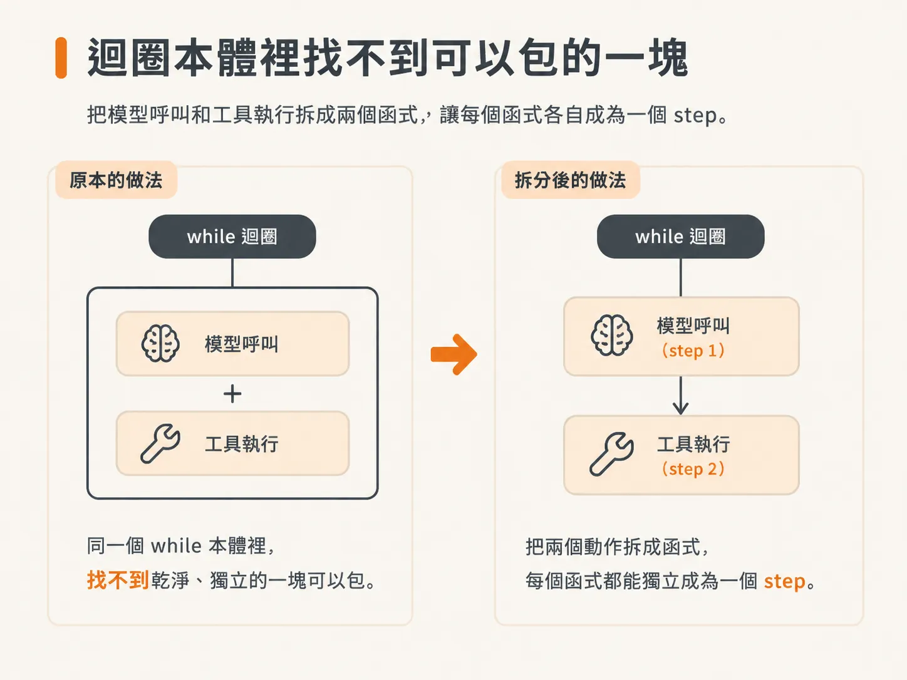
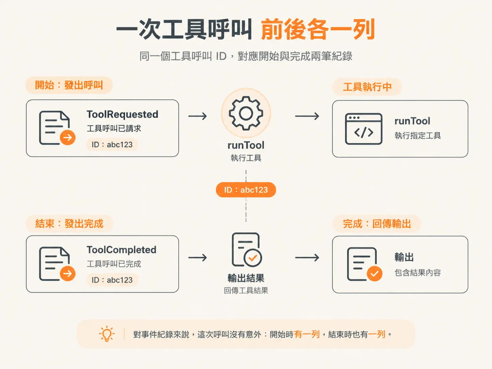
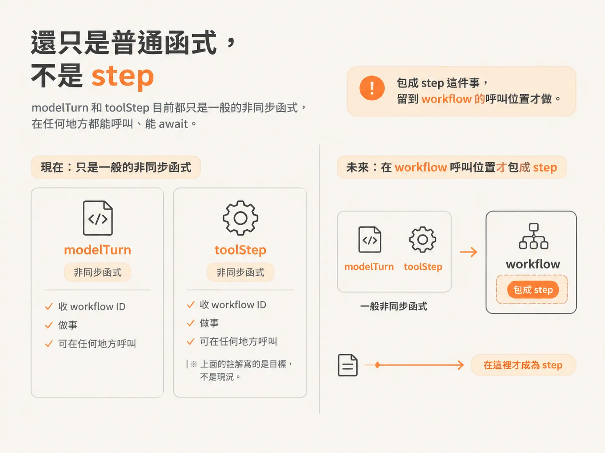

# 把迴圈拆成 modelTurn 與 toolStep

檢查工具呼叫的邏輯在 runtime，而 runtime 也是這次動最多的地方。它從一個被呼叫的函式，變成負責把整個 workflow 串起來的角色。

兩個 import 就把大部分工作解決了。`DBOS` 來自 `@dbos/dbos`；再從 `ai` 匯入 `ModelMessage`、`JSONValue` 兩個型別，加上我們替 harness 定義的事件型別。

有一個 import 要搬家。`emit` 原本從 server index 一路匯進來，現在改成從 harness 裡的 bus 拿，所以 runtime 從那裡匯入。`tools` 和 `runTool` 則從 tools 檔案匯入。

## 兩個型別，以及 turn 的定義

第一個輔助型別是 `ToolCall`：工具呼叫 ID、工具名稱，加上型別為「字串對應未知值」的輸入物件。每次工具呼叫都有自己的 ID，所以留著它。

第二個是 `Turn`。接下來要記錄每一個 turn，得先把它定義出來。呼叫 LLM 之後，模型可能要執行工具，也可能直接給出答案。每次需要執行工具，就算是一個 turn；工具跑完，模型再想一次。



所以 `Turn` 裡有文字、這一輪發出的工具呼叫，還有回應訊息。把 turn 寫進事件紀錄，就知道現在走到第幾個 turn。workflow 重新啟動時，也能從那個 turn 接著跑，不必從頭。

## 為什麼要把函式拉出來

現在所有工作都塞在 `while` 迴圈裡。迴圈中斷一次，就是一個新的 turn；每一次迭代，就是一個 turn 要完成的事。

我們要把模型那個 turn 和工具執行拆成兩個函式，因為希望它們各自是一個 step。同一個 `while` 本體裡，找不到乾淨、獨立的一塊可以包。所以要換掉的，是整個迴圈。



## `modelTurn`：邊串流邊收結果

`modelTurn` 收 workflow ID 和 messages。它拿模型、messages 和 tools 去呼叫 `streamText`，接著逐一處理 `result.fullStream`。

串流裡的每一段，只要是文字增量，就 emit 一個 `ModelDelta` 事件，內容帶 workflow ID 和文字。迴圈不用等整個串流跑完，收到一小段就能先送出去。

串流結束後，它等 `result.toolCalls`，回傳一個 `Turn`：最後的文字、轉成我們精簡格式的工具呼叫，以及回應訊息。

## `toolStep`：執行一個工具，前後各留一筆

`toolStep` 收 workflow ID 和單一工具呼叫。它只處理一個工具，這正是它的用途：一個工具、一個 step、一次副作用。

工具開跑前，它 emit `ToolRequested`，帶上工具呼叫 ID、名稱和參數。接著用呼叫裡的名稱和輸入去執行 `runTool`。

跑完，它 emit `ToolCompleted`，附上同一個工具呼叫 ID 和結果，最後回傳輸出。對事件紀錄來說，這次呼叫沒有意外：開始時有一列，結束時也有一列。



<!-- source: sources/agent-harness2/20261029/harness-engineering/harness/runtime.ts#L24-L70 -->
```ts
type ToolCall = { toolCallId: string; toolName: string; input: Record<string, unknown> };
type Turn = { text: string; toolCalls: ToolCall[]; responseMessages: ModelMessage[] };

// One model turn over the hydrated context, using the CURRENT agent's tools.
async function modelTurn(
  workflowId: string,
  context: ModelMessage[],
  agentTools: ToolSet,
): Promise<Turn> {
  const result = streamText({ model, messages: context, tools: agentTools });

  for await (const part of result.fullStream) {
    if (part.type === "text-delta") {
      await emit({ type: EventType.ModelDelta, workflowId, text: part.text });
    }
  }

  const rawCalls = await result.toolCalls;
  return {
    text: await result.text,
    toolCalls: rawCalls.map((c) => ({
      toolCallId: c.toolCallId,
      toolName: c.toolName,
      input: c.input as Record<string, unknown>,
    })),
    responseMessages: (await result.response).messages,
  };
}

// Execute one tool. Run as a DBOS step so its side effect runs exactly once.
async function toolStep(workflowId: string, call: ToolCall): Promise<Record<string, unknown>> {
  await emit({
    type: EventType.ToolRequested,
    workflowId,
    toolCallId: call.toolCallId,
    name: call.toolName,
    args: call.input,
  });
  const output = await runTool(call.toolName, call.input);
  await emit({
    type: EventType.ToolCompleted,
    workflowId,
    toolCallId: call.toolCallId,
    result: output,
  });
  return output;
}
```

## 這兩個函式還不是 step

這兩個函式現在都還不是 step。它們只是收 workflow ID、然後做事的普通非同步函式，`toolStep` 上面那行註解寫的是目標，不是現況。



真正的 step 會在 workflow 本體呼叫它們的地方才產生。最後要做的只是包裝，而重跑之所以能成立，靠的就是這個動作。
