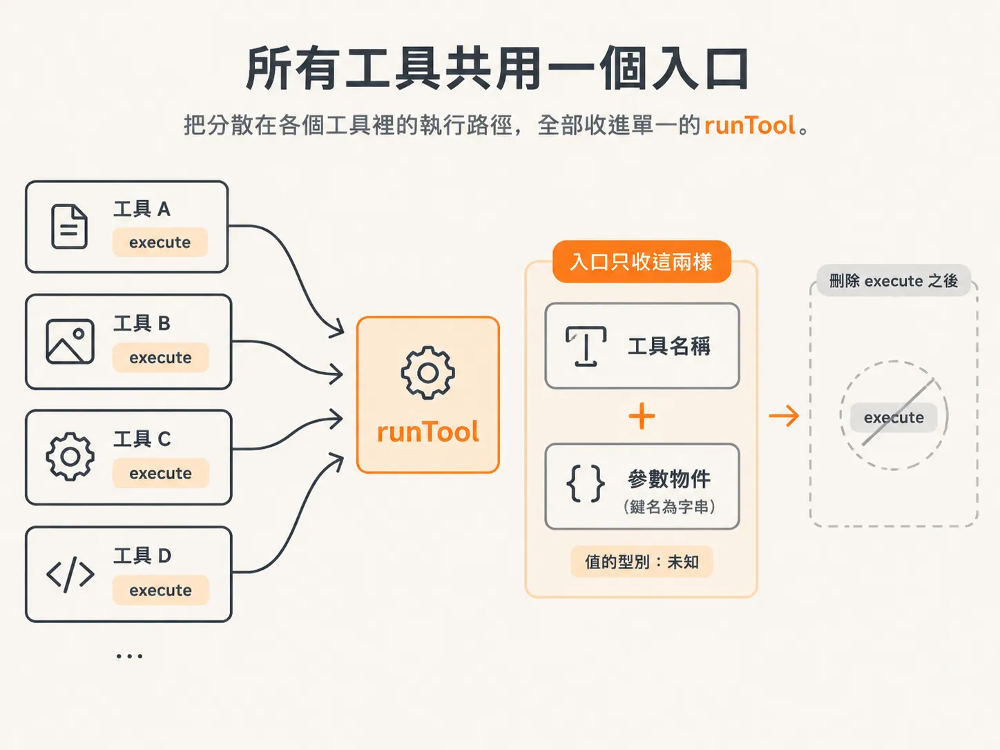
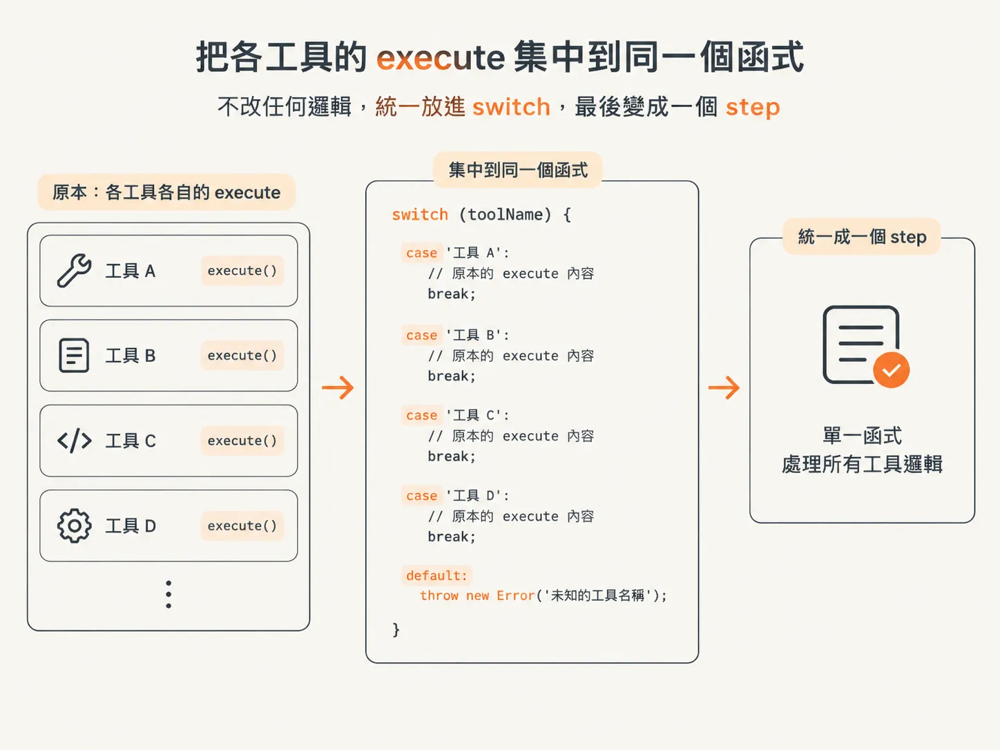
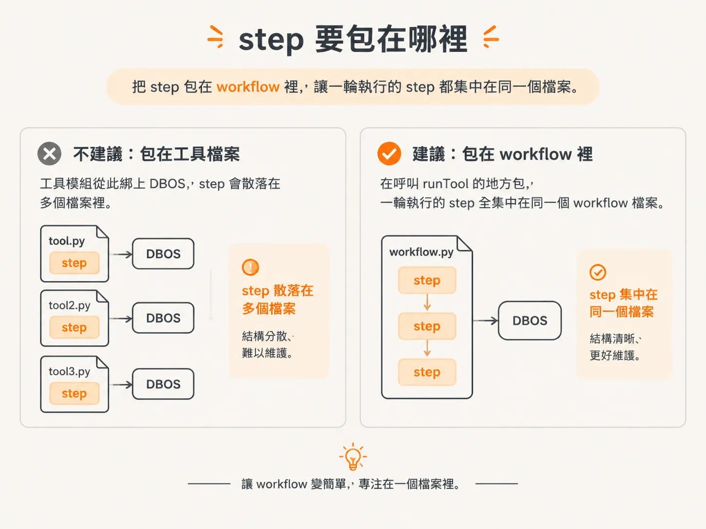
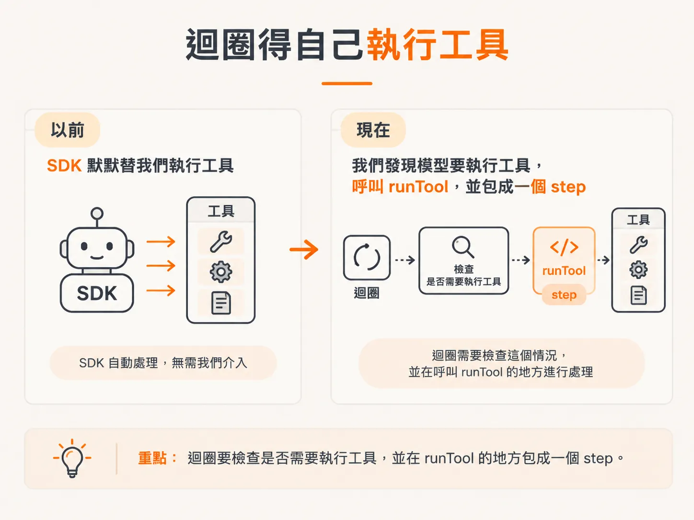

# 把所有工具收進一個 runTool

刪掉 `execute` 後留下的洞，交給一個函式補。原本散在各個工具裡的工作，全部搬進這個函式，之後我們只要包這一個入口。

這個函式就是 `runTool`。它收模型想執行的工具名稱，加上那個工具要的參數。參數一律是物件，鍵名是字串；值的型別現在還不知道，先標成未知。



## `runTool` 長什麼樣

它回傳一個 promise。promise 最後解析出什麼，由我們決定；這個版本先回一個物件，鍵名是字串，值是未知型別。

這些型別標註在執行階段什麼都不做。它們是 TypeScript 的東西，編譯完就被拔掉，只是讓你在編輯器裡寫得順一點。嫌吵的話，先略過也可以。

真正的工作在函式裡：用 `switch` 看工具名稱，每個工具一個 `case`。

## 把內容搬過來，不要重寫

每個 `case` 就放原本那個工具 `execute` 裡的內容。搜尋知識庫、分類項目、寫回覆草稿、送出回覆：已經寫好的邏輯直接貼進對應的 `case`。

這些邏輯一行都不用改。我們沒有要改善它們，只是把它們集中到同一個函式，之後才能一起變成一個 step。



最後一個 `case` 是 `default`。有人要執行不存在的工具，就丟錯誤。這樣找不到工具會是看得見的失敗，而不是悄悄掉出 `switch`。

<!-- source: sources/agent-harness2/20261029/harness-engineering/harness/tools.ts#L97-L129 -->
```ts
// ── The harness-owned executor ──────────────────────────────────────────────
//
// `runCode` is mediated: it never runs in the host process, only in the sandbox.
// The side-effecting tools (sendReply) still run here as normal durable steps.
export async function runTool(
  name: string,
  args: Record<string, unknown>,
): Promise<Record<string, unknown>> {
  switch (name) {
    case "runCode":
      return runInSandbox(String(args.code ?? ""), sandboxApi);
    case "getCharges":
      return { charges: CHARGES[String(args.customerId)] ?? [] };
    case "searchKnowledgeBase":
      return { articles: searchKB(String(args.query ?? "")) };
    case "classifyItem":
      return { ok: true, itemId: args.itemId, category: args.category };
    case "draftReply":
      return { ok: true, draftId: `draft-${args.itemId}` };
    case "sendReply":
      return { sent: true, itemId: args.itemId, draftId: args.draftId };
    case "issueRefund":
      return {
        refunded: true,
        customerId: args.customerId,
        chargeId: args.chargeId,
        amountCents: args.amountCents,
      };
    default:
      throw new Error(`unknown tool: ${name}`);
  }
}
```

這個 `switch` 裡目前都是模擬程式，不會真的送出任何東西。這門課的 agent 聰明或笨拙都無所謂，我們在建的是執行框架，不是 agent。

## step 不要放在這裡

你可能會想直接在這個檔案裡把 `runTool` 包成 step。不要。那會讓工具模組綁上 DBOS，之後想在不引入這個依賴的情況下匯出它都做不到。

要包，就在呼叫 `runTool` 的地方包，也就是 workflow 裡。這樣一輪執行裡的 step 全集中在同一個 workflow 檔案，不用散在整個專案裡再一個個匯入。step 散落在多個檔案是很怪的寫法，能免則免。



## 執行環境現在多了什麼工作

執行這件事被抽出來之後，控制權回到我們手上。意思是 runtime 現在得自己做一件原本 AI SDK 默默做完的事：注意模型有沒有要執行工具，有的話就去執行。

以前 SDK 替我們跑工具，現在換我們跑，所以迴圈要檢查這個情況，而檢查的位置就在呼叫 `runTool` 的地方。接下來要重寫的，就是這個迴圈。


