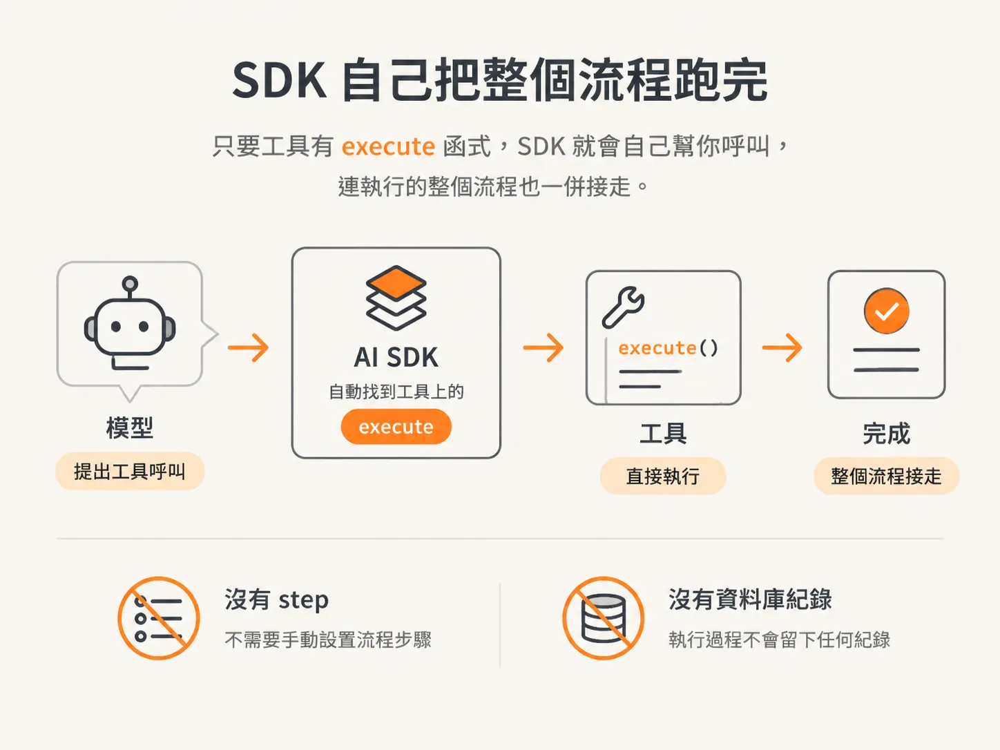
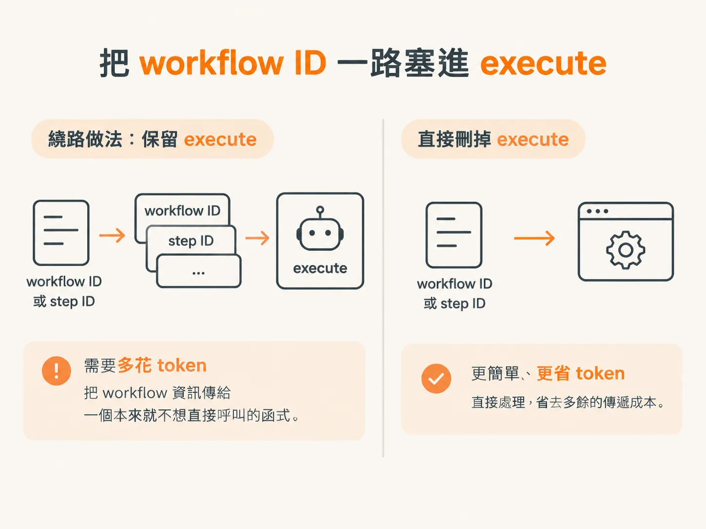
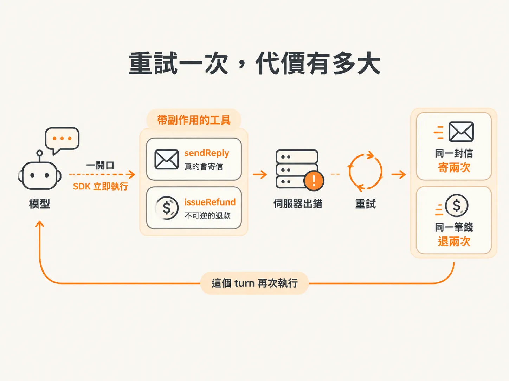
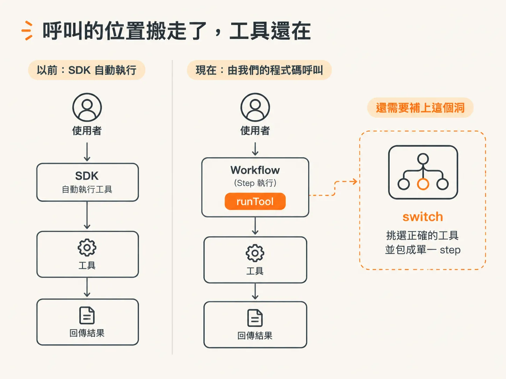

# 刪掉 execute：把工具執行權拿回來

要把工具執行權拿回來，得從工具檔案開始。而且第一步不是加功能，是刪東西。

這個檔案要做的事已經變了。我們只想留一個 `runTool` 函式，由它看模型要哪個工具，就切到並呼叫那個工具。這個單一函式之後會成為一個 step，同一類工作永遠由同一個 step 處理。第一步，就是把工具裡的 `execute` 全部拿掉。

## 為什麼非拿掉 `execute` 不可

這跟程式碼風格無關，是 AI SDK 本來就這樣運作。只要工具有 `execute` 函式，SDK 就會自己幫你呼叫，連執行的整個流程也一併接走。



模型一提出工具呼叫，SDK 看到請求、找到 `execute`，就直接執行。你的程式碼沒有插手的餘地。更麻煩的是，這次呼叫發生在 workflow 外面，不會在 DBOS 的 step 裡跑。沒有 step，就沒有被保存的輸入與輸出，下次重新執行也沒辦法跳過已經做完的工作。

所以問題可以一句話講完：自動執行的工具，就是沒有留下紀錄的工具。某個 turn 因為錯誤而重試，工具就再跑一次；工具只要帶副作用，副作用就跟著再來一次。

## 保留 `execute`、硬把 ID 塞進去，划算嗎

你可以留著 `execute`，再想辦法把 step ID 或 workflow ID 傳進去。這樣一來，自動執行的呼叫也知道自己屬於哪個 workflow。

嚴格說，這樣能跑。但你要多花 token，把 workflow 資訊傳給一個本來就不想直接呼叫的函式。繞這麼大一圈，不如把函式刪掉。



## 工具之後長什麼樣子

剩下的只有宣告。每個工具還是有自己的說明和輸入結構描述，但不再帶執行邏輯。

<!-- source: sources/agent-harness2/20261029/harness-engineering/harness/tools.ts#L48-L95 -->
```ts
export const tools = {
  // Code Mode: instead of chaining a dozen tool calls (each round-tripping
  // through the model), the agent writes ONE program that fetches and analyzes.
  runCode: tool({
    description: [
      "Run a JavaScript program (an async function body) to fetch and analyze data.",
      "Available inside the program:",
      "  • await tools.getCharges(customerId) → [{ id, amount (cents), date, description }]",
      "  • await tools.searchKnowledgeBase(query) → string[]",
      "  • console.log(...) for debugging",
      "Use `return` to return your result (any JSON value).",
    ].join("\n"),
    inputSchema: z.object({ code: z.string() }),
  }),

  classifyItem: tool({
    description: "Classify a work item into a category.",
    inputSchema: z.object({
      itemId: z.string(),
      category: z.enum(["billing", "technical", "sales", "other"]),
    }),
  }),
  draftReply: tool({
    description: "Write a draft reply for a work item. Does not send anything.",
    inputSchema: z.object({ itemId: z.string(), message: z.string() }),
  }),
  sendReply: tool({
    description: "Send the drafted reply to the customer. This really emails them.",
    inputSchema: z.object({ itemId: z.string(), draftId: z.string() }),
  }),

  // Privileged: only the billing specialist gets this. Moves real money.
  issueRefund: tool({
    description: "Issue a refund to the customer. IRREVERSIBLE — this moves real money.",
    inputSchema: z.object({
      customerId: z.string(),
      chargeId: z.string(),
      amountCents: z.number(),
    }),
  }),
```

回頭讀一次工具說明，就知道這件事有多要緊。`sendReply` 真的會寄信給客戶；`issueRefund` 會動到真實款項，所以被標成不可逆。

只要其中任何一個工具掛回 `execute`，模型一開口，SDK 就立刻執行，外面沒有 step 包著。伺服器一出錯、這個 turn 重試，結果可能就是同一封信寄兩次，或同一筆錢退兩次。



## 那現在誰來執行工具

我們自己來。拿掉 `execute` 不會讓工具失去執行能力，拿掉的是 SDK 自動執行的那條路。接下來由我們的程式碼呼叫工具，而且是在 workflow 的 step 裡呼叫。執行能不能持久，就差在這一點。



所以刪掉 `execute` 只是把呼叫的位置搬走，工具本身還是能跑。但這也留下一個洞：總得有個地方，看請求挑出正確的工具，而且那個地方要能被包成單一 step。
