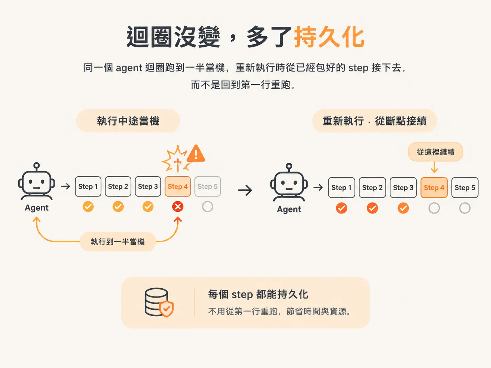
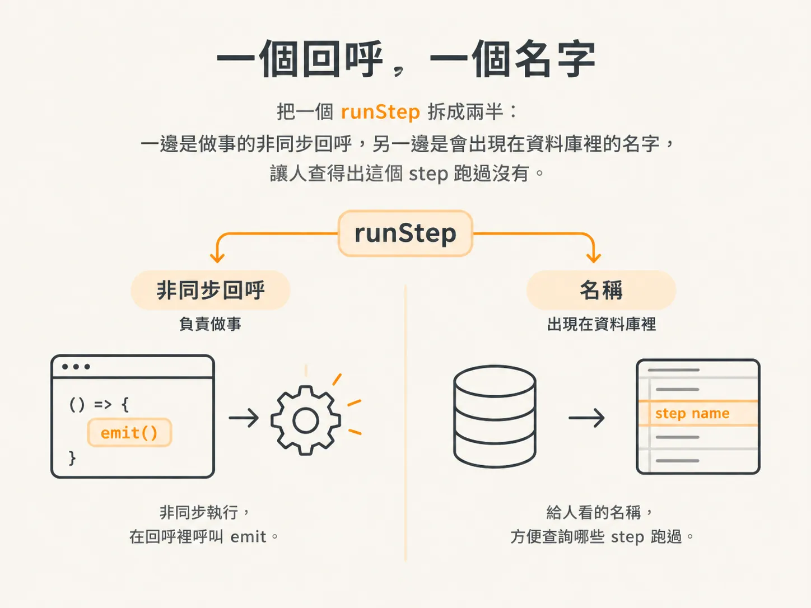
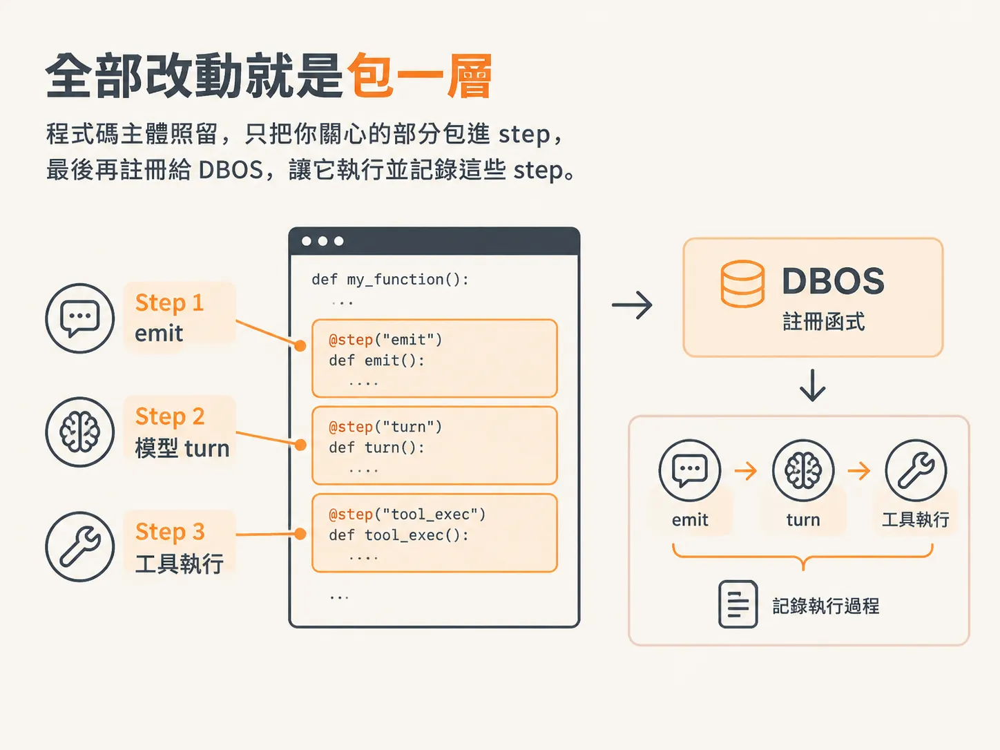
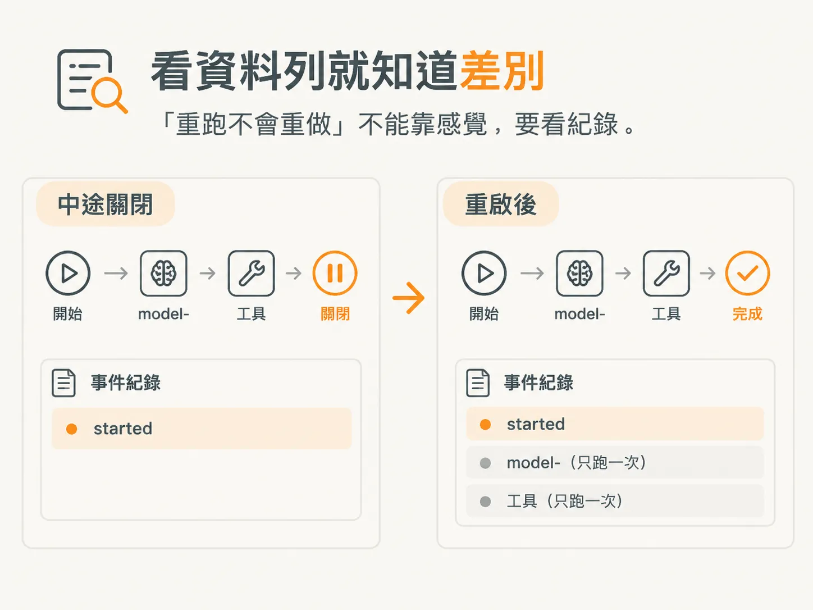

# 用 DBOS.runStep 包住：重跑不會重打 LLM

兩個函式都好了，剩下就是把原本那個迴圈換掉。邏輯不動；差別是包進 `runStep` 的每個 step 都能撐過當機，重新執行時從斷掉的地方接下去，不用全部重來。



差別就這樣。東西都會落到 Postgres，迴圈還是迴圈。

## 先拿到 workflow ID

迴圈要有個身分，才記得住後來發生什麼事。`DBOS.workflowID` 給的就是這個 ID；拿不到就用 `"unknown"`。

後面每個呼叫都會帶上它，step 之後才能靠這個 ID 找回自己的歷史。

## 先把 emit 包成第一個 step

現在的 `emit` 會先把事件寫進事件紀錄，確認那一列真的存在，才通知所有已連線的監聽器。

就是這個順序，讓 `emit` 不能裸奔。沒有包裝的 `emit` 重跑兩次，同一件事就寫成兩列。最後事件紀錄留下來的不是「流程發生過什麼」，而是「你重試了幾次」。所以 `emit` 得進 step。

`runStep` 收一個回呼函式和一個名稱。非同步的活放在回呼裡跑；這裡的活就是呼叫一次 `emit`。名稱是給人看的：它會出現在資料庫裡，你自己的工具也查得出哪些 step 跑過。



<!-- derived -->
```ts
const workflowId = DBOS.workflowID ?? "unknown";

await DBOS.runStep(
  () => emit({ type: EventType.WorkflowStarted, workflowId, input }),
  { name: "started" },
);

const turn = await DBOS.runStep(
  () => modelTurn(workflowId, context, currentAgent.tools),
  { name: `model-${step}` },
);

const output = await DBOS.runStep(
  () => toolStep(workflowId, call),
  { name: `tool-${call.toolCallId}` },
);
```

改動就是這樣。把工作包進 step，由 step 去執行，它就有持久性：輸入和輸出都被追蹤、被存下來，當機也不會讓同一件事再做一次。

## 兩個函式用同一套寫法

`modelTurn` 用 `model-${step}` 當 step 名稱，迴圈裡的每一輪都有名字可以認。`toolStep` 用 `tool-${call.toolCallId}`，每次工具呼叫都跟其他呼叫分得開。

step 名稱比看起來重要。同一次執行裡，兩次 `runTool` 呼叫就是兩個不同的副作用；`tool-${call.toolCallId}` 讓紀錄清楚顯示哪一次做完了、哪一次根本還沒跑。

## 註冊之後，它就是一個 workflow

一行程式碼，把這個函式交給 DBOS 執行和記錄。

<!-- source: sources/agent-harness2/20261029/harness-engineering/harness/runtime.ts#L229-L231 -->
```ts
export const runAgentWorkflow = DBOS.registerWorkflow(agentWorkflow, {
  name: "agentWorkflow",
});
```

在各種持久化執行引擎裡，這大概是最容易講清楚的一種：程式碼照留，只把你關心的部分包進 step。其他引擎通常要設定更多東西。



## 實際驗證：關掉伺服器，再看紀錄

「重跑不會重做」不能靠感覺，要看紀錄。



先跑一次流程，讓它走到工具呼叫，然後把伺服器關掉。重啟之後看資料列，這個 workflow ID 只會有一筆 `started`。當機前跑完的那個 `model-` step 不會再呼叫一次，所以 LLM 不會被同一個問題問第二次。

工具那個 step 之所以不能省，就是這個原因。`sendReply` 是在 step 裡執行，而且那個 step 已經被記錄，重新執行就不會再跑到它。

## 這對測試框架代表什麼

現在有三件事被包進 step：`emit`、模型那個 turn，還有工具執行。每一件都有名字可以在資料庫裡查，也都能看出自己跑過沒有。

之後課程加新功能，一樣套這個模式。當某件事必須真的只發生一次，第一個該問的是：它有沒有被放進 step？
