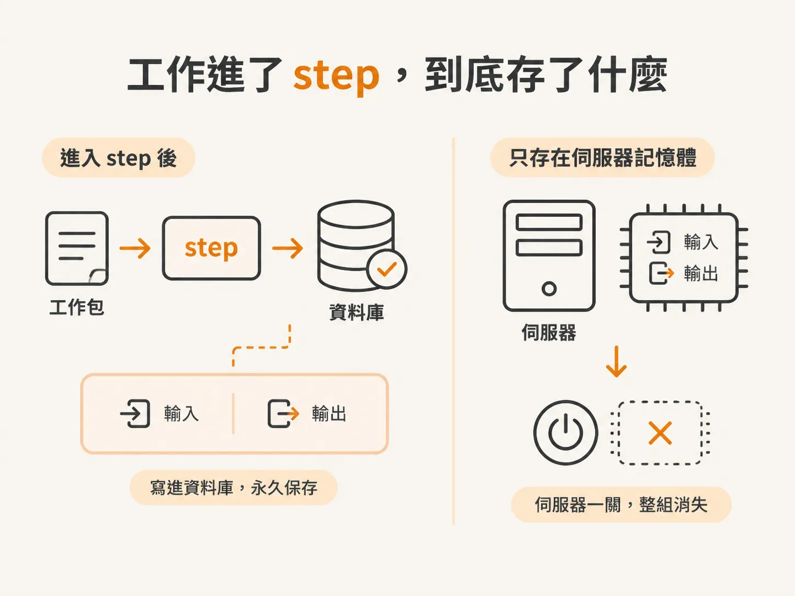
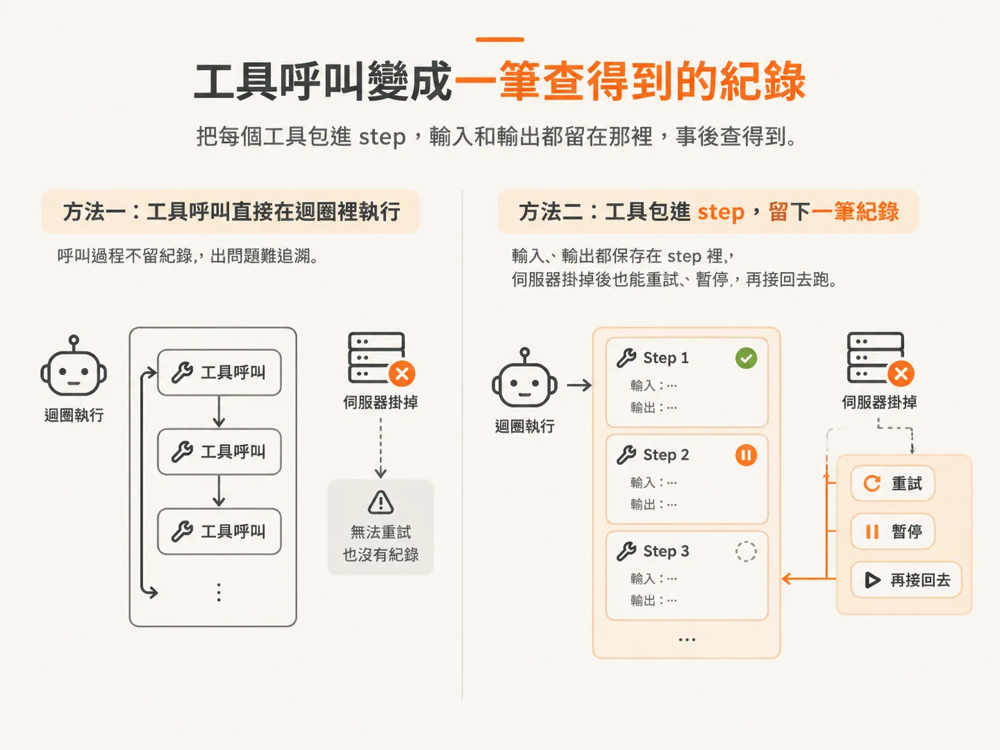
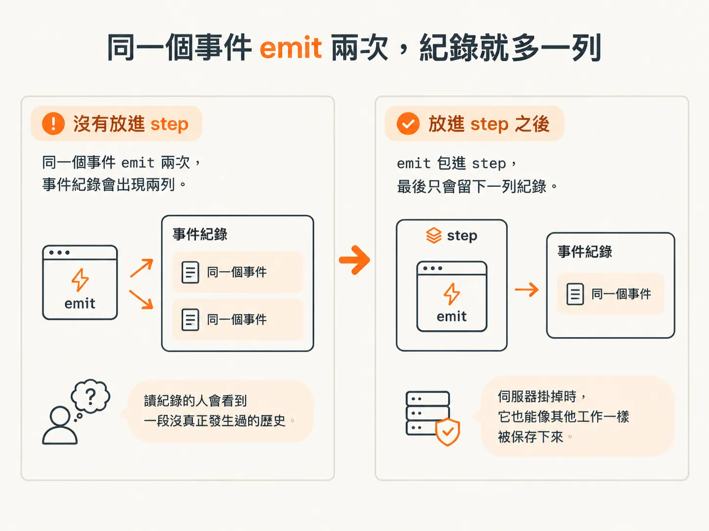
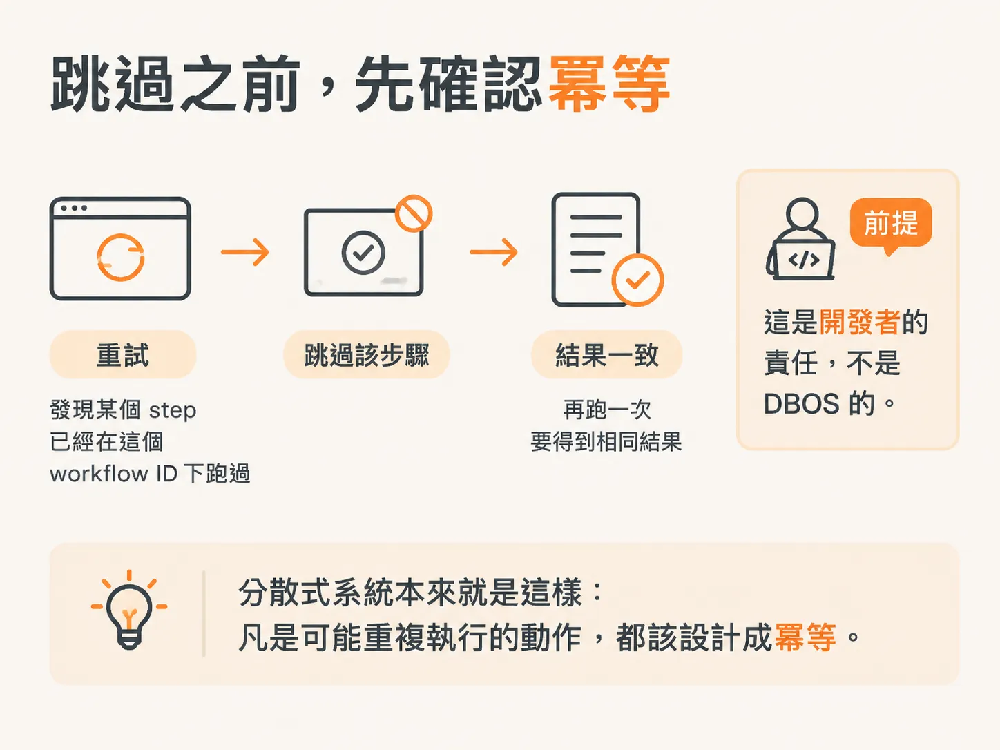

# 工具呼叫與 emit 為什麼要各自包成 step

你手上有一個跑得起來的 Agent runtime：送出訊息後，模型要求呼叫工具，工具執行完畢，再把結果回傳給模型。某個 turn（模型的一輪來回）跑到一半，伺服器突然被關掉了。

這一輪就沒了。模型想到哪裡、工具回了什麼、你已經推給瀏覽器的事件，全都只存在記憶體裡；伺服器一關，這些東西也跟著消失。重開之後，整個流程只能從頭再跑一次，連做完的部分也不例外。

DBOS 就是衝著這件事來的。它是個持久化執行引擎，把你想保住的工作包進 **step**。工作一旦進了 step，這項任務的輸入與輸出就會寫進資料庫。

設計問題也跟著換了。你要問的不再是「這些資料我要怎麼記住」，而是「runtime 裡哪些工作值得被保存」。

以我們現有的 Agent runtime 來說，答案是兩個。

## 工具呼叫是第一個

每一次工具呼叫都值得考慮包成 step。工具可能需要重試，也可能得先暫停、之後再接下去跑。就算伺服器掛了，已經做完的事也不該憑空消失。

如果工具呼叫就放在迴圈裡直接執行，上面這些都保證不了。它就只是一個活在伺服器行程裡的函式呼叫，而行程隨時會停。

把每個工具包進 step，這次呼叫就變成一筆有紀錄的工作，輸入和輸出都留在那裡，事後查得到。

## emit 是第二個

第二個要包成 step 的東西沒那麼顯眼。runtime emit 一個事件時，我們做的 event bus 會把事件寫進資料庫裡的事件紀錄。

重複事件就是在這裡出問題。同一個事件 emit 兩次，事件紀錄就多一列。之後讀這份紀錄的每個元件，看到的都是一段沒真正發生過的歷史。

所以 emit 也要進 step，避免事件重複寫入；伺服器掛掉時，它也能像其他工作一樣被保存下來。

## step 是零件，workflow 是組合方式

目前我們交給 DBOS 的就是這兩類工作。包成 step 之後，這些 step 串起來就是一個 workflow。

workflow 不是另外疊上去的一層大抽象。每個重要環節各自成了 step，workflow 就是這樣長出來的。

真正的好處要等到重試才看得出來。流程在某個地方失敗後，你可以去看各個 step 的執行結果，發現某個 step 已經在這個 workflow ID 下成功跑過，就直接跳過它。

但只有 step 具備**冪等性**時，跳過或重試才安全。也就是說，再跑一次，結果還是一樣。

這件事是你的責任，不是 DBOS 的。分散式系統本來就是這樣：凡是可能重複執行的動作，都該設計成冪等。

## 還缺什麼

知道 step 該放在哪裡，不代表它們已經真的被包起來了。模型還是會自己決定要呼叫哪個工具，而只要工具上掛著 `execute` 函式，AI SDK 看到工具就會立刻替你執行。

自動執行就是問題所在。它在 step 外面跑工具，執行紀錄不會進資料庫；下次重新執行，工具的副作用可能再發生一次。

所以在動手包裝之前，得先把工具執行權拿回來。
