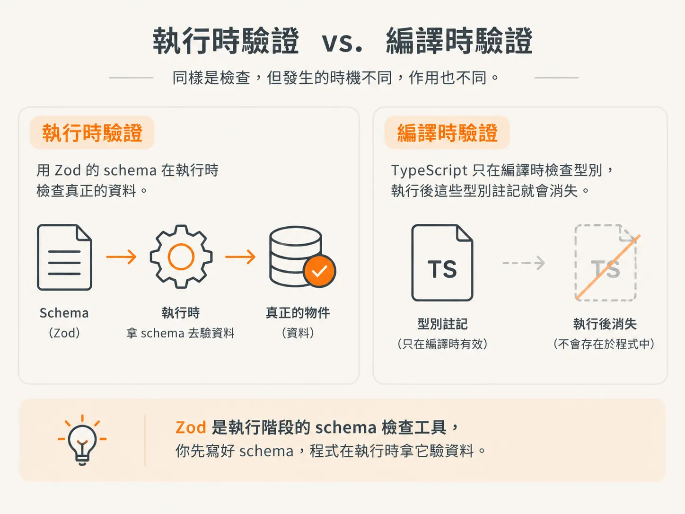
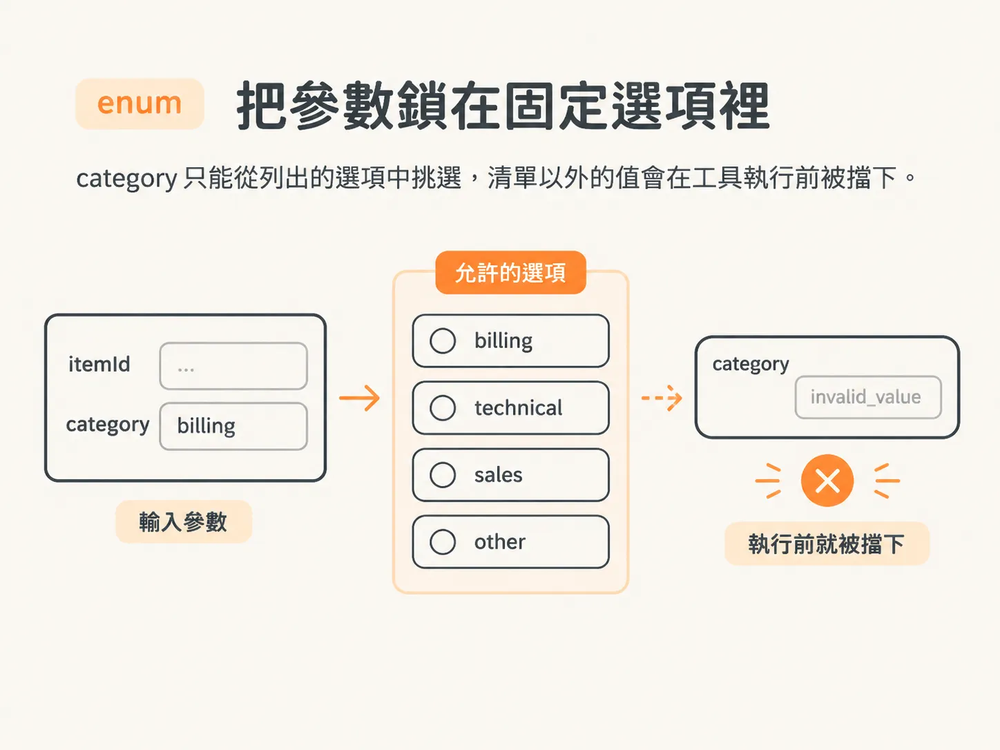
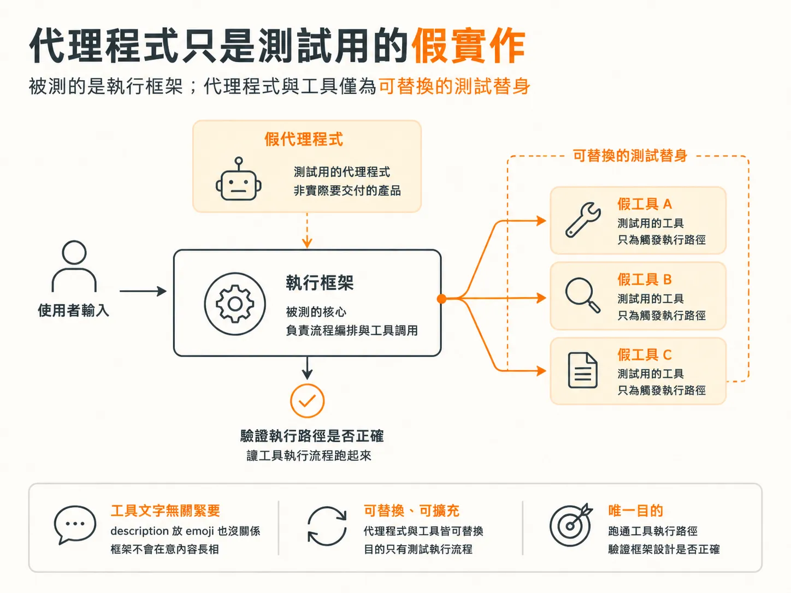

# classify item 與 draft reply

## 兩個承載更多意義的工具

上一步提到接下來會用到兩個工具。`classifyItem` 必須從固定選項裡挑一個類別；`draftReply` 則要準備一段訊息，留給後面的步驟寄出。這兩件事不是只寫在說明裡，schema 會強制執行。

這兩個工具也刻意做得很單純：只回傳 `ok: true`，把收到的資料原樣帶回去，不會改變外部世界的任何狀態。這個代理程式只是讓執行框架有東西可操作，用一個測試用的假實作就夠了。

## Zod 在執行時檢查 schema

先定義一個名詞。Zod 是執行階段的 schema 檢查工具：你先寫好 schema，程式在執行時拿它驗資料，而不是只在 TypeScript 編譯時檢查。



它有點像能在執行時運作的 TypeScript，也有點像拿來檢查記憶體裡物件的資料庫 schema。Zod 是 JavaScript 裡最受歡迎的選擇，也相容於 AI SDK，所以會出現在匯入程式碼裡。

## classifyItem 用 enum 限定類別

`classifyItem` 的結構和上一步一樣：`description`、input schema 和 `execute`。`description` 說它會把工作項目分類；schema 則是一個只有兩個欄位的物件。

`itemId` 是字串。`category` 是 enum，只能從列出的選項裡挑一個。這裡的選項是 `billing`、`technical`、`sales` 和 `other`。



<!-- source: sources/agent-harness2/20261029/harness-engineering/harness/tools.ts#L63-L73 -->
```ts
classifyItem: tool({
  description: "Classify a work item into a category.",
  inputSchema: z.object({
    itemId: z.string(),
    category: z.enum(["billing", "technical", "sales", "other"]),
  }),
}),
draftReply: tool({
  description: "Write a draft reply for a work item. Does not send anything.",
  inputSchema: z.object({ itemId: z.string(), message: z.string() }),
}),
```

這四個類別不是仔細規劃過的分類法。知識庫裡剛好有 `billing`，卻沒有 `technical`。其他類別是隨手挑的，也沒有為任何一個類別寫過 eval。

這樣也行，重點不在標籤本身。代理程式可以很爛，執行框架照樣得測。真正要緊的是：拿你打算用來測試的提示丟進去時，工具會被呼叫，所以類別清單要短，才測得到。

## execute 只會回傳 ok

`execute` 幾乎什麼也不做。它收到工作項目 ID 和類別，就回傳 `ok: true`，把同樣的值原樣帶回去。代理程式會把這個物件當成這一步完成的確認。

資料沒有存下來，工作項目也沒有移動。這個工具的作用，是給模型一個可以接著處理的結果，讓流程繼續跑，也讓執行框架有下一步可以記錄。工具什麼都不回，流程就卡住了。

## draftReply 會建立草稿，但不會寄出

`draftReply` 的做法一樣，只是進來的資料不同。`description` 說它會替工作項目寫一則回覆草稿，但不會寄出任何東西。schema 收 `itemId` 和 `message`，兩個都是字串。

`execute` 回傳 `ok: true`，再加上一個用工作項目 ID 拼出來的假 `draftId`。`message` 完全沒被用到。真正的實作會把草稿存起來；這裡只告訴代理程式草稿已經存在。

欄位描述是另一個可以調的地方。在 schema 欄位上加 `describe`，就能先回答模型可能對這個欄位的疑問。要不要加，看模型和資料而定：如果每個物件裡都有叫 `itemId` 的欄位，意思很清楚；如果 ID 是用別的名字傳進來，就得用一句話講明白。

## 代理程式只是測試用的假實作，字串怎麼寫都行

這些工具裡的文字沒特別設計過。你就算在 `description` 裡塞個 emoji，執行框架也不在意。這個代理程式只是拿來測框架的假實作，不是任何人會真的拿來用的產品。



這也解釋了類別清單為什麼隨便、`execute` 為什麼只把資料原樣送回來。但下一個工具不是這樣。`sendReply` 看起來是同一套做法，實際上會把電子郵件寄給客戶。差這一點，天真的執行框架就撐不住了；`description` 裡寫「先詢問使用者」也救不回來。
