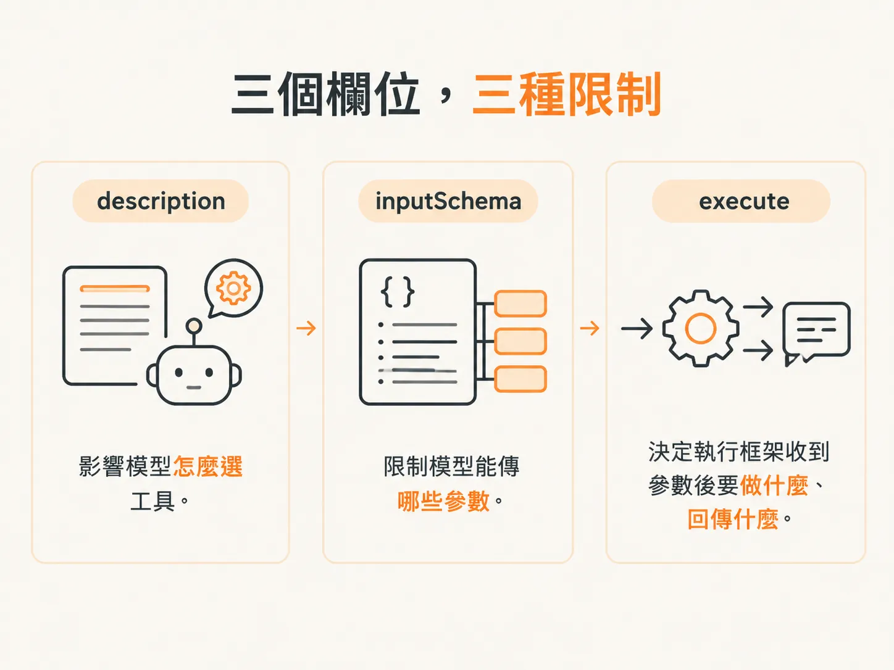
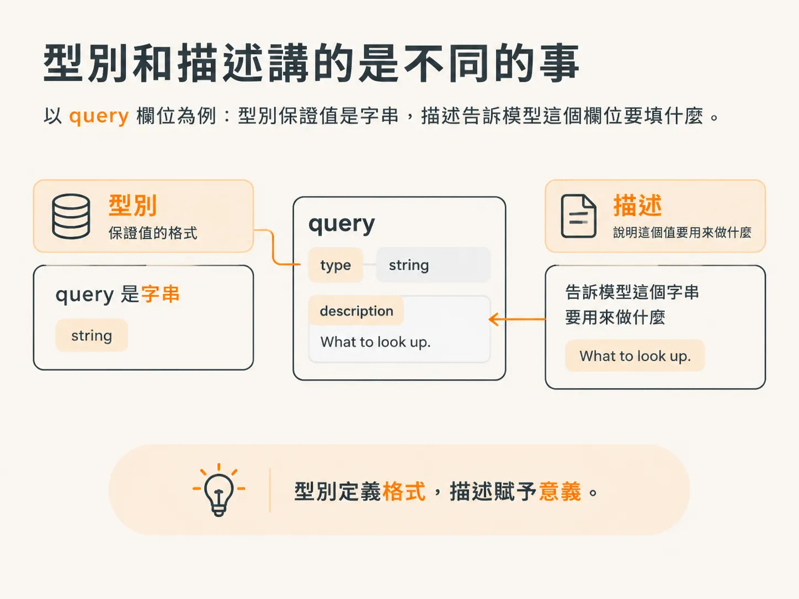
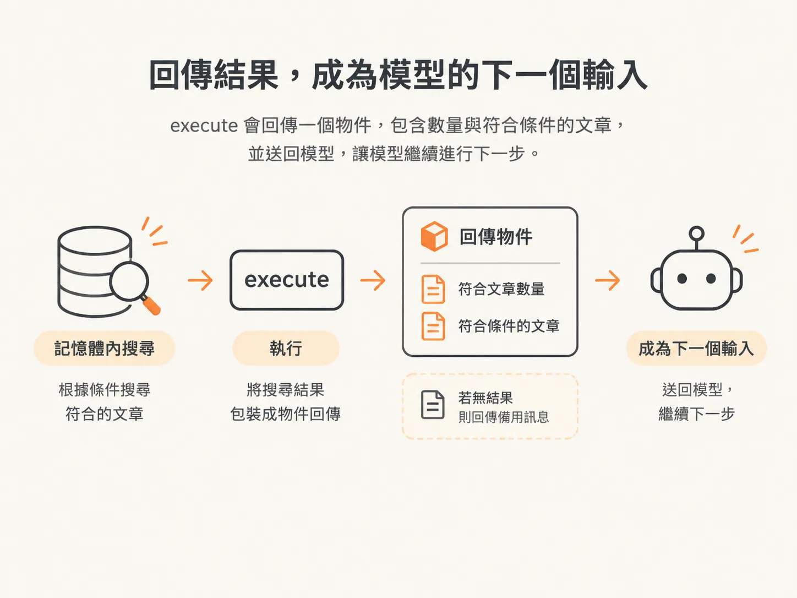

# 工具的 description、input schema 與 execute

## 從 function 到 tool

上一步已經替執行框架準備好一份知識庫和 `searchKB` 函式，但模型還碰不到。工具定義把兩邊接起來，也回答了上一步最後那三個問題。

AI SDK 有 `tool()` 輔助函式，傳進去的物件裡放 `description`、`inputSchema`，還有一個 `execute` 函式。最後把工具收成一個匯出的物件，執行框架就能照工具名稱把它們交給模型。

<!-- derived -->
```ts
export const tools = {
  searchKnowledgeBase: tool({
    description: "Search the support knowledge base for relevant articles.",
    inputSchema: z.object({
      query: z.string().describe("What to look up."),
    }),
    execute: async ({ query }) => {
      const q = query.toLowerCase();
      const articles = Object.entries(KNOWLEDGE_BASE)
        .filter(([key]) => q.includes(key))
        .map(([, article]) => article);
      return articles.length
        ? { count: articles.length, articles }
        : { count: 0, message: "No exact match — use your judgment." };
    },
  }),
};
```

這三個欄位各管各的：`description` 影響模型怎麼選工具；`inputSchema` 限定模型能傳哪些參數；`execute` 決定執行框架收到參數後要做什麼、回傳什麼。



## description 決定模型是否呼叫工具

模型決定要不要呼叫工具時，讀的就是 `description`。你可以把它寫成使用時機的提示，也可以直接講工具在做什麼。這裡寫的是：搜尋支援知識庫，找出相關文章。

沒有唯一正確的寫法，只有程度差別。模型判斷帶有機率性，所以真正的問題是：哪種描述能提高模型叫對工具的機率？這只能靠 eval 來量。

所以描述要短、要具體。你不是在替人寫文件，而是在提供模型挑工具時唯一的線索。

## input schema 是輸入時的合約

`inputSchema` 是工具呼叫時必須遵守的合約。代理程式一旦決定呼叫這個工具，就得一併提供指定的參數。接著執行框架代替代理程式執行工具，並照收到的資料結構處理。

沒有這份合約，函式可能收到根本不能用的參數。schema 把猜測拿掉：`query` 是必填、型別是字串，工具裡的程式碼就知道會收到什麼。

`describe` 能替欄位補意義，就像工具的 `description`。以 `query` 為例，它的描述是 `What to look up.`。型別說明它是字串，描述則說明這個字串要用來做什麼。



這兩段文字也可以用「新人測試」檢查。試著跟剛進團隊的同事講這個工具：他們為什麼要用？這個參數是幹嘛的？兩個文字欄位要做的就這麼多。

## execute 才是真正執行的部分

`execute` 就是工具被呼叫時實際跑的東西。它收到的是照 `inputSchema` 定義的物件，所以裡面的 `query` 型別已經正確。

在裡面幾乎什麼都能做，包括呼叫另一個模型，但有一條規矩：一定要回傳東西。回傳值會送回 LLM，工具一直不回，流程就沒東西給模型讀。

要回傳什麼，是設計選擇；問題是你想讓模型看到什麼。這裡的 `execute` 沿用上一步的記憶體內搜尋，回傳一個物件，裡面有結果數量和符合條件的文章。



查不到結果時，也要有專屬的回傳格式。工具回傳 `count: 0`，加上搜尋功能本來就會給的 `No exact match — use your judgment.`。模型讀到這段文字，就知道下一步該怎麼做，不用盯著空陣列發呆。

## 下一步還需要加入什麼

`searchKnowledgeBase` 只負責讀資料，執行它不會動到程式之外的任何東西，所以簡單的執行框架可以放心呼叫。接下來兩個工具就不一樣了：`classifyItem` 必須從固定選項裡指定一個類別，`draftReply` 要準備一則訊息給後面的步驟寄出。這兩個工具的 schema 欄位都要多帶一點意義，也都要用 `describe` 說明每個欄位代表什麼。
