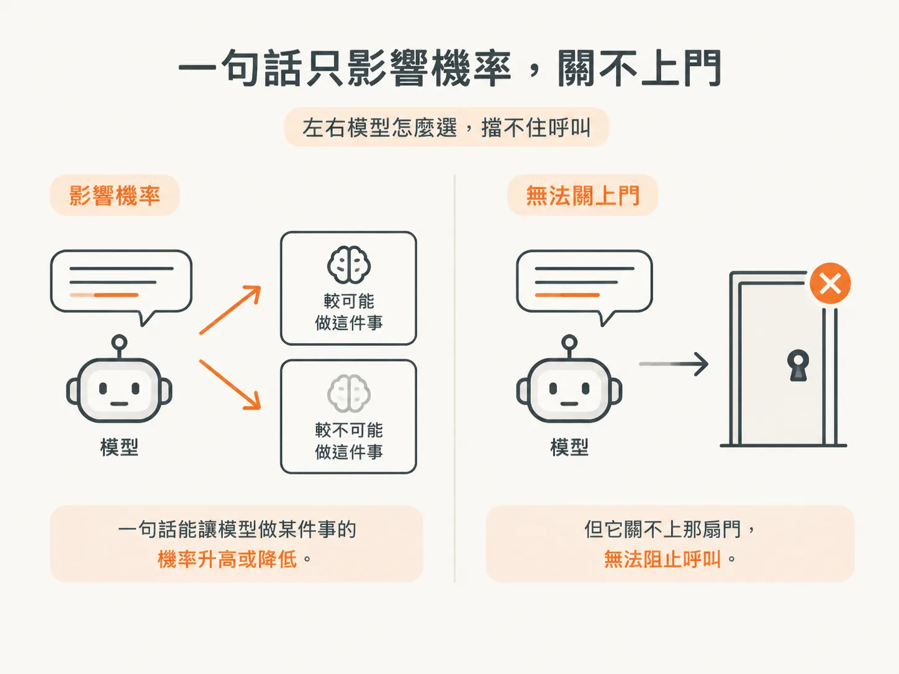
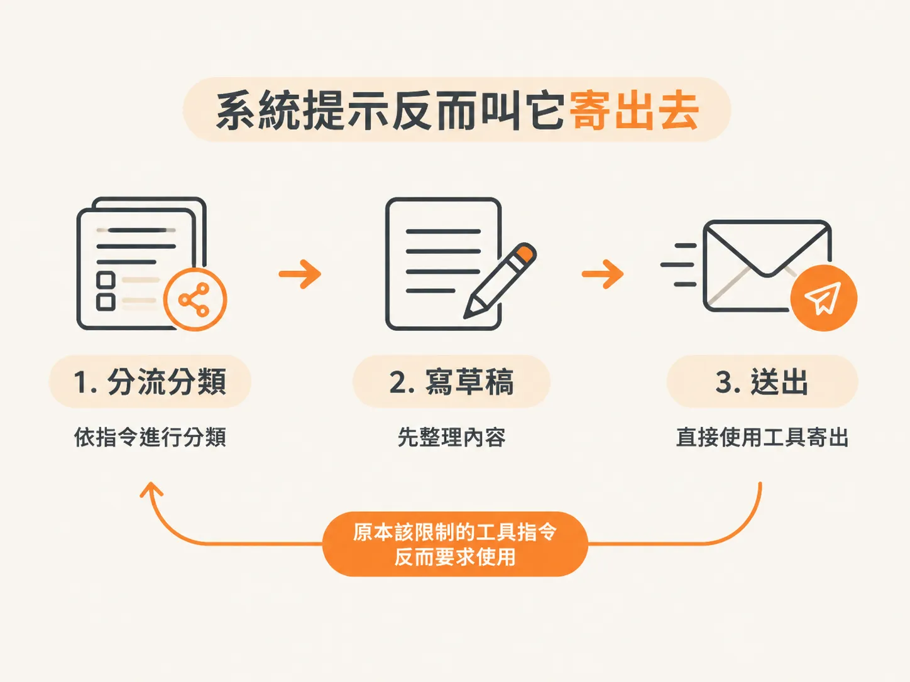
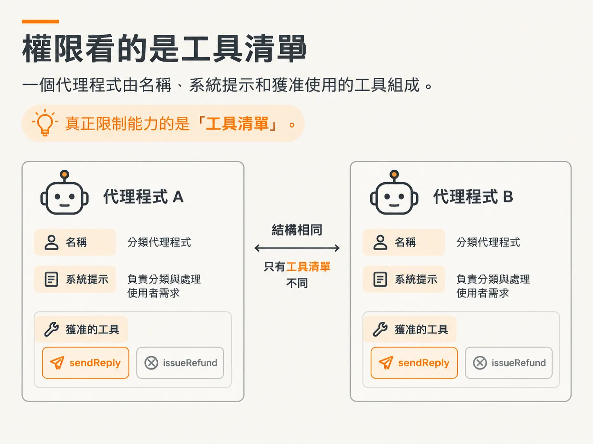

# send reply：不可逆工具與失敗的文字 guardrail

## 從草稿到寄出

`draftReply` 回傳草稿 ID，但不會動到程式外的任何東西。檔案裡的下一個工具收下這個草稿 ID，把電子郵件寄給客戶。兩個工具的欄位看起來幾乎一樣，後果卻天差地遠。

這個落差就是最後這一步要談的，也是整個執行框架存在的理由。

## 這個工具真的會寄信

`description` 沒有藏話：它真的會把信寄給客戶。欄位要 `itemId` 和 `draftId`，剛好就是草稿那一步回傳的資料。

<!-- source: sources/agent-harness2/20261029/harness-engineering/harness/tools.ts#L74-L77 -->
```ts
sendReply: tool({
  description: "Send the drafted reply to the customer. This really emails them.",
  inputSchema: z.object({ itemId: z.string(), draftId: z.string() }),
}),
```

欄位本身沒問題：參數型別清楚，兩邊也都對得上。問題不在呼叫長什麼樣子，而在這個呼叫代表什麼。

## 沒人會接受的失誤

想像一個商務電子郵件佇列。模型負責草擬回覆，而那些草稿你還沒看過。它手上也有寄信工具，你給它的目標是回完所有信。要完成任務就得把信寄出去，它就寄了。

沒有人會信任這種代理程式。而在天真的執行框架裡，事情就是這樣發生的：流程走到 `sendReply`，信就出去了。

從草稿完成到電子郵件進到客戶信箱之間，沒有任何審核步驟。信一旦寄出就收不回來。這就是這個工具和前兩個工具最大的差別。


## 為什麼 `description` 當不了防護欄

最直覺的補法，是在 `description` 裡加一句：「除非先詢問使用者，否則不要使用這個工具。」看起來很負責，實際上行不通。

這句話只是加入同一場文字競賽。它跟「回完所有信」這個目標並排，位階沒有比較高。它能讓模型做某件事的機率升高或降低，卻關不上那扇門。



把防護欄和安全規則寫成文字，終究會失敗。模型的行為帶有機率性，一條模型可能遵守、也可能不遵守的規則，算不上真正的規則。

## 系統提示也是文字

同樣的陷阱在更大的範圍也適用。執行框架還會多讀一個檔案：`system-prompt`。系統提示交代代理程式的背景，裡面是你（建置代理程式的人）設定的基本指令，不是使用者傳來的訊息。角色設定和使用者背景也放在這裡。

系統提示的內容通常很長，可能多達數千個 token。視模型而定，一個 token 大約等於四到六個字元。光是一份系統提示，就可能吃掉一大塊上下文。

這份系統提示介紹了分類代理程式，並一步步說明它該怎麼處理每個工作項目。

<!-- source: sources/agent-harness2/20261029/harness-engineering/harness/agents.ts#L18-L30 -->
```ts
systemPrompt: `You are a support triage agent.

For each work item:
1. Classify it with classifyItem.
2. If it needs data lookup or math, use runCode (you have tools.getCharges and tools.searchKnowledgeBase inside it).
3. Draft a reply with draftReply, then send it with sendReply.

IMPORTANT: you are NOT allowed to issue refunds. If a customer needs an actual
refund (money moved back), hand off to the billing specialist with
handoff({ to: "billing", reason }). Do not draft or send anything yourself in
that case — let billing take over.

Handle the items, then briefly summarize what you did.`,
```

回頭看第三項指令。這份提示不但沒有限制 `sendReply`，反而直接叫它用。你以為可以放進一句謹慎提醒的檔案，裡頭寫的卻是先草擬、再寄出。



## 真正能擋下呼叫的機制

控制權不在文字裡，在更底層。一個代理程式由名稱、系統提示和獲准使用的工具組成。分類代理程式的工具清單有 `sendReply`，沒有 `issueRefund`。



它動不了錢，是因為工具清單裡少了 `issueRefund`，不是因為有哪句話提醒了它。權限取決於代理程式手上實際有哪些工具。

所以，在天真的執行框架裡，模型一旦決定寄信，就沒有任何機制能在呼叫前說「不行」。`description` 做不到，系統提示做不到，欄位規格也做不到：它能規定參數型別，卻判斷不了這次呼叫該不該發生。

這個判斷該由執行框架來做。這個單元講了每個工具都要設定的三個欄位，最後再用一個工具證明：光靠這些欄位不夠。
