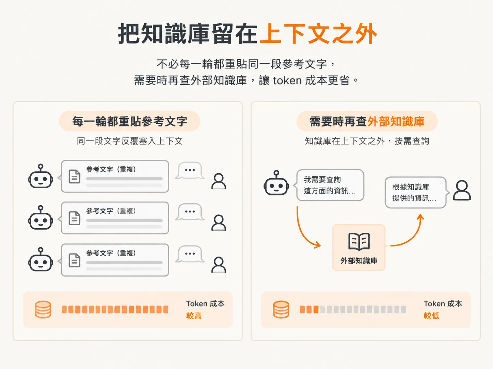
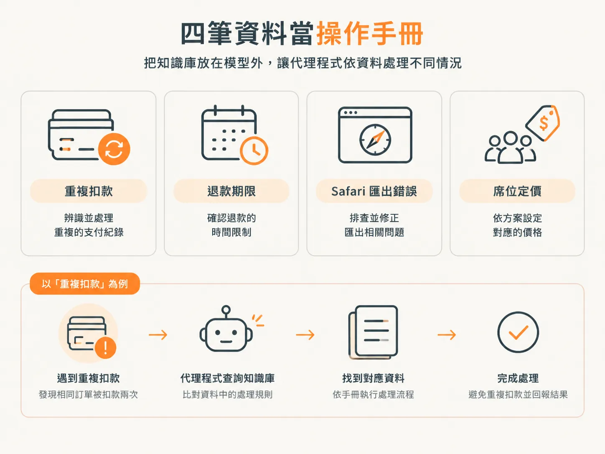
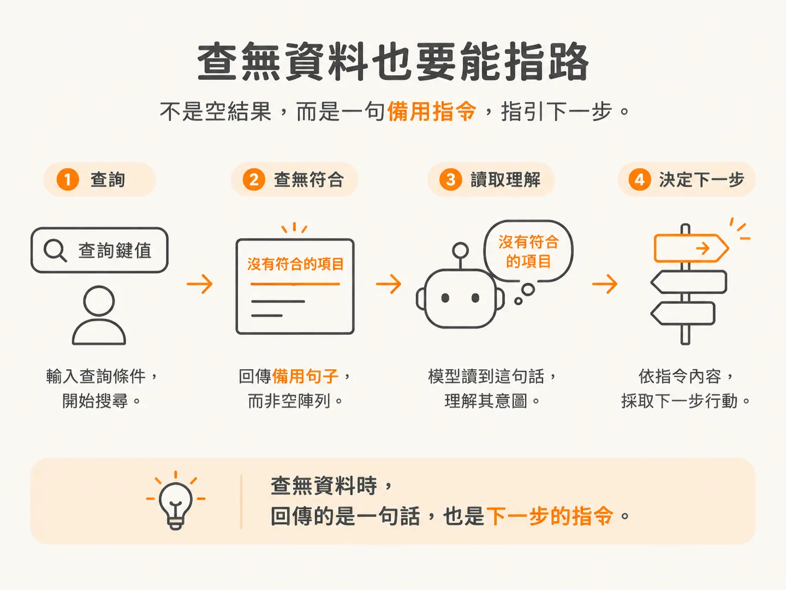

# 建立 tools 檔與假的 knowledge base

## 前言

模型只會產生文字。它查不了費用、分不了客服單，也寄不出電子郵件。這些事之所以做得到，是因為有人把它們寫成工具，交給執行框架去用。

少了這些準備，你做出來的就只是剛好成功一次的展示。流程會呼叫工具、讀結果、再呼叫另一個工具，直到它覺得可以回答為止。過程中沒有紀錄，擋不住重複執行有副作用的操作，也不會在錢要動之前停下來問人。等你第一次把能影響外部世界的工具交給代理程式，就會看到這些缺口。

這個單元會分四個步驟補上缺口：建立工具檔和背後的知識庫、區分每個工具都有的三個欄位、用 Zod 撰寫兩個安全工具，再加入一個不可逆的工具，看看只靠文字設定的防護措施為什麼擋不住它。

第一步先回答一個較小的問題：在執行框架把工具交給模型之前，必須先準備好什麼？

## 先建立檔案，不急著做功能

執行框架首先需要的是一個檔案。在 `harness/` 裡建立 `tools.ts`。AI SDK 提供了 `tool` 輔助函式，因此這個檔案需要從 `ai` 匯入 `tool`，並從 `zod` 匯入 `z`。

這門課做的是執行框架，不是打磨到能上線的代理程式。代理程式本身還有一堆事要處理，所以底層資料先用簡單、通用的假資料頂著。第一份假資料就是知識庫。

知識庫是一批代理程式可以查的資訊，你可以把它想成代理程式查資料用的維基百科。把資料留在上下文之外，而不是每一輪都重貼同一段文字，token 就不用一遍又一遍重花。



所謂「放在外部」，是說代理程式得透過你選的機制去拿資料。RAG 可以，傳統搜尋也可以。這個檔案用最簡單的做法：在記憶體裡搜四筆資料。

<!-- source: sources/agent-harness2/20261029/harness-engineering/harness/tools.ts#L18-L26 -->
```ts
const KNOWLEDGE_BASE: Record<string, string> = {
  billing:
    "Double charges are usually a duplicate authorization that drops off in 3–5 days. If it already settled, refund immediately.",
  refund: "Refunds post in 5–10 business days. Pro accounts can be expedited.",
  export:
    "The Safari export failure is a known bug (TICKET-4412). Workaround: use Chrome or the CSV export.",
  pricing:
    "Team plans are $20/seat/mo with a volume discount at 25+ seats. For 50+ seats, send the pricing PDF.",
};
```

這四筆要當操作手冊看，不是說明文件。遇到重複扣款時，`billing` 說這通常是重複授權，會在三到五天內消失；如果款項已經完成請款，則會立即退款。`refund` 說明退款入帳要五到十個工作天，也提到 Pro 帳戶可以加快。

`export` 把 Safari 匯出失敗列為已知問題 TICKET-4412，並提供改用 Chrome 或匯出 CSV 的替代方案。`pricing` 列出 Team 方案費率、適用的用量門檻，並指示超過五十個席位時寄送定價 PDF。

這些資料就是代理程式遇到不同情況時照著做的操作手冊，所以要放在模型外面。代理程式的行為依據放在能編輯、能比對差異的檔案裡，而不是一條只能指望模型記住的提示詞。



<!-- source: sources/agent-harness2/20261029/harness-engineering/harness/tools.ts#L28-L34 -->
```ts
export function searchKB(query: string): string[] {
  const q = query.toLowerCase();
  const hits = Object.entries(KNOWLEDGE_BASE)
    .filter(([key]) => q.includes(key))
    .map(([, article]) => article);
  return hits.length ? hits : ["No exact match — use your judgment."];
}
```

搜尋先把查詢文字轉成小寫，再留下鍵值有出現在查詢裡的那幾筆。這裡刻意做得很笨，因為這門課不教 RAG：比對方式就是看鍵值是不是小寫查詢字串的一部分。

查無結果時怎麼處理，跟找到資料一樣重要。沒有符合的項目時，函式回傳的是一句話，不是空陣列。這句話本身還是指令：模型讀到它，再決定下一步怎麼做。



這些資料到底有沒有讓輸出變好，是另一個問題。要衡量這些上下文對代理程式的影響，得靠 eval，但這不在本課程範圍。

## 下一步需要補上什麼

目前知識庫和查詢函式都已經在了，但模型兩個都還碰不到。要讓模型呼叫 `searchKB`，得先回答三個問題：怎麼向模型說明這個工具、模型必須提供哪些參數，以及收到呼叫後執行框架要做什麼。下一步逐一處理。
