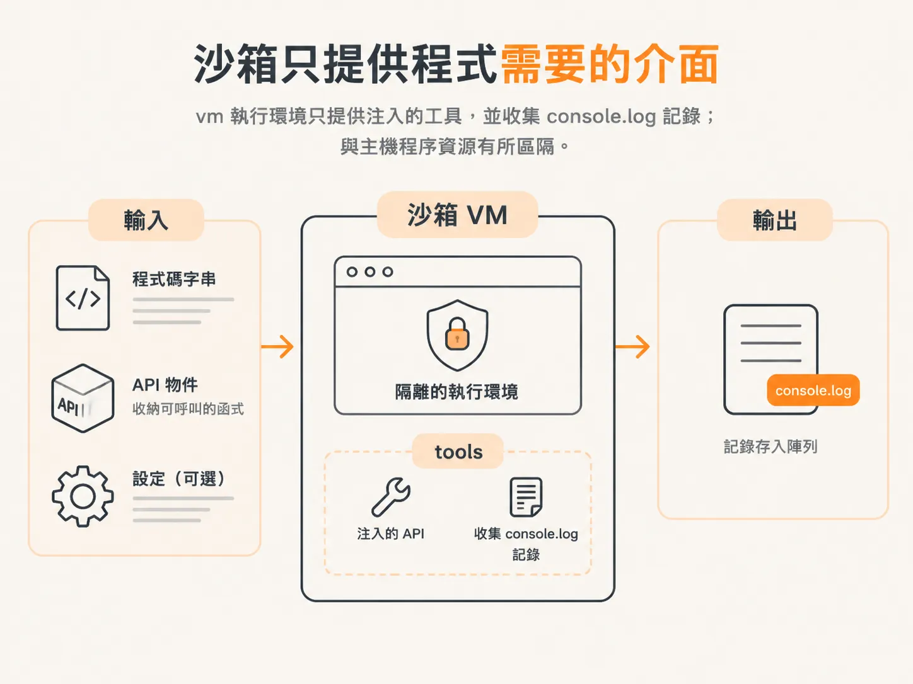
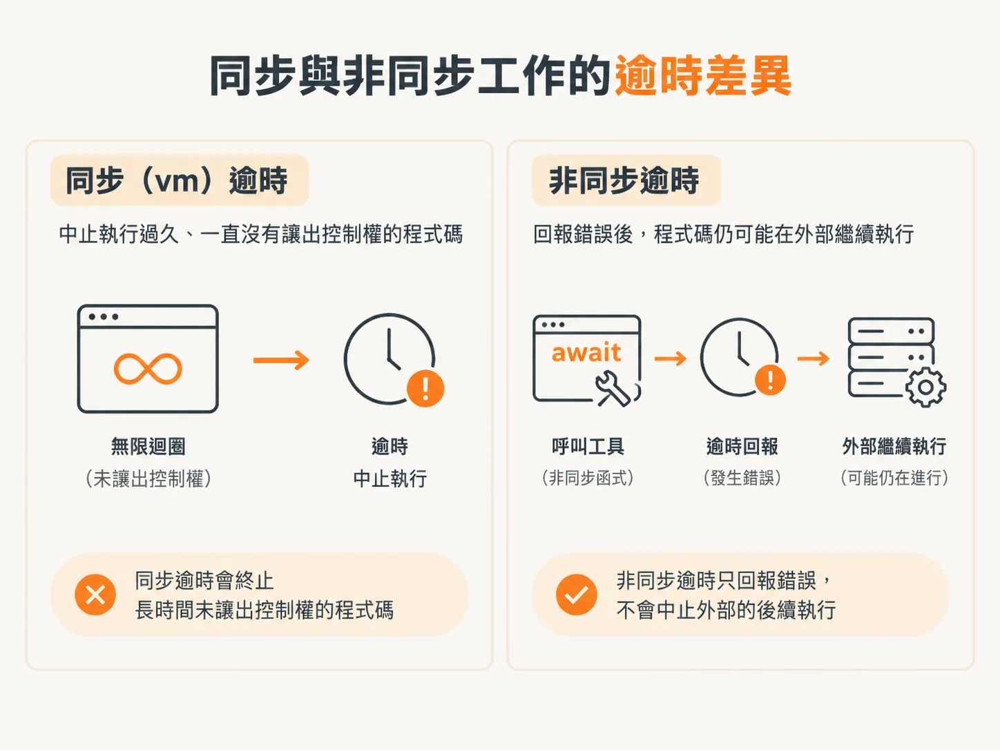

# 用 `node:vm` 包出 `runInSandbox`

前一步已經畫出界線：模型產生的程式碼不能直接在正式環境伺服器上執行。接著要做的是提供一個介面，限制程式能存取哪些內容、能執行多久。這個離線範例用 `runInSandbox` 來做。

這個函式接收三個輸入：程式碼字串、API 物件，以及可選的設定。API 物件收納程式可以呼叫的函式；執行環境會透過 `tools` 提供這些 API，並把 `console.log` 的輸出存進陣列。



包裝函式會把程式碼放進非同步函式執行，因此程式碼可以用 `await` 呼叫工具，也能用 `return` 傳回結果。同步的 `vm` 逾時設定會中止執行過久、一直沒有讓出控制權的程式碼；另一個逾時設定則會在非同步操作卡住時回報錯誤。



`node:vm` 不是真正安全的沙箱。逾時機制無法停止已脫離包裝函式、仍在外部執行的非同步工作。這個包裝函式可以限制程式碼的存取，但正式環境仍應改用託管式沙箱，或隔離能力更強的執行環境。下一步會替代理程式加入 `runCode` 工具，讓它用程式計算退款金額。

<!-- source: sources/agent-harness2/20261029/harness-engineering/harness/sandbox.ts#L1-L60 -->
```ts
import vm from "node:vm";

// The harness is the security boundary. When the agent writes code (Code Mode),
// it runs HERE — never with raw access to the process.
//
// This is `node:vm`, which is deliberately minimal:
//   · the context has NO `require`, `process`, `fs`, `fetch`, ... — only what we
//     hand in (a small `tools` API + `console.log`)
//   · the `timeout` option kills runaway SYNCHRONOUS code (e.g. `while(true){}`)
//
// Be honest about the limit: `vm` is NOT a true security sandbox, and its
// timeout can't interrupt async code. That's exactly why production systems run
// untrusted code in a hosted sandbox (e2b, Cloudflare's Sandbox SDK, Fly,
// Vercel, Daytona). The harness's job is to MEDIATE the boundary; the strength
// of the boundary is a deployment choice.

export type SandboxResult =
  | { ok: true; result: unknown; logs: string[] }
  | { ok: false; error: string; logs: string[] };

export type SandboxApi = Record<string, (...args: any[]) => unknown>;

export async function runInSandbox(
  code: string,
  api: SandboxApi,
  opts: { timeoutMs?: number } = {},
): Promise<SandboxResult> {
  const timeoutMs = opts.timeoutMs ?? 2000;
  const logs: string[] = [];

  // The ENTIRE global the code can see. Frozen so the code can't add to it.
  const context = vm.createContext({
    tools: api,
    console: { log: (...args: unknown[]) => logs.push(args.map(String).join(" ")) },
  });

  // Run the model's code as the body of an async function so it can `await`
  // tool calls and `return` a result.
  const wrapped = `(async () => { ${code} })()`;

  try {
    // `timeout` bounds the SYNCHRONOUS portion (a sync infinite loop dies here).
    const pending = vm.runInContext(wrapped, context, { timeout: timeoutMs }) as Promise<unknown>;
    // Backstop for async hangs. (vm can't actually KILL the leaked async work —
    // a real isolate can. We surface a clean error to the model regardless.)
    const result = await withTimeout(pending, timeoutMs);
    return { ok: true, result, logs };
  } catch (err) {
    return { ok: false, error: err instanceof Error ? err.message : String(err), logs };
  }
}

function withTimeout<T>(promise: Promise<T>, ms: number): Promise<T> {
  return Promise.race([
    promise,
    new Promise<T>((_, reject) =>
      setTimeout(() => reject(new Error(`execution timed out after ${ms}ms`)), ms),
    ),
  ]);
}
```
