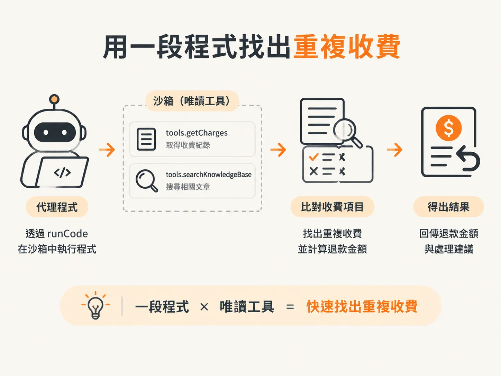
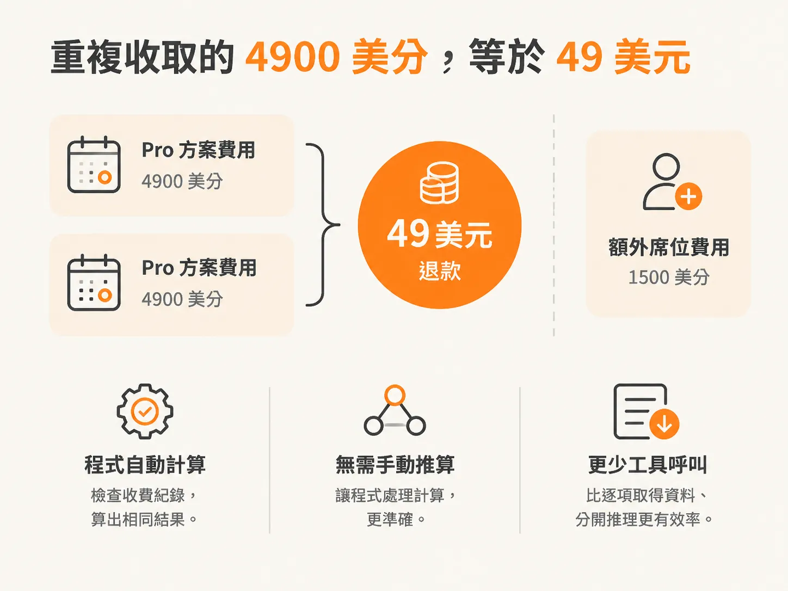

# 讓模型寫程式算出退款金額

`runInSandbox` 讓代理程式能在受控環境中執行程式碼，但還需要在系統提示中說明何時使用 `runCode` 工具。這個例子會告訴代理程式，需要計算時，就在非同步函式中使用 JavaScript。

沙箱提供的工具函式只能讀取資料：`tools.getCharges(customerId)` 會回傳收費紀錄，`tools.searchKnowledgeBase(query)` 會搜尋相關文章。代理程式可以用一段程式取得資料、比對收費項目並算出結果，不必讓模型拆成小步驟反覆呼叫工具。



客戶 `cus_88121` 的收費清單有兩筆日期相同的 Pro 方案費用，編號是 `ch_001` 和 `ch_002`，金額各為 4900 美分；另有一筆 1500 美分的額外席位費用。程式可以找出重複收費，並把金額從美分換算成美元。

<!-- derived -->
```js
const charges = await tools.getCharges("cus_88121");
const duplicate = charges.find((charge, index) =>
  charges.slice(0, index).some(previous =>
    previous.amount === charge.amount &&
    previous.date === charge.date &&
    previous.description === charge.description
  )
);

return duplicate ? duplicate.amount / 100 : 0;
```

重複收取的金額是 4900 美分，也就是 49 美元。示範執行時，程式檢查收費紀錄後算出相同結果。讓程式處理計算，不必只靠模型推算金額；和逐項取得資料、分開推理相比，這個例子也少呼叫幾次工具。



整個流程分三步：先把模型產生的程式碼限制在執行邊界內，再用 `runInSandbox` 控制它能存取的內容，最後透過 `runCode` 取得資料並計算。`node:vm` 能示範這種邊界，但不是真正安全的沙箱；正式環境需要隔離能力更強的機制。
