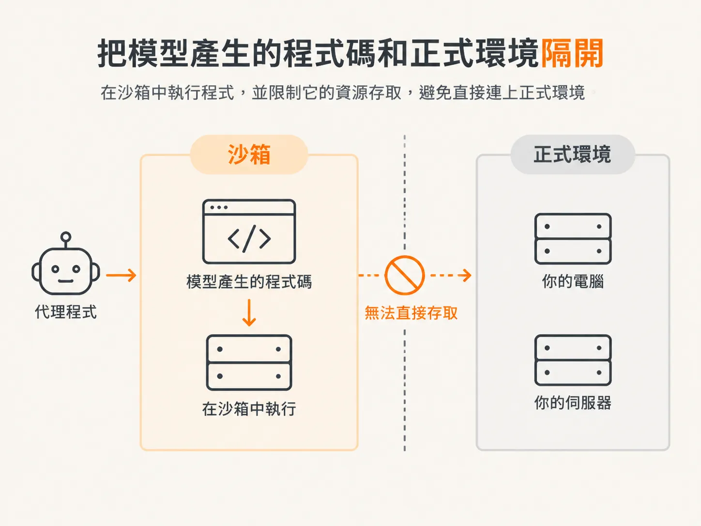

# 先畫執行邊界：別讓模型程式碰 production

代理程式有時需要執行 Bash 指令、查詢資料庫或進行運算。它可以先為這些工作產生程式碼，再執行程式碼。關鍵是：程式要在哪裡跑？

不要在自己的電腦或正式環境伺服器上執行模型產生的程式碼。它可能帶有風險，也可能做出意料之外的事；若在正式環境伺服器上出錯，正在運作的系統也可能受影響。

把程式碼放進沙箱執行。沙箱是一種隔離環境，會限制程式能存取的資源。代理程式不該能越過這道界線連上正式環境；如此一來，它可以執行產生的程式碼，程式本身卻不能直接存取你的電腦或伺服器。

「程式碼模式」讓代理程式把工作寫成程式，一次執行，不必每做一個小步驟就呼叫工具。像是運算或 SQL 查詢，都可以交給同一段程式處理。設計時仍得先決定：程式要在哪裡執行？

離線範例會使用 Node 的 `vm` 模組建立基本的隔離邊界。不過，即使漏洞已修補，代理程式仍可能逃出這個沙箱。正式環境應改用另一個程序隔離程式。接下來會介紹 `runInSandbox` 包裝函式能提供哪些控制，以及 `vm` 做不到什麼保證。
