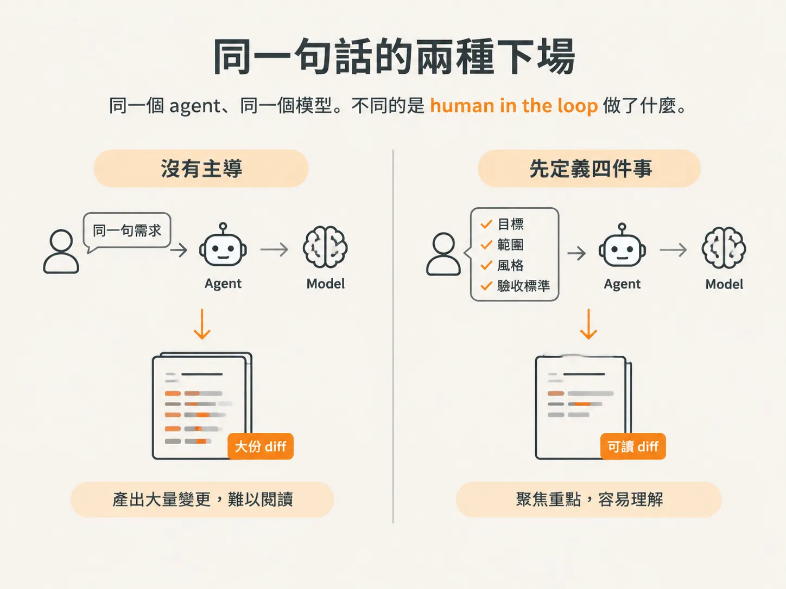
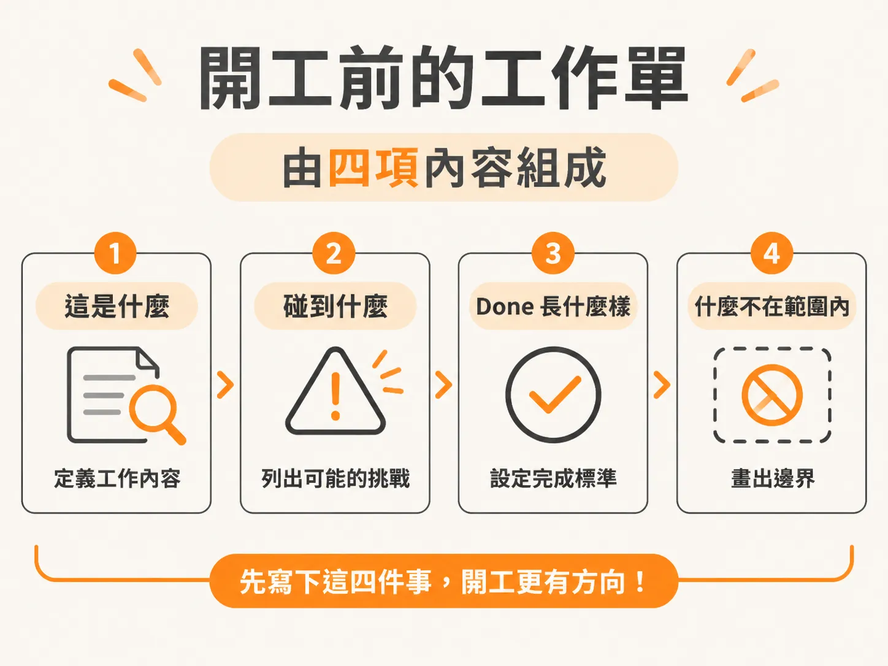

# 同一個 agent，同一個模型

## 同一句話的兩種下場

上一步問的是：judgment 在一次實際開發中會如何展現？先看同一句話帶來的兩種結果。

你說：「build the card feature。」agent 默默做了 20 個決定，最後交給你一份 300 行的 diff。你根本無法有效審查。

同一個任務，由人主導的版本卻大不相同。你先定義這張 card 是什麼、會碰到哪些部分、done 的標準是什麼，以及哪些內容不在這張 card 的範圍內。接著，agent 接到一項有明確限制的工作，交回 40 行的 diff。你兩分鐘就能讀完。

同一個 agent、同一個模型。不同的是 human in the loop 做了什麼。

## 「主導」具體要交出哪四樣東西

開工前，先寫下四件事。

一，這張 card 是什麼。二，它會碰到哪些部分。三，done 的標準是什麼。四，哪些內容不在這張 card 的範圍內。

前三項告訴 agent 要往哪裡做。第四項最容易被跳過，卻決定了範圍邊界由誰來畫。凡是你沒有明確排除的部分，就留給 agent 自行判斷。

這四項合在一起，才構成一項 scoped job：一份帶有明確限制的工作單，而不是一個功能名稱。少寫一項，agent 就會用自己的預設補上。這跟 prompt 寫得多長無關，而在於你有沒有先把決定寫清楚。

把工作單交出去，回來的 diff 才有機會讀得懂、審得動。40 行不是保證，而是你提供明確限制後換來的結果。

## 它是 multiplier，不是方向盤

把 agent 看成 multiplier：它會放大你給的方向。模糊的方向會被放大成災難；清楚的方向則會被放大成可用的軟體。

這也是為什麼害怕被取代的開發者常把順序搞反。只會許願的人容易被取代，因為任何人都能輸入一句模糊的願望。能把模糊問題轉化成清楚方向，再讓引擎執行的人，價值反而更高。公司爭相留住的，正是這種人。

實務上只需要練一個動作。每次發現自己又開始許願，就停下來問一句：一個 senior 工程師會怎麼做？如果你是 engineering director，那就負起定方向的責任（direct）。

這兩個 diff 的差別，用一句話概括，就是誰在主導。那麼，放進真實的 session 裡，會是什麼樣子？
