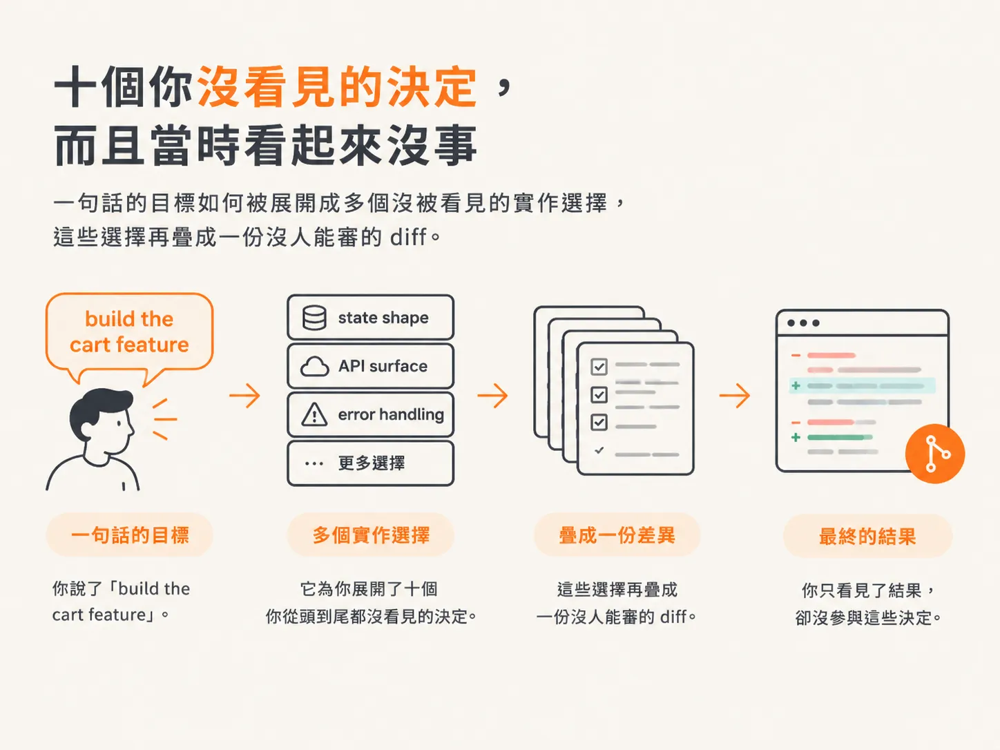
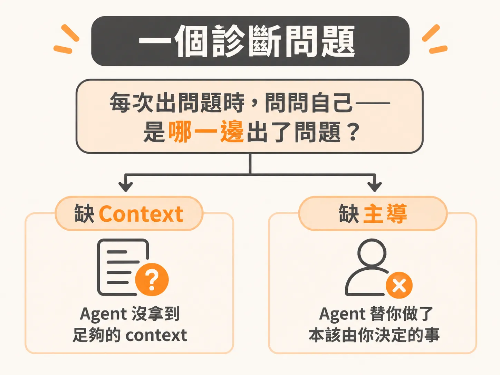

# 它瞄準你說出口的目標

## 它不是沒有計畫，而是瞄準了你交出去的目標

上一步停在這裡：它讀得到你提供的內容；沒提供的部分，它就自己補上。那些被補上的，究竟是哪些決定？

先看第二個成因：它執行的是你說出口的計畫，不一定是你真正想指向的目標。

你可能以為我會說，agent 沒有計畫。那種說法已經過時了。現代 agent 確實會規劃：它讀你的檔案，擬定做法、執行測試，測試失敗了就自行修正。這個迴圈確實行得通。

問題在於它瞄準什麼。它瞄準的是你交給它的目標，而你沒說明的部分，它就用最可能的預設補上。

## 十個你沒看見的決定，而且當時看起來都沒問題

你說「build the cart feature」，它就替你做了十個你從頭到尾都沒看見的決定。state shape、API surface、error handling——你沒問，它也沒問，直接選了具體做法。

程式碼跑得起來，它自己寫的測試也通過了，所以一開始很難看出問題。測試通過，只能證明它寫的測試和它寫的程式碼彼此吻合。

這些決定會一層層疊上去，最後變成一份 300 行的 diff，還動到你原本沒打算碰的檔案。到了那時，你既無法好好 review，也很難把測試跑清楚。東西壞了，你也找不到原因，因為所有地方都同時變了。

問題不在於計畫失敗，而在於它是針對一個沒說清楚的目標做計畫，再用合理的猜測補足其餘部分。那些猜測是它做的，不是你下的決定。

## 一個診斷問題

這兩個成因加在一起，就是多數人卡住的迴圈：prompt 很大、產出很多、驗證不了；出問題後，再用更大的 prompt 修，結果更難驗證。本能反應總是一樣：繼續 prompt。補上更多細節、換個模型，或開一個新對話。

再長的訊息，也無法讓它憑空理解一個從未讀過的 codebase；它也無法靠蠻力，把一個模糊的目標變得具體。你是在試著用一句話解決一個工程問題。

問題從來不在 prompt，而在系統——或者說，根本沒有系統。

所以，從現在開始，你可以用一個問題來診斷：每次出問題時，問問自己——是 agent 沒拿到足夠的 context，還是它替你做了那些本該由你決定的事？幾乎每次，問題都出在這兩者之一。

如果這些決定本來就該由你做，那麼你在這條生產線上的位置叫什麼？
