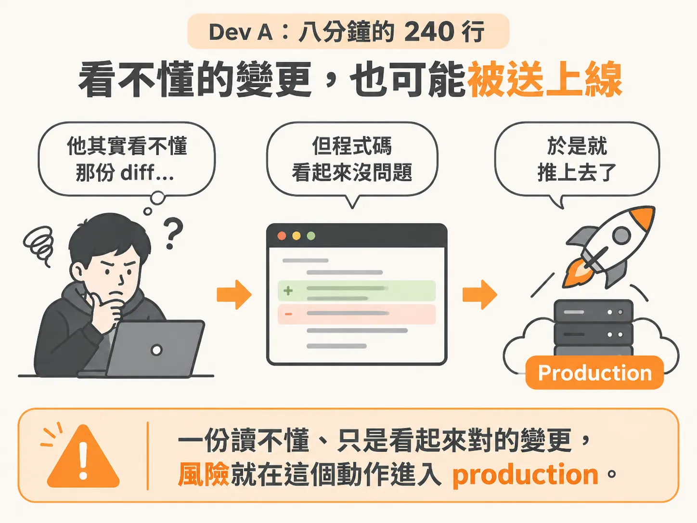
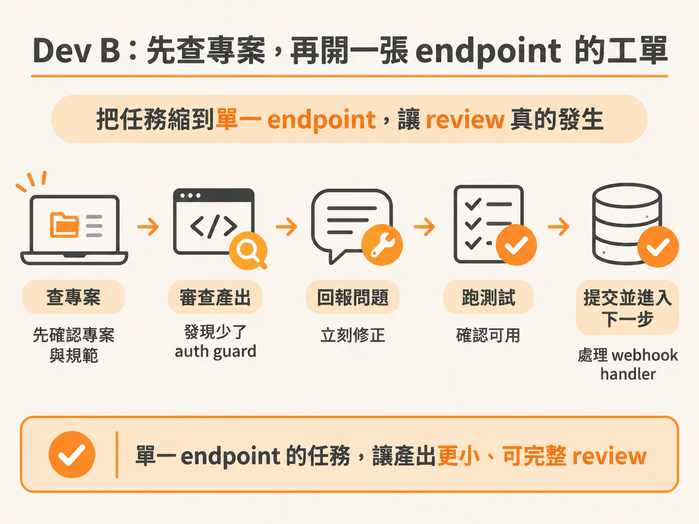
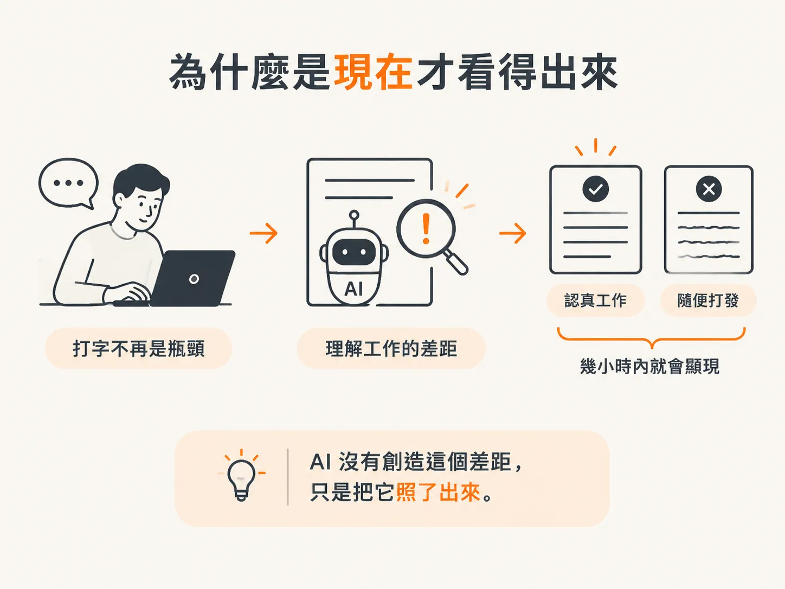

# 同一個 AI，同一個任務

## Dev A：八分鐘，240 行程式碼

上一步把差異歸結成一句話：誰在主導。現在，讓我們把這句話放進一段真實的 session 裡。同一個 Stripe checkout 任務，兩位開發者。

Dev A 開啟新對話，輸入「幫我打造 checkout 功能」，接著提到 Stripe。agent 立刻開始動手：建立 payment intent、增加 API route、加入 webhook handler，連套件都替他安裝好了。

八分鐘後，Dev A 得到三個新檔案、240 行程式碼，還有一個看起來可以運作的成果。

他其實看不懂那份 diff，但程式碼看起來沒問題，於是就推上去了。

兩小時後，webhook 在 production 觸發，卻噴出一個他從沒見過的 signature verification 錯誤。agent 加上了 handler，卻沒有設定 Stripe 要求的 raw body parser。這是 agent 在他毫無察覺的情況下做出的錯誤決定。Dev A 也沒有機會及時攔下來，因為他從頭到尾都沒 review 過實際產出的內容。

現在，他只能在一段全新的對話裡，debug 自己從未寫過的程式碼；而這段對話對原本的 session 毫無 context。

## Dev B：先查專案，再開一張 endpoint 的工單

Dev B 接下同一個任務。他在輸入第一句 prompt 前，先做了一件不同的事：確認專案裡已經有什麼。像是 auth middleware、既有的 API 慣例，以及環境變數裡已設定的 Stripe key。

他把重要的 context 補進 AGENTS.md：SDK 版本、專案使用的 route pattern，以及 webhook 必須使用 raw body parsing。

接著，他把任務範圍縮小。不是要做一整套 checkout feature——那其實包含好幾件事——而是先做一個 payment intent endpoint。只做這一件。

他把工作交給 agent，並附上完整的 context。agent 產出 60 行程式碼。Dev B 看過後發現，route 少了 auth guard，而這個專案要求所有受保護的 endpoint 都必須加上。他傳了一則訊息，問題立刻修好。接著跑測試、確認可用，再 commit。然後進入下一步：webhook handler。同樣是一項任務、完整的 context，以及完全能夠 review 的產出。

## 差別不在技術，而在誰掌控方向

同一個 AI、同一個任務。Dev A 出貨比較快，接著弄壞 production；Dev B 則交付了乾淨的成果。

差別不在技術，甚至不在模型，而在誰掌控方向。Dev A 只是被動回應，期待 agent 自己搞懂需求。Dev B 則主動帶領，提供 agent 完成一項明確工作所需的一切。

用第二步的診斷方式來看 Dev A 的 webhook bug：他沒有把 raw body parsing 這項要求放進 context；而錯誤決定發生時，他雖然在場，卻沒有 review。兩個成因同時存在：context 不足，主導不足。

## 為什麼現在才看得出來

當打字速度是瓶頸時，這兩位開發者看起來差不多，因為兩人都受限於自己寫程式碼的速度。

AI 一夜之間移除了這個瓶頸，於是「理解你的工作」和「隨便打發」之間的差距，立刻顯現出來。

AI 沒有創造這個差距，只是把它照了出來。

Dev A 和 Dev B 一直都存在，只是現在，幾個小時內就能分辨出來。

而且，這個差距會不斷累積。一段 session 越久缺乏方向，就越容易偏離目標；產出越多，就越難 review；越難 review，就越容易在 production 出問題。

vibe coding 不是新手才會犯的錯，而是預設值：沒有系統時，阻力最小的那條路。

這門課要提供的，就是那套系統。心智模型調整好之後，下一個 node 會打開引擎蓋，帶你看看它能看到什麼、如何讀取你的 codebase，以及 context 為什麼會比你想像得更快用完。
