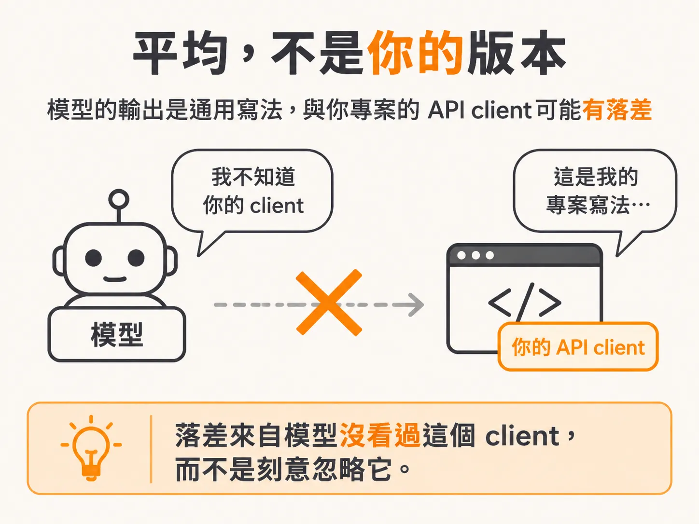
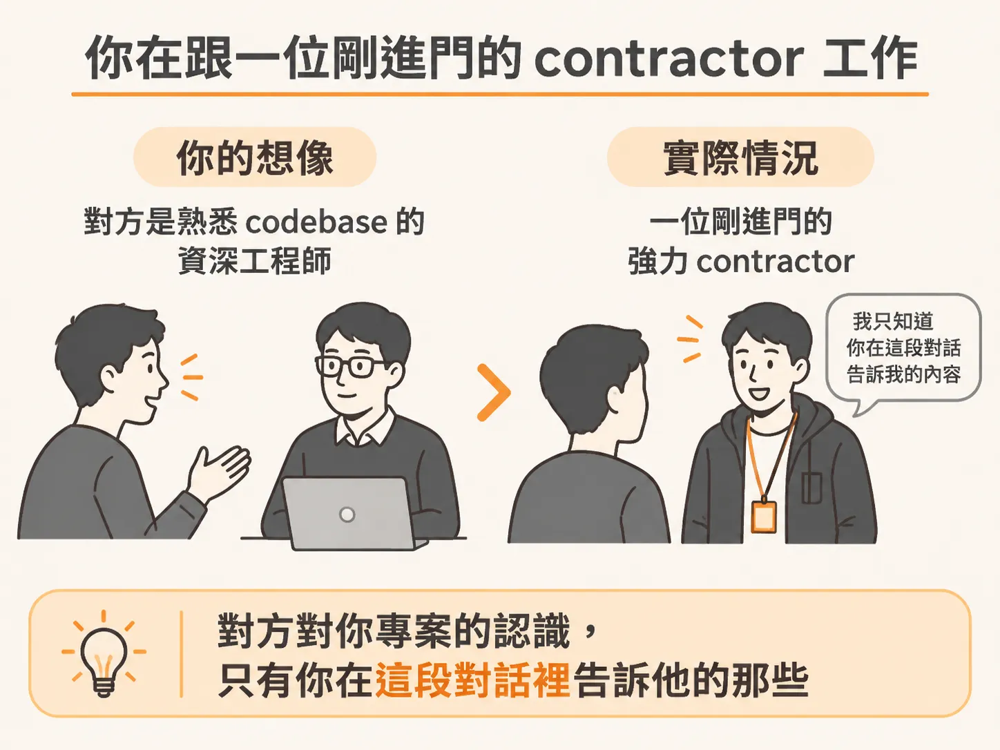

# 模型給你平均，不是你的版本

## 前言

新專案一開好，丟進一個 prompt，agent 就動起來了。它 scaffold auth、接好 routes。前 30 分鐘，你會覺得這東西什麼都懂。兩小時後，你開始懷疑：它到底是在幫你，還是在製造你已經累到沒力氣檢查的程式碼？

這不是模型不夠聰明，也不是你的 prompt 寫得不好，而是兩個結構性成因疊加的結果。看不清這一點，代價就是你會不斷換模型、開新對話、把 prompt 寫得更長，最後卻在同一個地方再次碰壁。

你每天都可能遇到這種情況。agent 幫你 scaffold 一個功能，看起來比你還熟悉自己的專案。接著，它把已經寫過的 function 再寫一次；你把錯誤貼回去，它修好一處，卻弄壞另一處。

這個 node 會依序回答幾個問題：為什麼前 30 分鐘好用，之後卻開始崩壞？它替你做了哪些你沒注意到的決定？如果那些決定本該由你做，你在這條生產線上的角色是什麼？主導工作具體要交出哪些成果？最後，我們會拉遠鏡頭，看看兩位開發者執行同一個 Stripe 任務時，會呈現出什麼差異。

這一頁先處理第一個問題。答案不在 prompt，而在兩個結構性成因。先來看看：它寫出的是平均版本，不是你的版本。

## 半小時的幻覺與之後的四個徵狀

新專案一開好，丟進一個 prompt，AI 就動起來了。它 scaffold auth、接好 routes；你甚至還沒打完字，它就猜到你的意思。前 30 分鐘，你會想：這東西真的改變了一切。

然後，裂縫開始出現。

一小時後，它加了一個自己已經寫過的 function。你把錯誤貼回去，它修好一處，卻弄壞另一處。你叫它只改一個地方，它卻重寫了三個你沒提過的檔案。context 一變長，回應就變慢，答案也變得不準。兩小時後，你分不清它是在幫你，還是在產出一堆聽起來很有自信、但你已經累到沒力氣檢查的程式碼。於是你開一個新對話，想把它拉回正軌，結果只是得把講過的事再講一次。

這四種徵狀，是同一條曲線的四種表現：重複造輪子、修好 A 卻弄壞 B、改一處卻動到三個檔案，以及 context 越長、答案越不準。無論你最熟悉的是哪一種，背後都是同一個問題。

## 它寫的是平均，不是你的版本

第一個成因：模型給你的是平均版本，不是你的版本。

coding tool 的訓練目標是預測下一個 token，訓練資料則來自大量公開程式碼。所以你向它要一個功能，它產出的就是這個功能在它讀過的世界裡最常見的寫法。一般來說，這種寫法是正確的；但預設情況下，它只是通用的解法。

你的專案並不通用。你有特定的 API client、一套專屬慣例，還有上週才做出的決定。這些，它一樣都沒看過。你的程式碼不在它的訓練資料裡；除非你把程式碼放進 context，否則此刻它也看不到。

所以，當你叫它呼叫你的 API，它可能會寫一段 plain fetch，再搭配自己的 error handling。因為在公開網際網路上，呼叫 API 的程式碼通常就是那個樣子。

它不是忽略了你的 client，而是根本不知道你的 client 存在。

代價不會等到編譯時才出現，而是先反映在 diff 裡：一段不符合你 client 的 fetch，以及一套與專案無關的 error handling。

## 你在跟一位剛進門的 contractor 共事

你以為自己是在跟一位熟悉你 codebase 的資深工程師共事。實際上，你面對的是一位剛走進門、能力很強的 contractor。他對你專案的全部認識，只有你在這段對話裡告訴他的那些。

所以，光是把 prompt 加長，並不能解決問題。講者一開頭就把話說清楚了：有兩個成因，而更好的 prompt 無法改善其中任何一個。

更長的訊息，只會把更多你說出口的內容放進 context。至於沒說出口的部分，它還是會用平均值補上。

這就是第一個成因：缺少真正的 context。它能讀到你放進去的東西；沒放進去的部分，它就自行補上。

接下來的問題是：它補上的，究竟是哪些決定？
