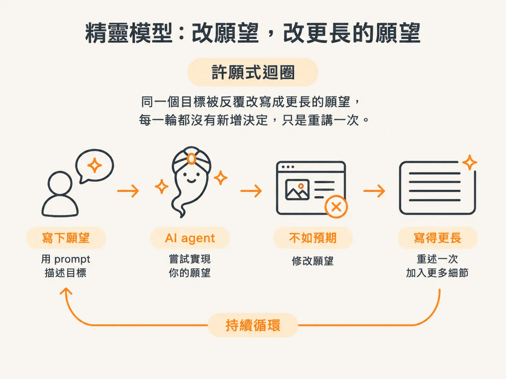
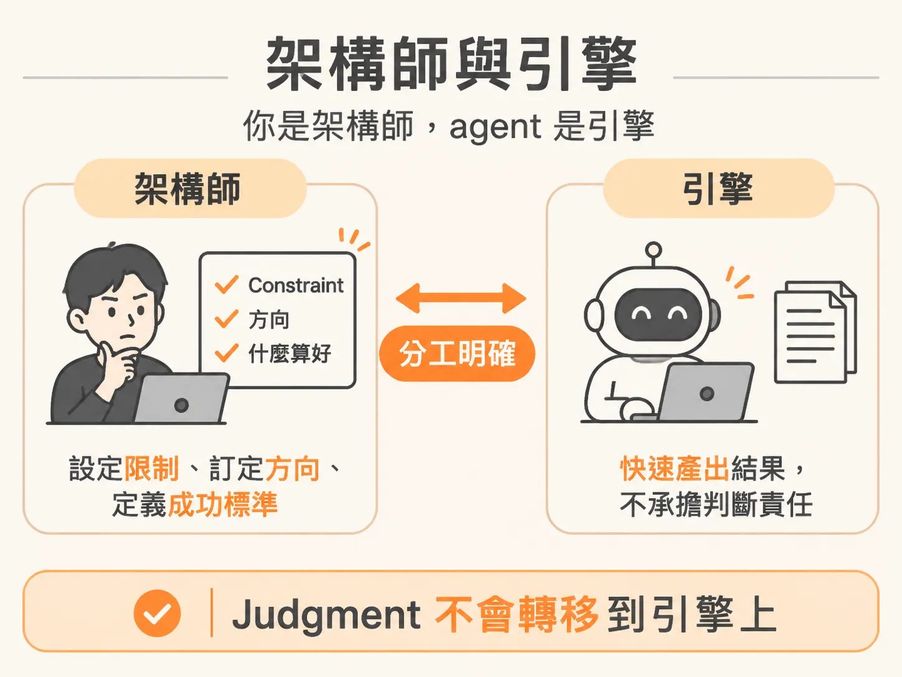

# 你是架構師，agent 是引擎

## 精靈模型：改願望，再改一個更長的願望

上一步留下了一個關於位置的問題：如果那些決定本來就該由你做，那你在這條生產線上的位置是什麼？

先看看多數人現在站在哪裡。上一步提到的兩個成因——缺乏真正的 context、沒有真正的計畫——都指向更深層的問題：你對自己正在操作的東西，抱持著錯誤的心智模型。

多數開發者把 AI agent 當成精靈。你許下一個願望，也就是寫一段 prompt，然後期待它交出符合你心意的成果。不像，就修改願望；還是不像，就把願望寫得更長。這個循環會一直持續，直到你換掉模型。

但這裡要談的不是換模型，而是改變你看待手上這台機器的方式。

## 架構師與引擎

你是架構師，agent 是引擎。

你不再只是希望成果夠好的人，而是決定什麼才算好的人。你設定 constraint、做出真正的決定，明確指出：「不要這樣做，要那樣做。」而且，你清楚每一個做出的選擇。

AI 是引擎：速度快，而且不知疲倦。它一小時產出的程式碼，比你一天能打出的還多。

但它沒有 judgment。

## 判斷力一直是你的工作

judgment 是你的工作，而且一直都是。

想想你見過最出色的 senior 是怎麼帶 junior 的。他不會替 junior 寫下每一行程式碼，也不會丟下一句「去把 app 建起來」就轉身離開。他會提供 context、指引方向、review 交付成果，並在問題變嚴重之前及時攔下來。

你和 agent 建立的關係，正像 senior 帶 junior。差別在於，你的 junior 一分鐘能打出一千字，而且不會累。你對 agent 做的，就是那四件事。

AI 變快了，但你的工作並沒有消失。它真正卡住的地方就在 judgment，而這件事只有你能做。

如果 judgment 是你的工作，那麼在一次開發任務中，它會如何發揮？面對同一句「build the card feature」，由你主導和不由你主導，差別究竟在哪裡？
