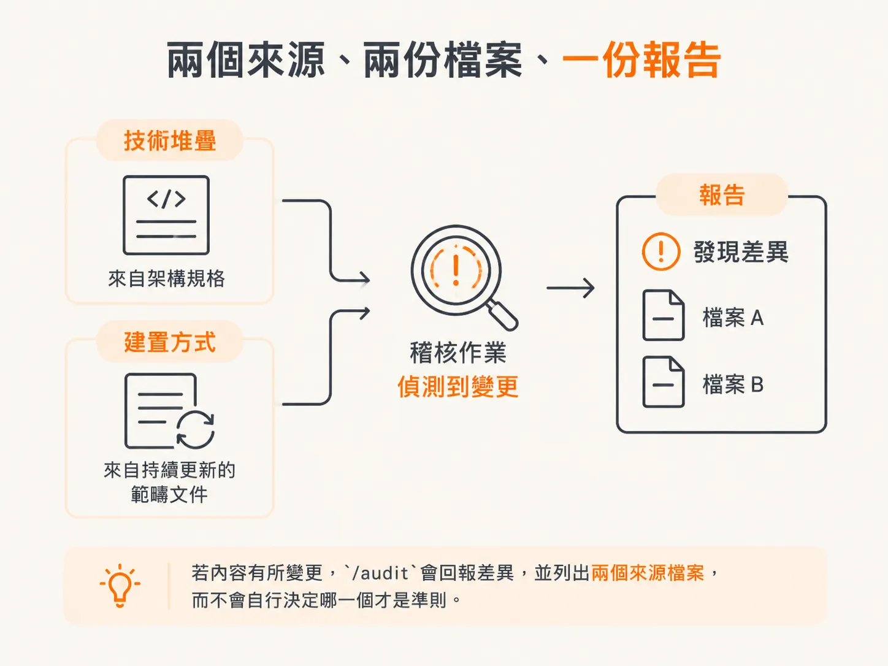

# 用 /audit 寫下最小但會改變行為的 AGENTS.md

上一篇文章最後留下了一個幾乎空白的 AGENTS.md。這篇文章要回答的問題是：裡面應該放些什麼？

起始狀態是示範專案剛開啟時的樣子。技術堆疊已經決定，專案的第一個版本也已經建立在磁碟上，包含實際程式碼、框架、設定、相依套件、指令碼，以及初始資料夾結構。

## 缺少專案背景檔案的代價

目前沒有任何內容說明這個專案應該如何運作、該使用哪些指令，或後續修改必須遵守哪些慣例。

缺少這些背景資訊，每次執行任何 skill，都得重新研究一次專案。有些細節可以透過瀏覽程式碼找出來，但這很花時間；其他資訊則可能在每次執行時都被用不同的方式猜測。


有些資訊甚至得翻完範圍說明和規格才找得到。

解決方法只需要一個檔案，而且 agent 會在讀取其他內容之前，先讀這個檔案。這個檔案就是 `AGENTS.md`。

## 寫入之前，先判斷 repo 的類型

在寫入任何內容之前，`/audit` 會先判斷自己進入的是哪一種類型的 repo。判斷錯誤會影響它提出的問題，以及寫下的指示。

repo 有四種情況。Greenfield 專案會詢問編碼規範，並根據回答建立根目錄檔案。整個 codebase 都沒有背景檔案時，它會完整掃描一遍。工作只涉及特定區域時，改為建立巢狀文件。若 repo 已經有根目錄檔案，則補上缺少的內容。

Greenfield 專案也有執行順序。`/audit` 要等專案使用選定的技術堆疊建立完成後才執行；太早執行並不合適。

這次示範進入的是補缺模式，因為 codebase 已經存在，而且根目錄也有 `AGENTS.md`。這個模式的任務，是根據檔案中已有的內容檢查整個 codebase，並補上遺漏之處。

## 它找到了什麼，又新增了什麼

根目錄檔案裡只有一項內容：Next.js 建立的一則重大變更說明。技術堆疊、建置方式、指令、規則和 agent skills 區段都付之闕如。

它提議用架構規格、範圍說明，以及找到的程式碼來補上這些內容，並在修改既有檔案前先詢問。這是規則，不是客套。既有的 `AGENTS.md` 可能是由人撰寫的，因此絕不會被覆寫。

這個 codebase 很小，只有行銷頁面，因此不需要建立巢狀檔案。判斷哪些內容適用於全域、哪些只適用於特定區域，就是這次示範所說的 skill 超能力。

接著它開始寫入內容。技術堆疊部分列出 TypeScript strict mode、Next.js 16、app router、重要相依套件，以及套件管理工具。建置方式則以 tracer bullet 的形式記錄。檔案也列出啟動應用程式的指令、規格的存放位置，以及規格採用的格式。

規則區段則涵蓋整個專案都必須遵守的事項：依目標受眾區分 route group、所有變更都透過 server action、透過 Drizzle 和 Supabase connection pooler 處理資料庫變更，以及使用路徑別名。所有 agent skill 也一併列進去，讓之後負責建置的 agent 知道該呼叫哪一個。

`CLAUDE.md` 保持為指向其他檔案的索引，因此只需要維護一個檔案：

<!-- source: sources/agentic-engineer/20261030/skills/skills/audit/agent-prompt.md#L13-L20 -->

```markdown
# CLAUDE.md

This project's context for all AI tools lives in [AGENTS.md](./AGENTS.md).
Claude Code loads it via the import below:

@AGENTS.md
```

## 為什麼刻意保持精簡

這份檔案的唯一目標，是記錄技術堆疊、啟動應用程式所需的指令、選定的慣例、從範圍說明沿用的建置方式，以及日後查找更深入背景資訊的指引。


它不會試圖說明 repo 中每個資料夾的相依關係或設計理念。這些內容應留在程式碼、規格和巢狀檔案裡。

重點是讓 agent 花最少力氣，就能顯著改變工作方式。根目錄檔案控制在大約 60 行以內，規則區段則維持 5 到 10 個項目。

## 兩個來源、兩個檔案、一份報告

檔案裡有兩個欄位是鏡像內容，而且都不是憑空編造的。技術堆疊來自已核准的架構規格，建置方式則來自持續更新的範圍說明。

因此，`/audit` 會沿用既有決策，而不是重新討論，也不會默默把它們換掉。

如果日後其中一項內容有所變更，再次執行 `/audit` 時，它會回報差異，並指出涉及的兩個檔案，而不會默默決定哪一個才是準則。



這也讓整個工作流程不再那麼依賴完美的指令執行順序。

## 只有在值得建立時才新增巢狀檔案

沒有人規定 `AGENTS.md` 只能有一個，也沒說它只能放在根目錄。根目錄檔案應保持精簡，只記錄整個 repo 都適用的規則。

它不該收納專案各部分的慣例。

當某個區域逐漸形成穩定的專屬規則時，`/audit` 就會在更靠近該區域程式碼的位置新增另一個 `AGENTS.md`。payments 資料夾可能需要記載重試、供應商故障、安全性和重複請求等規則；這些內容只會干擾負責公開網站的 agent。

根目錄檔案只需要提供一項指引：任何與 payments 相關的工作，都要查閱 payments 資料夾中的 `AGENTS.md`。在該資料夾中工作的 skill 會同時讀取兩個檔案。

這不代表每個資料夾都要放一個指示檔。只有當某個區域累積了足夠多、且長期適用的專屬慣例，值得建立自己的背景資訊時，才會新增巢狀檔案。

## 什麼時候再次執行

系統不會要求你一定要重新執行 `/audit`。當你新增了值得記錄的內容時，再執行即可。

如果你想把程式碼風格記錄下來，就提出要求。示範中的 `/audit` 沒有詢問這件事，這樣做也沒問題；第二次執行時，如果要求它「選擇一種模式」，它就會反問，讓你選 functional immutable。

同樣的做法也適用於其他規則：要遵循哪個 git 帳號、型別系統要多嚴格、資料夾要依產品功能還是技術分層來組織，以及要採用哪些 linting 和格式化規則。執行 `/audit`，並告訴它要加入這些規則即可。

## 這個節點留下了什麼

現在的 `AGENTS.md` 是一份精簡的檔案，卻能改變之後每個 agent 的行為；其中的每一行，都指向其他地方已經存在的決策。

這就是整個節點的脈絡。專案樣板根據已定案的技術堆疊建立，首頁根據寫下並獲得授權的假設做出，設計系統來自推導後再檢查過的價值選擇，背景資訊檔案則取材自 repo 原本就有的內容。

這些工作都不需要更大的模型，只需要在寫程式之前，先把決策記錄在檔案裡。
