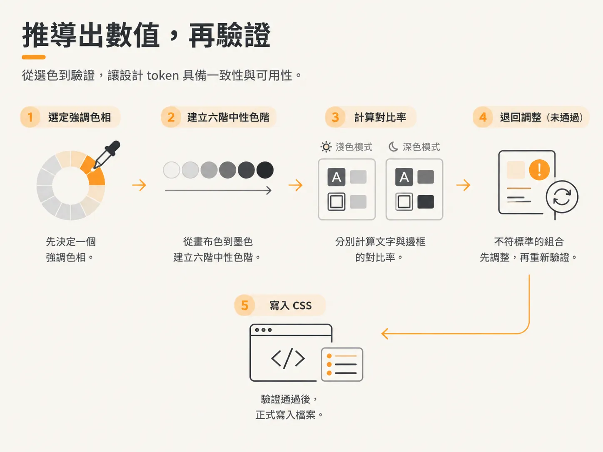
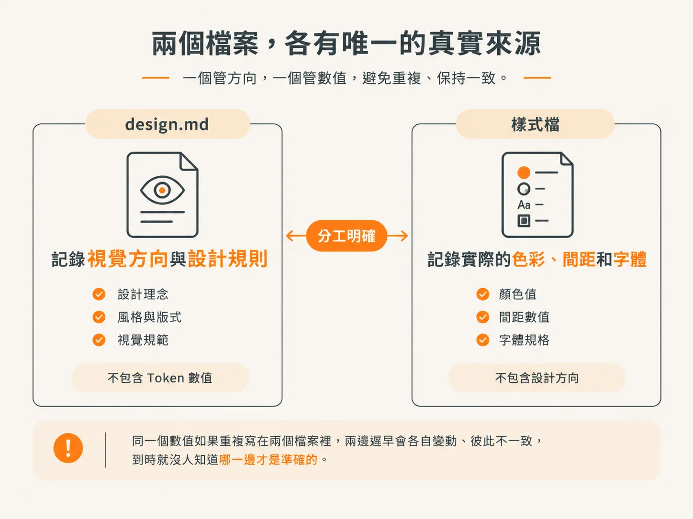

# 從一張截圖推導 design system，而不是照抄

上一篇文章最後提到，建置流程會附上一張圖片。這篇接著回答當時留下的問題：`/develop` 到底會如何處理那張截圖？

## 參考圖是什麼，又不是什麼

貼上的圖片是最直接的設計依據。參考圖呈現了外觀與構圖，因此 `/develop` 會以它為準，不會自行加入圖中沒有的設計。

只看這段描述，聽起來像是在照著截圖重做畫面。

然而，示範也呈現了另一個面向。在瀏覽器裡，參考圖只顯示某個瞬間；真正的產品則需要一套完整的介面，涵蓋使用者可能遇到的各種狀態。

一個瞬間，不等於完整介面。

## 不只是靜態仿作

因此，agent 會先為整個應用程式建立主題，再定義並建出一套設計系統，而不是逐頁仿作。

示範中開啟了 `design.md`。檔案指出圖片是設計來源，接著說明從參考圖中讀取到的資訊：溫暖、沉靜，帶有手作工具般的氛圍；使用柔和的奶油色畫布，而非刺眼的純白；並搭配粉彩面板。

至於截圖無法呈現的部分，則由系統推導得出。Token 數值會寫進 CSS，整體風格會記錄在 `design.md`；單張截圖無法展示的響應式與無障礙行為，也會透過推導補足，而不是直接照抄。

## 可重複使用的元件

系統會根據頁面判斷實際需要哪些元件，再將它們建置出來。

這在後續開發中很重要。元件只要建置一次，就能重複使用，而且會包含各種狀態：空白、載入中、錯誤、停用。

建置時不會假設截圖中的單一狀態就是唯一狀態，而是會涵蓋使用者可能遇到的各種情況。

在這個示範中，首頁主視覺區塊的空白與載入狀態不太容易判斷，示範也坦承了這一點。之後透過 `/develop` 開發實際功能時，也會從一開始就處理這些狀態。

這項標準非常嚴格。缺少空白、載入中或錯誤狀態，都算不合格；只要缺一項，UI 就還沒完成。

## 推導數值，再驗證它們

這些數值不是憑記憶想出來的。憑印象配出的色盤，只是附上一組十六進位色碼的猜測。Token 必須先經過推導與驗證，最後才會寫入檔案。

系統會先選定一個強調色的色相。第二個強調色是選出來的，不是預設值。接著建立一組包含六階的明度階梯，從畫布色一路延伸到墨色；每一階都與前一階有明確的視覺差異，同時帶有一點強調色的色相，讓灰色看起來也像是經過刻意設計的。

在寫下第一行 CSS 之前，系統就會先計算對比度。畫布上的內文對比度需要達到 4.5:1；強調色上的文字也需要達到 4.5:1，而這一組通常最容易不合格。如果邊框是唯一用來標示控制項的方式，對比度就需要達到 3:1。

淺色與深色模式會分開檢查，因為淺色模式下合格的明度階梯，反轉後往往就不合格。

字級採用模組化比例，而不是任意挑選數值，讓不同字級之間維持一致的關係。間距以 4px 為基準，並遵循 8px 的節奏；所有間隙、內距與外距都是基準的倍數。圓角與動態效果則各有三個層級。

接著，示範展示了驗證結果。`/develop` 會執行型別檢查、確認建置結果、啟動伺服器，並檢視實際渲染的頁面；它也會看配色合不合適、對比度夠不夠，發現問題就調整數值。

## 兩個檔案，各自維護一個唯一真實來源

現在，專案的整體視覺方向與設計規則都記錄在 `design.md`。實際使用的顏色、間距、字體等設定則放在 `globals.css`。

`design.md` 只負責描述藝術指導，不會複製 Token 數值。同一個數值如果重複寫在兩個檔案裡，兩邊遲早會各自變動、彼此不一致，到時就沒人知道哪一邊才是準確的。

整個工作流程都遵循同一條規則：每一種唯一真實來源只定義一次。

## 最後交付的內容

最後，`/develop` 問要不要把推導出的驗證步驟存到 `verify.md`，還是只留在摘要裡。工程師選了後者，並提到之後會用 verify skill 涵蓋更重要的功能。

建議的下一步是規劃行銷頁面與 SEO，確認那項假設是否成立，但這不是必須。

工程師改為在 localhost:3000 上執行 `pnpm dev`。頁面看起來和參考圖完全一樣。

這些小型元件之所以先建好，是為了讓版面之後能更適應不同螢幕，也不會顯得那麼高。手機版現在看起來就已經很棒了。

## 還沒寫下來的部分

現在，視覺規則放在一個檔案裡，數值則放在另一個檔案裡。除此之外，這個 repo 的其他部分都還沒整理成文件。

目前專案已有 scripts、dependencies 和設定檔，還有一份幾乎空白的 AGENTS.md。

那個檔案應該放些什麼？
