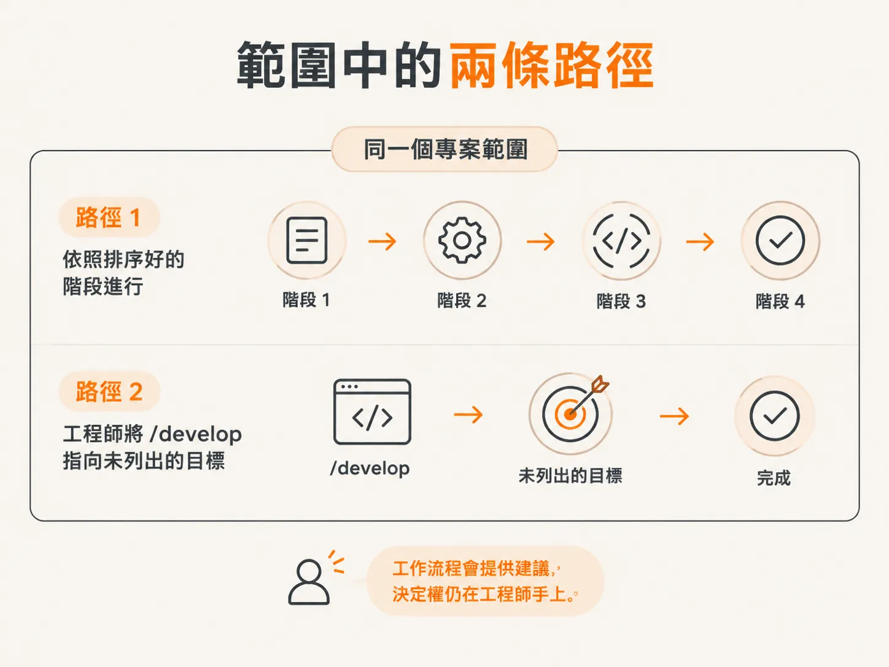
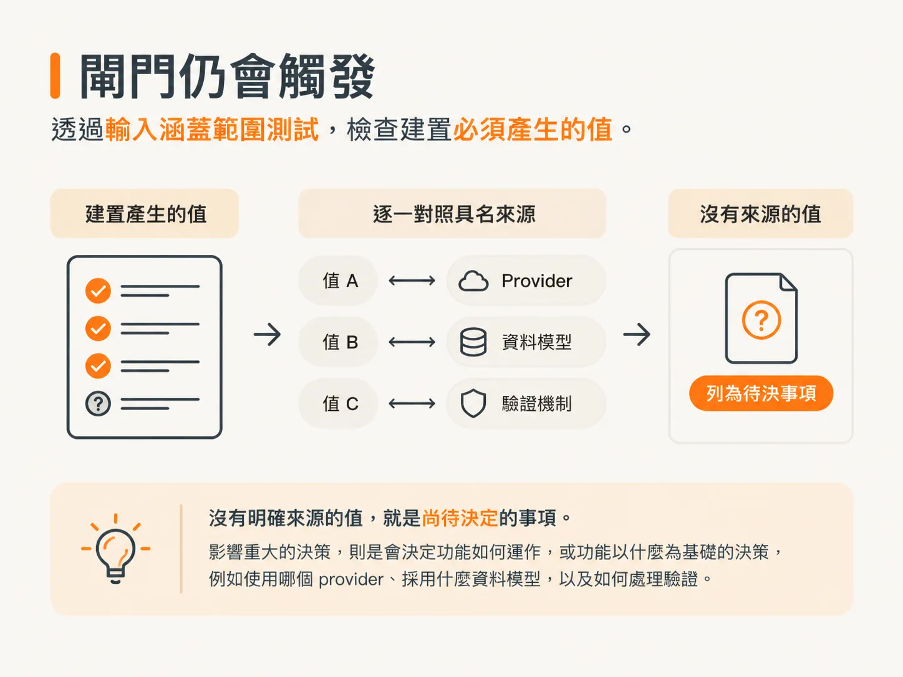
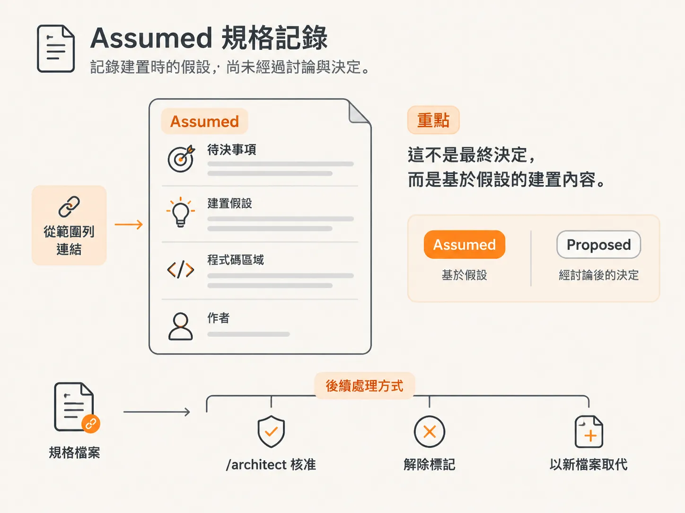

# 把 develop 指向 plan 上沒有的工作

scaffold 很容易完成，因為 plan 把它列為第一個功能的子任務。接下來 scope 裡還有很多功能，要讓 `/develop` 依序處理，有兩種做法。

## 走過 scope 的兩種方式

第一種方式是完全依照 plan 執行。依序完成 `/architect`、`/develop`、`/check verify`、`/test`，接著進行 audit，再為資料模型執行一次 `/architect`，以此類推。

第二種方式則更有彈性。你不必完全照著 plan 走，也不必徹底放棄整套工作流程。這正是這場示範想傳達的重點。

在對話中，工作流程已經指出接下來該做什麼：依照 scope 中的 beta workflow，先執行 `/check verify`，再執行 `/test`。但工程師沒有照做。

工作流程會提供建議，決定權仍在工程師手上。



## 指向 plan 中沒有的項目

他清空對話，接著請 `/develop` 開發首頁。scope 中沒有專門列出首頁的功能項目。他也附上一張圖片，清楚呈現應用程式完成後的樣貌。

不照工作流程的指示行事，感覺有點像在耍小聰明。這堂課要談的就是這種時候。

這套工作流程的設計，是為了在範圍內理解你的需求。它沒有偏離流程，只是看出這項需求屬於介面工作，並從設計圖裡判斷出這一點。

## 門檻仍然會啟動

程式碼還沒開始寫，第一個狀況就出現了。scope 中的 Feature 10，也就是行銷頁面與 SEO，被標記為 `needs a decision`，而且目前還沒有 spec 或 `design.md`。

Mock-up 已經定下視覺方向，所以真正的問題是缺少 spec。

根據 build gate 的規定，開始建置前，`/develop` 必須先確認如何處理缺少的 spec。因此，它問要不要先做架構設計。

工程師認為單一前端頁面不需要先做這件事，於是決定直接開始建置。既然 mock-up 已經交代清楚，這也是建議的選項。

這道門檻不是憑感覺判斷。`/develop` 不會問自己「這看起來像不像是在憑空發明」，因為建置模型可能會把真正需要決定的事說成「只是把東西接起來」，然後直接放行。

它改用輸入涵蓋度測試。測試會列出建置時必須產生、計算或顯示的每個值，並逐一確認 spec 是否說明了該值的來源。

沒有明確來源的值，就是尚待決定的事項。影響重大的決策，指的是會改變功能怎麼運作、或功能建立在什麼之上的選擇，例如用哪個 provider、什麼資料模型、怎麼處理驗證。



除非 `design.md` 和頁面層級的 spec 已明確定義設計系統、頁面區塊、元件清單與素材策略，否則整個頁面本身也屬於影響重大的事項。

## Assumed spec 會記錄什麼

即使選擇 `Build now, record it as an assumed spec`，仍然必須先寫入一個檔案。它會建立一份最精簡的 spec，也是 `/develop` 唯一能建立的文件。

<!-- source: sources/agentic-engineer/20261030/skills/skills/develop/SKILL.md#L96-L118 -->

```markdown
# NNNN · <feature>

**Status**: Assumed
**Date**: <today>
**Authorized by**: <engineer>, during /develop

## Owed decision
<the specific load bearing choice that was not made>

## Assumption built on
<the concrete assumption this build will use>

## Code area
<the paths this build will touch>

## Requirements
<acceptance criteria seeds carried from the scope Done when, if any>

## Ratify
This decision was recorded by /develop, not deliberated. Run `/architect <feature>`
to deliberate and ratify it. Until then it stays flagged as an owed decision; it does not block marking the feature `done`.
```

這份 spec 的狀態是 `Assumed`，不是 `Proposed`。它記錄的是建置時採用的假設，不是討論後做出的決定。



scope 中該功能的列會新增一個連結，指向這份檔案。示範中把這稱為「記錄你採取的動作」。

這項假設現在有了正式紀錄，不會因為執行 `/clear` 而消失，隊友也能查看。之後再次執行 `/develop` 時，它會照這份假設建置，不必再猜一次同樣的事。

## 誰要負責

示範中打開了 specs 資料夾，找到新建立、狀態為 assumed 的 spec。裡面記錄了採取的動作，以及是誰做的。

之後納入 git 時，檔案還會記錄 git email。這樣就能清楚知道，是誰在架構決策尚未記錄下來前，就繼續往下做。

這個人可能需要為這項功能負責，也可能是最適合向他請教的人。無論如何，檔案裡都會留下名字。

這份 spec 會持續保留標記，而且這個標記永遠不會阻止功能變成 `done`。只有 `/architect` 能透過 ratify 清除標記。

Ratify 的意思是：閱讀尚待決定的事項、假設，以及相關程式碼所在區域，接著以實際建置出的內容為基礎討論設計。如果假設成立，就把正式決策寫進 spec，並移除標記；如果假設有誤，就以修正後的版本取代原本的 spec，然後重新建置。

這張圖片讓建置能快速通過門檻。不過，圖片並不等於設計系統。

`/develop` 實際上會如何處理這張截圖？
