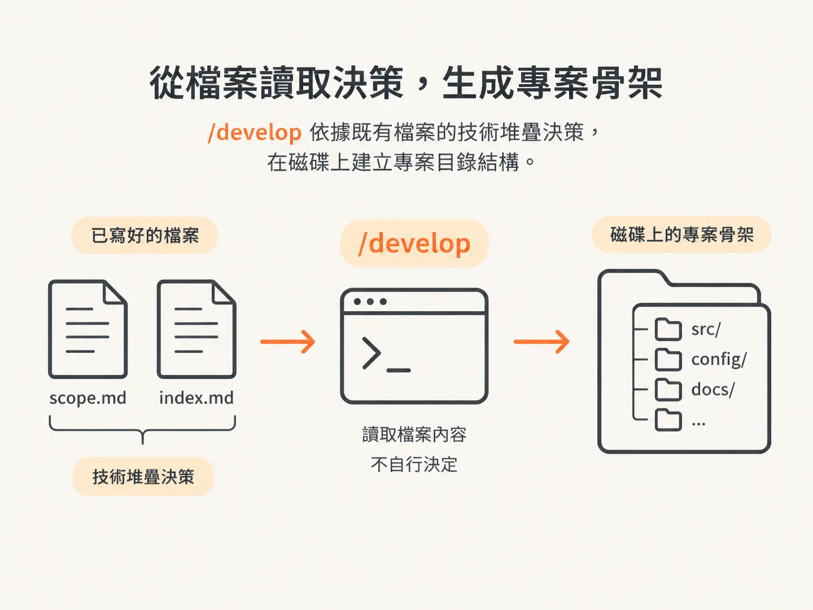

# Greenfield 的第一件事不是 feature，是架構地基

## 前言

`/develop` 負責寫程式碼，而寫程式碼本身並不難。真正費工的是打好程式碼所依賴的基礎。這個節點探討的是：當 agent 要動手寫尚未有人決定的內容時，會發生什麼事。

你會在三種情況下遇到這個時刻：一個全新的 repo，第一個 commit 就隱含了技術堆疊的選擇；一項確實要處理、卻不在計畫任何項目裡的工作；以及一張必須轉化成設計系統，而不只是單一頁面的截圖。

這個節點會依序處理這三種情況。先從架構地基開始，再把計畫之外的工作納入一份名為 `Assumed` 的規格，最後從 mock-up 推導出設計系統。文章最後會談到 `/audit`：它會將專案已確立的做法整理成一份短到讓人願意讀完的 AGENTS.md。

本文從起點談起：在一個全新的專案裡，還沒有任何功能時，`/develop` 應該先建立什麼？

## develop 讀取決策，不負責思考決策

開啟新的 Claude Code 視窗，輸入 `develop`，再告訴它你想做什麼。它產出的內容並不是重點。

真正值得留意的是，它從哪裡取得指示。`/develop` 位於 `/architect` 之後，而 `/architect` 已經確定了技術堆疊。

在示範中，它會讀取兩個檔案：`scope.md`，以及某份規格底下的 `index.md`。那份 index 已經記錄技術堆疊的決策，也將 scaffold 列為第一個功能的子任務。

接著，`/develop` 會讀取已接受的規格，了解框架、語言、資料庫、資料層、驗證方式，以及部署方向。

它不會在這裡做決定，而是讀取既有決策，再轉化成磁碟上的目錄。

## 用框架打好地基

示範中的 scaffold 是一個 Next.js 16 專案，使用 pnpm 和 TypeScript strict mode，與規格相符。接著，它會建立各個 route group 目錄，並確認建置結果。建置成功，回報：`scaffold created successfully`。

看看專案是如何建立的：它使用框架自己的初始化工具，而不是憑記憶手動建立目錄結構。

它不會照著想像中的現代專案樣貌自己拼一套，而是從該生態系維護的官方設定工具開始，讓地基符合社群實際發布的專案形式。

建立專案目錄時，也要留下已存在的內容；docs、agents、claude 和 skills 資料夾搬移後都還在。

## 只加入第一個開發切片所需的內容

scaffold 建立完成後，打開 `package.json`，會發現相依套件寥寥無幾。這是刻意安排的，並不代表設定尚未完成。

目前加入的只有技術堆疊所需的基本工具，以及 lint、格式化和型別檢查工具。

架構規格中列出的函式庫，不會在第一天就全部安裝。電子郵件、監控、分析和其他專用工具，等到有功能需要時才裝。

第一個原因是成本。專案一開始就安裝所有工具，可能會讓十個用不到的相依套件閒置一個月。

第二個原因是時機。稍後才加入的工具，可以在真正用到時，一併確立使用慣例和設定方式。

## 證明它確實能執行

在 `/develop` 宣告地基完成之前，必須先證明產生的專案確實能執行。依照技術堆疊而定，這可能表示要啟動開發伺服器、完成建置，或通過框架提供的初始檢查。

在示範中，建置確認成功，scaffold 被標記為已完成，並新增了一份範例 env 檔案，項目也跟著打上勾。

必須實際執行一次，地基才算完成。scaffold 只是一種宣稱，執行結果才是證據。

## 目前仍然空白的部分

到了這個階段，還有兩個檔案幾乎是空的：`CLAUDE.md` 和 `AGENTS.md`。對一般的全新專案來說，這是預期中的狀態。

不過，現在已經有一些資料可供 audit skill 使用：scripts、相依套件和設定檔。這些檔案會存在，是因為 scaffold 已經執行過。

scaffold 之所以簡單，只有一個原因：計畫裡明確列出了它。

如果眼前的工作根本不在計畫裡，又會怎麼辦？
