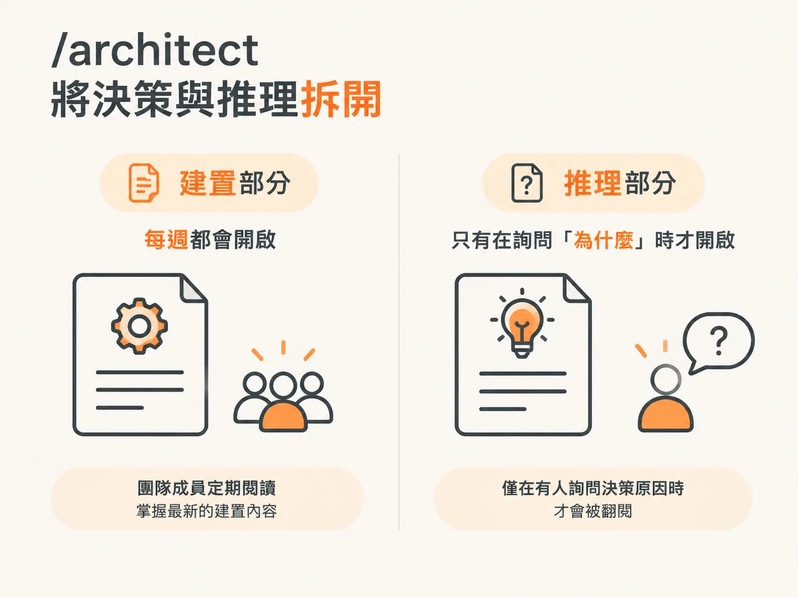
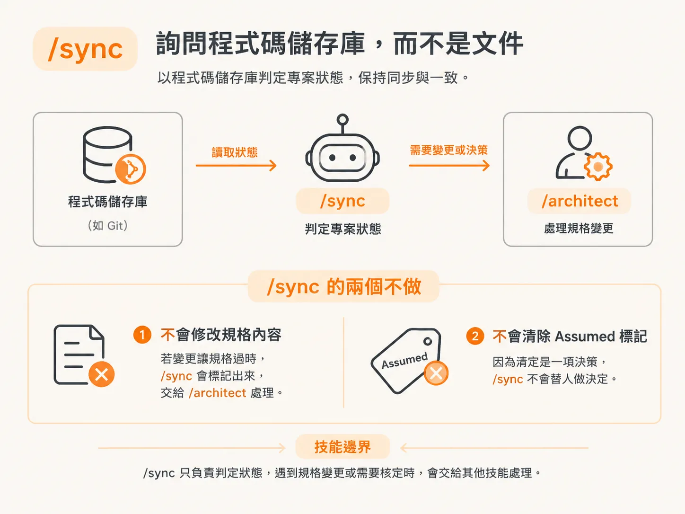

# Day Thirty：一份沒人再打開的 spec

上一篇文章以第三十天的問題作結：一份再也沒人打開的文件，後來會怎麼樣？這篇文章就是答案，也說明了這套技能中有三項為何採用目前的設計方式。

## 把事情寫下來，早已不是問題

GitHub 推出 Spec Kit，Amazon 推出 Kiro，BMAD 則協調一群不同角色的 agent。它們都把書面結構置於實作之前，而且這麼做是對的。

因此，寫下來有沒有幫助早有定論。真正值得問的是：到了第三十天，程式碼已經變了，卻沒有人再打開規格文件時，會發生什麼事？

## 被遺忘比不存在更糟

寫過一次就被遺忘的規格，比根本沒有規格更糟，因為它會用篤定的語氣陳述錯誤資訊，而且往往要過一段時間才會有人發現。

至少沒有規格時，問題仍然懸而未決。有人找不到決策紀錄，就會開口詢問。

過時的規格則恰恰相反。它用著第一天那樣篤定的語氣，描述一套早已不再如此運作的程式碼。

## 三項技能，三種解法

這套工作流程認真看待這個問題，並將解法分散到三項技能中。`/architect` 負責把決策和推理拆開。`/develop` 只讀取面向實作的部分。`/sync` 則根據實際交付的內容，重新核對所有資訊。

## /architect：把決策和推理拆開

如果一份規格把實作指示和兩頁遭否決的方案混在一起，你最後就會不想再打開它。因此，`/architect` 會將兩者分開存放。

實作規格檔是 `index.md`，內容包含摘要、需求、決策、設計章節、實作計畫、後果與後續事項，最後再用一句話指向推理文件。

推理內容則放在獨立的 `rationale.md`，包括背景、曾考慮的選項、選擇理由、參考資料，以及篇幅較長的佐證資料。

簡單的決策會將所有內容放在同一份檔案中。只有在決策複雜或影響深遠、需要統整多個相關子決策，或值得另外建立 `verify.md` 時，才會拆成兩份。

這兩部分的讀者不同。實作部分每週都會有人閱讀；推理部分則只有在有人詢問「為什麼」時才會翻閱。這種情況很少見，卻往往影響重大。

## /develop：只讀面向實作的部分

`/develop` 只讀取實作規格，完全略過 `rationale.md`。如此一來，實作者需要載入的內容就能保持精簡，規格到了第三十天依然容易開啟。

這個解法更關鍵的部分，在於規格資訊不足時 `/develop` 會怎麼處理：它不會默默自行補上。

這道關卡是機械檢查，因為不能指望模型察覺自己正在憑空創造內容。負責實作的模型可能會把真正需要決定的事，合理化成只是接線或串接。因此，`/develop` 會逐一列出實作時必須產生、計算或顯示的所有值，並逐項確認：規格是否寫明了這個值的來源？

如果必要的值沒有指定來源，就代表還有一項決策尚待處理。`/develop` 會停下來。

接下來不是停工，而是要做出選擇。你可以先用 `/architect` 設計，這是建議做法；也可以確認這項內容確實不需要；或者先繼續實作並記錄假設：`/develop` 會建立一份標記為 `Assumed` 的小型規格，寫明尚待處理的決策、實作所依據的假設，以及相關程式碼區域，然後繼續開發。

標記為 `Assumed` 的規格會明確註明尚未經過核定。這個標記會一直保留，直到 `/architect` 確認為止；但它不會妨礙你將功能標記為完成。

拿這種做法和憑感覺開發相比：後者既沒有標記，也沒有檔案，決策只存在於一段沒人能回頭查閱的對話裡。

## /sync：詢問 repo，而不是文件

第三種解法會在流程最後、接近合併時執行。`/sync` 會透過精確修改，讓需要長期保存的知識保持最新；它所依據的事實來源是 repo，而不是文件。

它會根據功能的實際狀態，更新每份規格的狀態列：planned 會變成 Proposed，in progress 會變成 In Progress，done 會變成 Accepted。它也會勾選那些能透過證據確認已完成的範圍子任務，讓程式碼和測試來判定完成了什麼，而不是依靠記憶。

有兩件事它不會做。第一，它不會修改規格內容。如果變更讓規格過時，`/sync` 會標記出來，交給 `/architect` 處理。第二，它不會清除 `Assumed` 標記，因為核定是一項決策，而 `/sync` 不會替人做決定。

這種拒絕正是設計的一部分，而非設計上的缺漏。發現問題的技能，不該同時擁有改寫紀錄的權限。

## 四句話說完整套流程

九項技能共同涵蓋一個生命週期：需求、設計、實作、驗證；每個階段都會把下一個階段所需的資訊交出去。

從哪裡開始，取決於你手上的素材。全新專案用 `/scope`；接手既有 repo 用 `/audit`；小幅修改則用 `/debug`，或使用 `/develop` 搭配 `/check verify`。

`/audit` 會持續有效，因為它描述的是證據，而不是假設。

而任何能在第三十天之後繼續派上用場的內容，都是因為決策、實作指示和紀錄彼此分開保存，並且會根據 repo 重新核對。

## 測試方式

檢查方式很簡單：打開規格文件，看看它是否仍符合程式碼的實際狀況。

如果符合，就表示有人維持了這個循環，而這就是整項工作的全部。

如果不符合，它就是一份用篤定語氣陳述錯誤資訊的文件，而你已經知道這會付出什麼代價。
