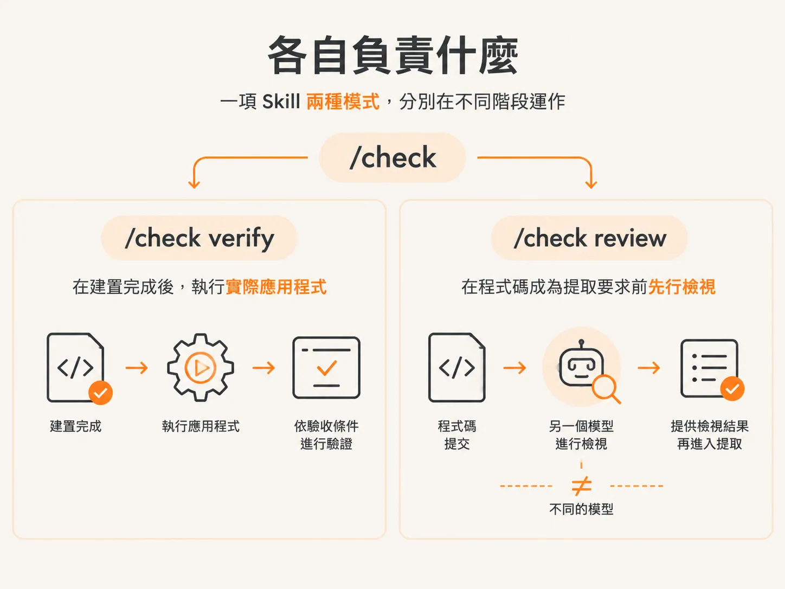
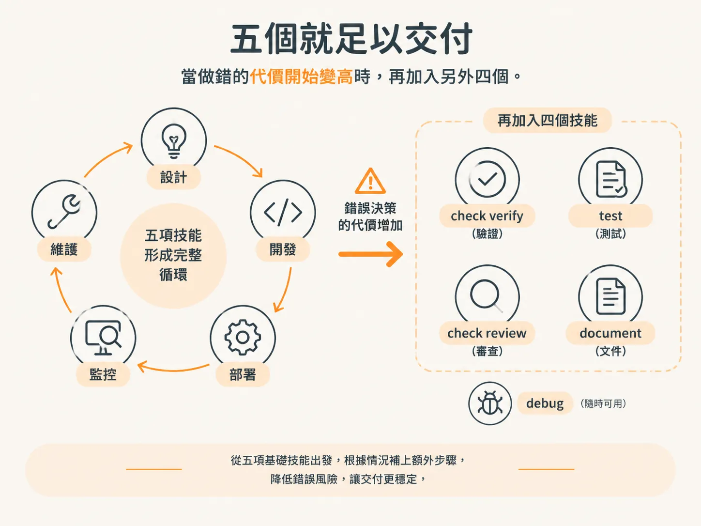
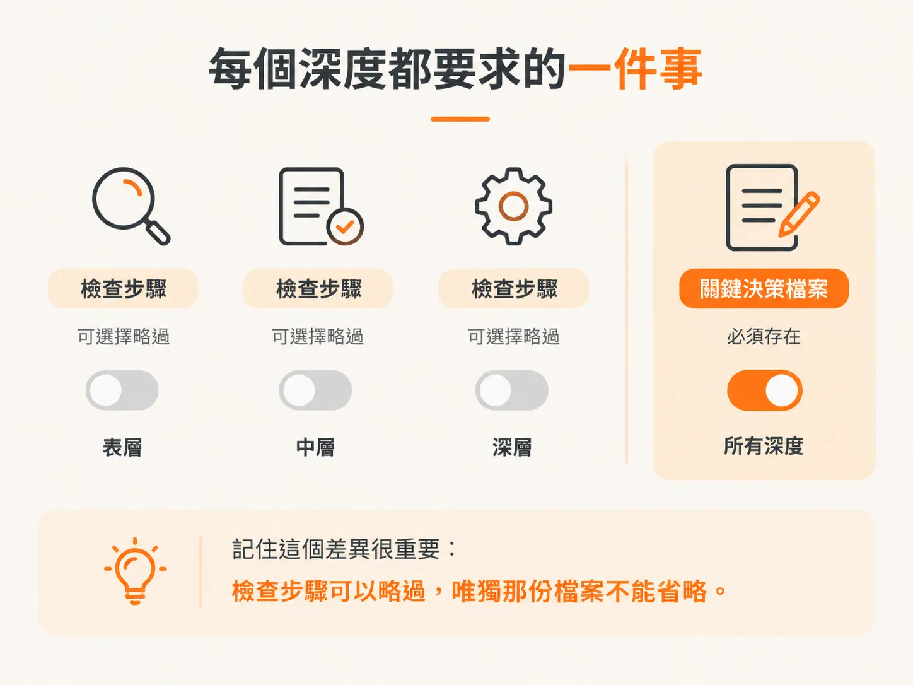

# The Loop：九個 Skill 各管一個階段

上一篇文章最後留下一個問題：九個 Skill 要一起完成一項任務，應該先呼叫哪一個？先別急著回答。在選擇入口之前，你得先看懂整張地圖。

先把整張地圖看一遍。每個 Skill 之後都有專屬課程，這裡只帶你認識整體流程。

## 流程鏈

九個 Skill 會按照固定順序運作，這個順序就是你已經看過的生命週期：從一個想法開始，接著執行 `/scope`、`/architect`，再用 `/develop` 建立專案架構，然後執行 `/audit`。之後進入功能開發循環：`/develop`、`/check verify`、`/test`、`/check review`、`/document`、`/sync`。

`/debug` 不在這條流程鏈上。任何時候遇到問題，都可以執行它。

沿著流程鏈從左到右看，每個 Skill 都會把一份檔案交給下一個 Skill。把流程看成一個循環，就會發現它最終會回到起點：因為 `/sync` 會將建置過程中學到的內容寫回專案，而下一個功能便從這裡開始。

## 每個 Skill 負責什麼

| Skill | 階段 | 負責內容 |
|---|---|---|
| `/scope` | 需求 | 說明要做什麼、不做什麼，以及執行順序 |
| `/architect` | 設計 | 將關鍵決策寫成規格 |
| `/develop` | 實作 | 建立專案架構，並根據規格開發功能 |
| `/audit` | 慣例 | 撰寫其他 Skill 都會讀取的 AGENTS.md |
| `/sync` | 回饋 | 將建置過程中學到的內容寫回專案 |
| `/check verify` | 驗證 | 根據驗收條件執行實際應用程式 |
| `/test` | 防護 | 建立測試套件，避免未來的變更造成問題 |
| `/check review` | 審查 | 由另一個模型從不同角度檢視程式碼 |
| `/document` | 紀錄 | 根據實際差異撰寫 PR 內容、變更紀錄與發行說明 |
| `/debug` | 修復 | 蒐集證據、提出假設、找出根本原因，並加入回歸測試 |

`/check` 是一個有兩種模式的 Skill，分別位於不同階段。`/check verify` 負責驗證，`/check review` 則交給另一個模型檢視程式碼，那個模型和寫程式碼的不是同一個。

表格中的每一列也都對應到一份檔案。`/scope` 會將範疇寫在 `docs/scope/` 底下，`/architect` 會將規格寫在 `docs/specs/` 底下，`/audit` 會撰寫 AGENTS.md，`/develop` 會建立設計系統並撰寫應用程式程式碼，`/check` 會將審查結果寫在 `docs/reviews/` 底下，而 `/document` 會撰寫 PR 內容、變更紀錄與發行說明。

## 有一個 Skill 沒有固定位置

`/debug` 負責修復，不會占據流程中的固定位置。遇到功能失效、發生錯誤或行為不如預期時，就執行它；最後，它會交給 `/test` 一項回歸測試。

另一個例外是單獨執行 `/scope`。任何時候都可以執行它，查看目前的進度。

## 要交付成果，五個就夠

要交付實際成果，九個 Skill 裡只需要用到五個。這個單元會完整介紹這五個：`/scope`、`/architect`、`/develop`、`/audit`、`/sync`。在 Prototype 階段，只靠這五個就能完成完整流程。

當做錯的代價開始變高時，再加入另外四個。`/check verify` 和 `/test` 會在下一個單元介紹；`/check review` 和 `/document` 則會在之後介紹。`/debug` 隨時都能使用。

你在 `/scope` 最後選擇的工作流程深度，說的是同一種取捨。Prototype 是在 `/develop` 後自行檢查，適合一次性的工作。Alpha 加上 `/check verify`，Beta 再加上 `/test`，GA 則加入 `/check review` 和 `/document`。

這個深度只是在建議你於 `/develop` 之後接上哪些檢查步驟。每個步驟都可以執行或略過，而功能是否完成，也由你決定。

## 無論選哪種深度，都要做的一件事

不論選擇哪種深度，工作流程都要求你做一件事：由 `/architect` 寫下關鍵決策。流程並沒有要求你一定要執行任何檢查。

檢查步驟可以略過，唯獨那份檔案不能省略。

## 為什麼這張地圖能跨工作階段使用

狀態會保存在檔案裡——包括範疇、規格、AGENTS.md 和測試，而不是留在某次聊天中。工作可以跨工作階段延續，從上次停下的地方接著進行，也能讓整個團隊一起使用。

這也是為什麼每個 Skill 都會建議你在交接時執行 `/clear`。新的工作階段會重新讀取磁碟上的檔案，而過長的對話也不會持續累積成本。

## 地圖不是路線

現在你已經知道流程順序，但實際執行時，不一定總是照著這個順序。上表中，`/audit` 位於流程中段；但如果你接手的是別人已經建好的 repo，第一個執行的就會是它。

要從哪個 Skill 開始，取決於你手上有什麼。這就是下一篇文章要談的內容。
