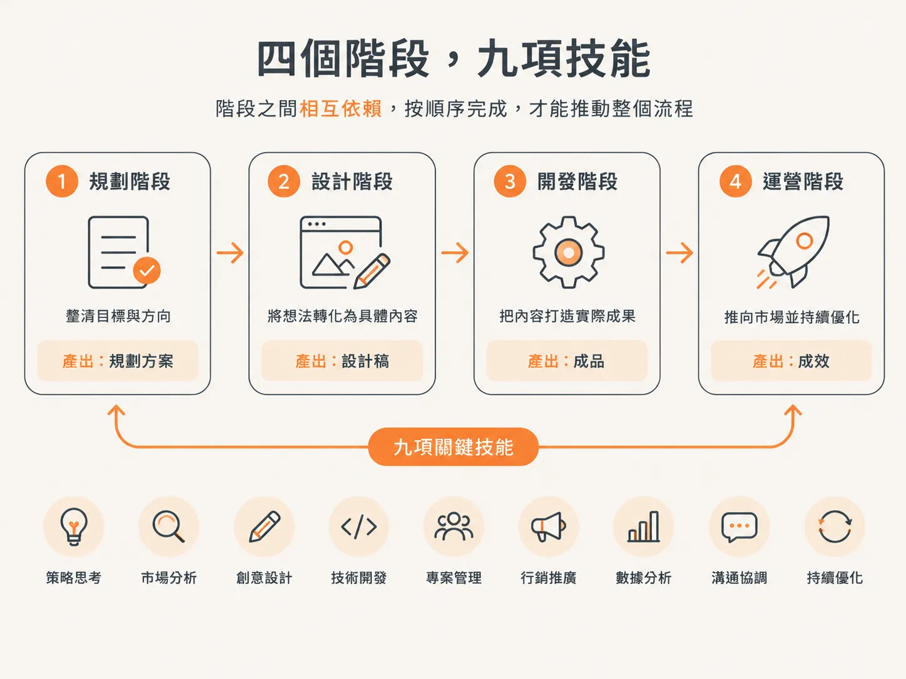
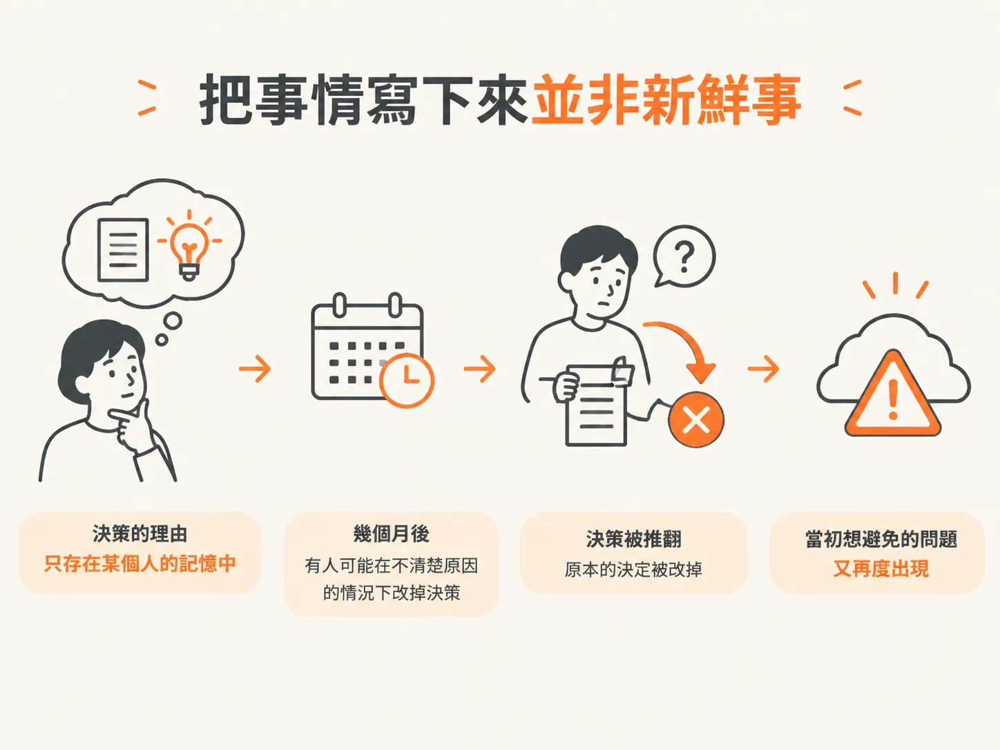

# Why the Workflow Is Structured This Way：九個階段就是生命週期

## 前言

這九個 skills 很容易安裝，卻不容易判斷什麼時候該使用哪一個。即使九個都已經安裝好，你還是可能不知道眼前的情況適合用哪一個。沒有明確規則時，你可能憑感覺挑選，或直接跳到那個會寫程式碼的 skill。

你可能會在三種情況下遇到這個問題：從一個想法開始的新專案、別人已經建立好的 repo，以及對正在運作的專案做小幅修改。這三種情況的起點各不相同。若選錯入口，後續步驟就會缺少它們預期要讀取的文件。

這篇文章會分五個部分回答這個問題。首先說明工作流程為什麼需要四個階段，以及為什麼對 agent 來說，把決策寫下來比對人更重要。下一篇會依序介紹九個 skills，並指出原型只需要其中五個。接著會說明面對三種不同材料時，該如何選擇入口、為什麼 `/audit` 的位置會移動，最後則會談到第 30 天：一份再也沒人打開的規格文件，會變成什麼樣子。

先從一個值得提出的質疑開始：這套九步驟工作流程真的是工程方法，還是只不過是某個人的偏好，再套上一份文件範本？

## 值得先提出的質疑

一套步驟明確、又要求準備特定文件的工作流程，看起來可能像是某個人把自己的偏好包裝成工程方法。

答案是：這套流程的架構早在這些工具出現之前就存在了。agent 還不會寫程式碼以前，認真的軟體專案就一直是這樣進行的：先弄清楚要打造什麼，再做出重要的技術決策並記錄下來，接著訂定規範，讓所有人都遵守。然後一次完成一個功能，並在任何東西被稱為完成之前，先證明它確實能運作。

這套順序有個名稱：軟體開發生命週期。從需求到設計，從設計到實作，再從實作到驗證。

它比 Cursor 和其他所有 AI 程式開發工具都早得多。

## 四個階段，九個 skills

這九個 skills 並沒有增加新的階段，而是讓 agent 依序走過原本就存在的四個階段；每個階段的決策，都會成為下一個階段的依據。

串起整個流程的關鍵，是階段之間的交接。每個階段都會產出下一個階段所需的內容。

因此，需求必須先處理，因為沒有需求就無法開始設計。驗證則放在最後，因為東西還沒完成之前，就無從證明它是否可行。閱讀下一篇介紹九個 skills 的文章時，請記住這一點：你看到的是軟體開發生命週期，只是被拆解得更細，細到能在一次工作時段內完成其中一個部分。

## 把事情寫下來並不是新做法

多年來，工程師一直在撰寫架構決策紀錄，而這麼做並不是為了走形式。

如果重要決策背後的理由只存在某個人的腦海裡，遲早會消失。幾個月後，有人可能在不清楚原因的情況下改掉那項決策，結果又帶回當初做出這項決策時想避免的問題。

做事謹慎的團隊不會只靠記憶。他們會留下記錄，作為決策依據。

## 為什麼 agent 會讓問題更嚴重

agent 的本能反應就是衝去寫程式碼。你在那次 vibe build（憑感覺開發）時已經看過了：它想到一個點子，悄悄替所有尚未決定的事情做出選擇，幾秒內就開始實作。

看起來效率很高，實際上，它依據的是你從未做過的決定。

這也回答了「什麼都沒寫下來時，agent 會替誰做決定？」這個問題。它會以你的名義替你做決定，卻不會明說自己做了選擇。最後留下來的，是一個能運作的功能，支撐它的決策理由卻不見了。

因此，這些 skills 並不是讓程式碼寫得更快的捷徑，而是用來設下界線，避免 agent 跳過軟體開發中最重要的部分。

## 另外兩個組織也走上了這條路

這並不是某個團隊獨有的工作風格。GitHub 有 SpecKit，Amazon 有 Kiro。它們的核心想法相同：先把需求和決策寫下來，再請 agent 開始建置。

因此，這部分已經有了定論：把事情寫下來確實有幫助。

## 第 30 天會問的問題

真正有意思的問題是：到了第 30 天，這些文件會變成什麼樣子？如今，大家都同意要把事情寫下來。差別在於文件寫好之後會發生什麼事。

接下來看每個 skill 時，請把這個問題放在心上：到了第 30 天，還有沒有任何東西會回頭參照這份文件？

不過，在第 30 天之前，還有一個更小的問題：你面前有九個 skills 和一項任務，應該先呼叫哪一個？
