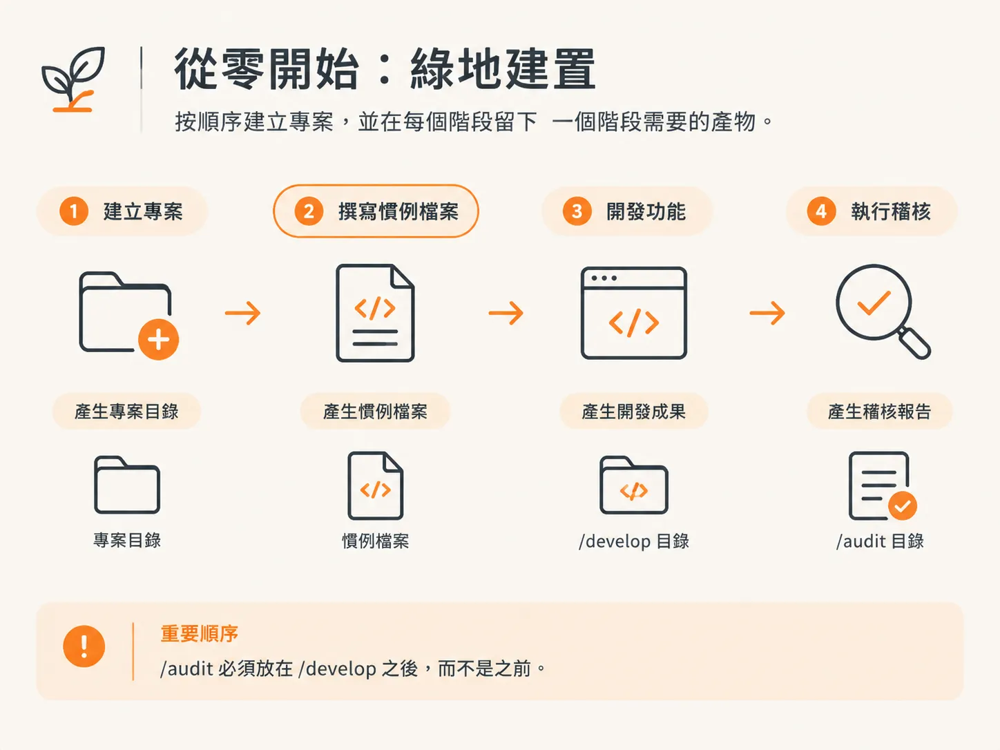
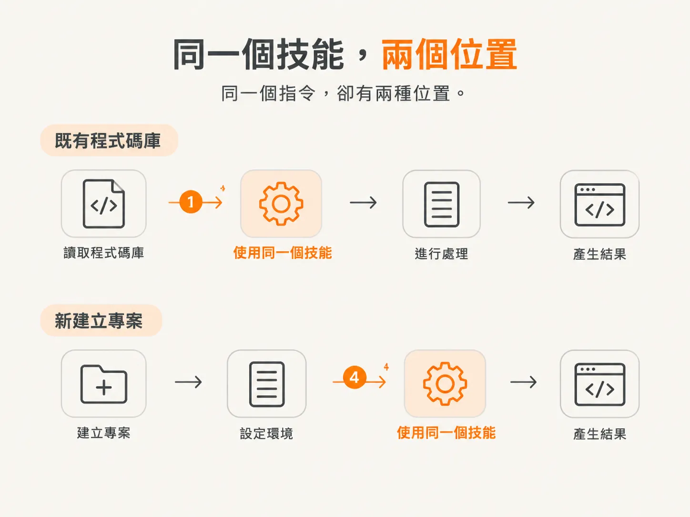

# Where You Enter：三種材料，三條入口

上一篇文章最後提醒了一件事：地圖不是路線圖，而 `/audit` 雖然在表格裡位於流程中段，實際操作時卻可能是第一步。讓它改變位置的，正是這條規則。

這條流程涵蓋完整路徑，但你很少需要從頭到尾跑完。該從哪裡開始，完全取決於你手上已有的東西。

## 三種起始條件，三個入口

起始條件只有三種：手上什麼都沒有，也就是從零開始；已有程式碼庫；或是只需要小幅修改。

## 什麼都沒有：從零開始

從零開始，是唯一從想法出發、手上沒有其他素材的情況。

先用 `/scope` 釐清想法，再用 `/architect` 規劃技術堆疊；接著用 `/develop` 建立專案骨架，然後執行 `/audit`，最後進入功能開發循環。

只有一處順序特別重要：`/audit` 必須放在 `/develop` 之後，而不是之前。

## 已經存在的程式碼庫

面對已有的程式碼庫，流程從 `/audit` 開始。接著，以現有程式為基礎，用 `/scope` 界定下一個開發範圍，然後進入功能開發循環。

這個第一步，和從零開始時流程中的第四個指令，是同一個技能。不同的是，在這種情況下要先執行它，讓每個技能都能先了解專案，再開始寫入任何內容。

## 一個小幅修改

小幅修改不必跑完整套流程，只執行必要的部分即可。

遇到 bug，直接使用 `/debug`。不必界定範圍、規劃架構，也不必建立專案骨架。

小幅修改也可以先執行 `/develop`，再執行 `/check verify`。修改完成後，依據驗收條件實際執行應用程式、確認結果，就可以停下來。

## 同一個技能，兩種位置

把這三種流程並排來看，會發現一件似乎不太對勁的事：在你接手的程式碼庫裡，`/audit` 是第一步；在你剛建立的程式碼庫裡，它卻排在第四步，要等專案骨架建立完成後才執行。

同一個指令，卻有兩種位置。

要嘛這條規則並不固定，要嘛你手上已有的資訊會影響檔案應該放在哪裡。答案是後者，下一篇文章會接著說明。
